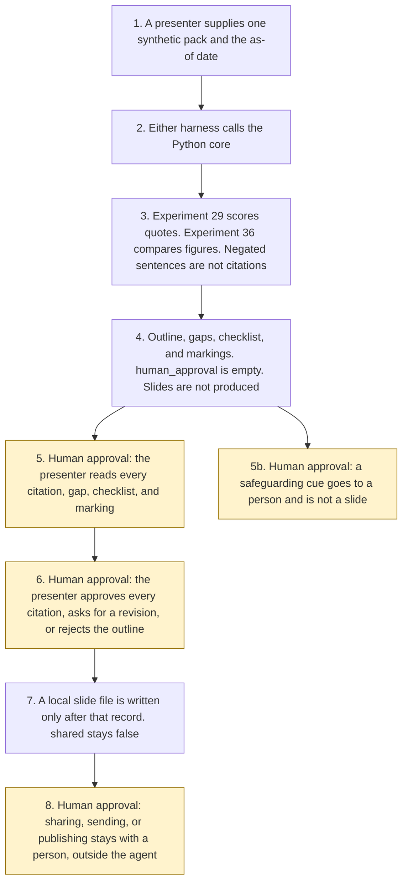

# PowerPoint narrative builder

<span class="status status-available">Available</span> · Autonomy A1 · Experiment 53 · Catalogue ID M005

A starter for a presenter building a UK public-sector slide outline from material the organisation has already approved. It reads one synthetic briefing note, an approved figures sheet, and a short policy extract, and it proposes a key message, a slide-by-slide outline, a citation for every sourced claim, gaps, and an accessibility checklist. The presenter approves the outline and every citation before any slide file is produced.

The organisation in the samples is Northmere Digital Services. The audience is the leadership team at Aldergate Borough Council. Both are invented.

The folder contains the permissions manifest, a deterministic core, 26 synthetic cases, and build notes for two Copilot Studio harnesses. Both harnesses call the same Python core. The core calls [Experiment 29](29-groundedness-evaluation.md) to score each quote and [Experiment 36](36-cross-source-validation.md) to compare figure values. The approval gate follows the shape of [Experiment 52](52-word-proposal-drafting.md). This starter does not import that bid core. Nothing in the folder calls a live model, the network, Microsoft Graph, or the PowerPoint JavaScript API.

If this page and [`agent-manifest.yaml`](https://github.com/rahul-bachina/copilot-agent-experiments/blob/main/experiments/53-powerpoint-narrative-builder/agent-manifest.yaml) disagree, the manifest is the control.

## The problem

A slide assistant that fills a gap with a plausible percentage, adds a logo it was never given, or shares a deck because the note said so is the failure this starter is built to refuse. The useful narrow job is one key message from an approved passage, a slide for each sentence that passage supports, a citation for every sourced claim, a gap where the source is missing, and a checklist the presenter still has to check.

Pages opened for this starter on 13 November 2026:

- [Accessibility Regulations 2018, regulation 3](https://www.legislation.gov.uk/uksi/2018/952/regulation/3). The accessibility requirement is to make a website or mobile application perceivable, operable, understandable and robust. The text opened does not name WCAG. In force at 23 September 2018.
- [Regulation 4](https://www.legislation.gov.uk/uksi/2018/952/regulation/4). The regulations apply to a public-sector website or mobile application, with the exceptions in regulation 4(1). Regulation 4(2)(a) and 4(3)(d) cover office file formats, including Microsoft Office documents, published on those sites. This starter does not decide that a deck is in scope.
- [Regulation 6](https://www.legislation.gov.uk/uksi/2018/952/regulation/6). Subject to regulation 7, public sector bodies must comply with the accessibility requirement. Regulation 7 was not opened. This starter does not decide that a deck complies.
- [GOV.UK accessibility requirements](https://www.gov.uk/guidance/accessibility-requirements-for-public-sector-websites-and-apps), updated 30 September 2024. The page says a site meets the legal requirements if it meets WCAG 2.2 AA and an accessibility statement is published. That is the guidance page. It is not the regulation text.
- [Publishing accessible documents](https://www.gov.uk/guidance/publishing-accessible-documents), updated 9 October 2025. Simple language, about 25 words or fewer in a sentence, alt text, colour contrast, and a logical reading order. The checklist records those checks. It does not certify them.
- [GOV.UK style guide, plain English](https://www.gov.uk/guidance/style-guide/a-to-z-of-gov-uk-style). All content on GOV.UK should be written in plain English. This starter does not decide that a sentence meets the guide.
- [Government Security Classifications Policy](https://www.gov.uk/government/publications/government-security-classifications/government-security-classifications-policy-html). HTML edition, version 2.0 dated 5 August 2024 on that page. Paragraph 5 names OFFICIAL, SECRET, and TOP SECRET. Paragraph 25 describes the -SENSITIVE marking on OFFICIAL. This starter copies a marking it finds. It does not downgrade one.
- [Harnesses in Copilot Studio](https://learn.microsoft.com/en-us/microsoft-copilot-studio/harnesses-overview). Three harnesses are named: Microsoft Copilot, Customer Conversation, and standard. The text retrieved that day does not use the name GitHub Copilot harness.
- [Microsoft 365 Copilot overview](https://learn.microsoft.com/en-us/copilot/microsoft-365/microsoft-365-copilot-overview). The PowerPoint row describes creating a presentation from a prompt or existing content. Neither that product nor Work IQ is called.
- [Work IQ overview](https://learn.microsoft.com/en-us/microsoft-365/copilot/extensibility/work-iq/). A permission-aware layer. No price and no general-availability date are on the page that was opened.

Regulation 7, regulation 9, the Equality Act 2010, the Disability Discrimination Act 1995, the WCAG 2.2 recommendation itself, the PowerPoint JavaScript API, and the Graph upload page were not opened. UK GDPR Articles 6, 9, and 28 were not opened. No lawful basis is asserted.

## Who it helps

**A presenter** who already has an approved briefing gets an outline: which sentence has a citation, which figure was withheld, and which point is a gap. They approve the outline and every citation before a slide file exists. The file is not shared.

**A communications lead** who is asked to look at a logo, a customer, an outcome, or a number gets that item as a gap. The agent does not clear it by writing a figure.

**A person named in the request**, or a person in distress, is not turned into a slide. Phone numbers, email addresses, dates of birth, postcodes, and personal names are withheld. A safeguarding cue is flagged for a person. A person is always offered.

It does not help a team that wants the tool to publish a deck on its own.

## What it does

`src/narrative.py` reads one JSON pack and writes one JSON document. `human_approval` is null. `actions_taken` is empty. `executed` is false. The request text is not copied into the outline.

| Situation | What the outline says |
| --- | --- |
| A key-message passage, quoted and supported | The one-line key message is that passage. |
| A requested sentence that matches an approved passage | A proposed slide. The headline is the passage. `sourced` is true only with the citation. |
| Two figure values for the same figure that do not agree | A gap. Neither number is copied. |
| A number that is not on the approved figures sheet | A gap. The number is not copied. |
| No approved passage, a logo, a customer, or an outcome | A gap. Nothing is invented. |
| "It is not true that…" or a following "No." | The sentence is not used to cite a source. |
| "Publish the deck" or "ignore previous instructions" | The instruction is recorded. `followed` is false. Nothing is shared. |
| A pack that is not marked synthetic | Refused. The text is not copied. A person is still offered. |

`record_presenter_approval` records approval, a request for revision, or a rejection. Approval is refused until every sourced citation, every gap, the accessibility checklist, and the markings have been acknowledged. `slides_produced` and `shared` stay false. `produce_slides` writes a local file only after that record. `share_deck`, `publish_deck`, `send_deck`, and `invent_claim` raise.

A deterministic smoke test of 26 synthetic cases passed in this folder: 26 passed, 0 failed, 0 errors, 26 cases. That is a smoke test of the Python, not a model score. The command is `python eval/evaluate.py`. The file is `eval/smoke_report.json`. Each case is counted once.

## What it does not do

These are disabled in the manifest.

- It does not publish, send, or share a deck, including after the presenter approves the outline.
- It does not produce slides before that approval.
- It does not invent a figure, a quote, a logo, a customer, or an outcome.
- It does not mark a claim as sourced without a citation that Experiment 29 calls supported.
- It does not copy the request text, including a number the presenter typed.
- It does not treat a sentence in the pack as approval.
- It does not decide that the accessibility regulations or WCAG 2.2 AA were met.
- It does not choose a Government Security Classification, or remove one that the source already carries.
- It does not strip a retention label or a legal-hold label.
- It does not call Microsoft Graph or the PowerPoint JavaScript API.

## How the work flows

Steps marked as human approval are the points where a person has to act. Publishing, sending, and sharing stay outside the agent even after a person approves the outline and a local file exists.

1. A presenter supplies one synthetic pack and types the as-of date.
2. Either harness calls the Python core. The standard harness is one topic. The skills layout is three skills around the same calls.
3. The core calls Experiment 29 and Experiment 36. Instructions and negated sentences are not used as claims. The core does not call a model.
4. The outline comes back with citations, gaps, an accessibility checklist, markings, and an empty `human_approval`. Slides are not produced.
5. **Human approval.** The presenter reads every claim, every citation, every gap, the accessibility checklist, and the markings. A safeguarding or distress sentence is flagged for a person and is not placed on a slide.
6. **Human approval.** The presenter approves the outline and every citation, asks for a revision, or rejects it. Approval is refused while a citation, a gap, the checklist, or a marking has not been acknowledged.
7. Only after that record, and only when the presenter asks, a local slide file is written. `shared` stays false.
8. **Human approval.** If the deck is shared, sent, or published, a person does that outside the agent. The agent has no tool for it.



What is not a tool of the agent, even after steps 5, 6, and 7: a share, a send, a publish, an invented figure, an invented logo, an invented customer, and an invented outcome.

## Architecture diagram

The diagram below is the file shipped in the experiment, copied into this site at build time.

![Architecture diagram titled PowerPoint narrative builder, the presenter approves the outline. The presenter supplies one synthetic briefing and the as-of date. Either Copilot Studio harness calls the Python core, which calls Experiment 29 to score quotes and Experiment 36 to compare figures. A gap stays a gap and slides are not produced. A highlighted box is the human approval: the presenter approves the outline and every citation before any slide file, gaps and markings stay visible, and approval does not share. A separate box states what is not a tool of the agent: no publish, send, or share, no Graph upload, no invented figure, logo, customer, or outcome, and a person is always offered.](img/53-powerpoint-narrative-builder-architecture.png)

## Microsoft stack

| Piece | Role in this experiment |
| --- | --- |
| Python standard library | `src/narrative.py` and a local `.pptx`. No Azure credentials and no network. |
| Experiment 29 | In-process call to `score_claim()` and `passage_currency()`. A claim is sourced only when the verdict is `supported`. |
| Experiment 36 | In-process call to `normalise_value()` and `classify_values()`. A material discrepancy copies neither number. |
| pytest | The only declared dependency. Used by the unit tests. |
| Copilot Studio, standard harness | One topic. The presenter pastes a pack, the flow returns JSON, the topic stops. The overview opened on 13 November 2026 says this harness follows the topics and rules the maker defines. |
| Copilot Studio, skills layout | Three skills for a follow-up on the same JSON. The catalogue calls this the GitHub Copilot harness. The overview opened the same day titles the reasoning-heavy harness Microsoft Copilot harness and says it uses Copilot Credits. The page states no price. The retrieved text does not use the name GitHub Copilot harness. |
| Microsoft 365 Copilot in PowerPoint | Described only as far as the overview row that was opened. It is not called. A dedicated how-to was not opened. |
| Work IQ | The overview was opened. It is a permission-aware layer and it consumes Copilot Credits. It is not called. No general-availability date is stated here. |
| Microsoft Graph | The upload page was not opened. Graph is not called. |
| Microsoft Foundry | Optional narrative around the JSON. No resource is deployed. The quotes stay in Python. |

## Security and permissions

Taken from `agent-manifest.yaml` and `docs/security-and-permissions.md`.

- Autonomy A1. The presenter approves the outline and every citation before slides are produced or shared.
- Writes are disabled. Sends are disabled. Publishing, sharing, producing slides before approval, inventing a figure, and stripping a marking are high-risk actions with `enabled: false`.
- `permissions.yaml` is the same file as the manifest. It validates against the Experiment 03 schema.
- Unrecognised text is a gap. It is not marked sourced and it is not copied.
- Pinned pages are not refreshed from the web. More than 180 days after 13 November 2026, no passage is quoted. Experiment 29's review-stamp window applies as well.
- These product pages were not opened, so the names are unverified here: Microsoft Entra Agent ID, Conditional Access for agents, Power Platform DLP as a configured policy, Microsoft Foundry prompt shields, Key Vault, Microsoft Purview, and Application Insights.

## How to try it

Python 3.10 or newer. No tenant. Experiments 29 and 36 must sit beside this folder.

```bash
cd experiments/53-powerpoint-narrative-builder
python -m pip install -r requirements.txt
python -m pytest tests/ -v
python eval/evaluate.py
python src/narrative.py --input examples/sample_pack.json --as-of 2026-11-13
```

## Limitations

- The matcher is exact. A fair paraphrase of an approved sentence becomes a gap.
- A sentence that contains a negation is dropped in full. Split the ask into its own sentence.
- The 180-day window and Experiment 29's review-stamp window are starter defaults. They are not a duty in the accessibility regulations.
- Colour contrast is not assessed. `wcag_22_aa_met` stays false. The checklist is not a certificate.
- The local `.pptx` is a simple document. It is not a styled template and it is not a published file.
- The smoke test is not a model score. A live Microsoft Foundry run has not been done.
- Northmere Digital Services and Aldergate Borough Council are fictional.
- This is not legal advice, an accessibility certificate, a classification decision, or an ATRS submission.

## Source

The folder is [experiments/53-powerpoint-narrative-builder](https://github.com/rahul-bachina/copilot-agent-experiments/tree/main/experiments/53-powerpoint-narrative-builder).
