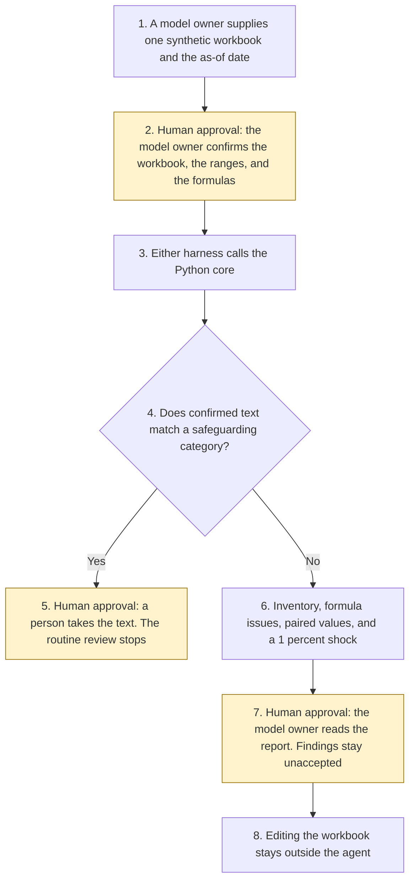

# Excel assumption review

<span class="status status-available">Available</span> · Autonomy A0 · Experiment 54 · Catalogue ID M006

A starter for a model owner in a UK public body or a regulated firm. The owner confirms the workbook, the ranges, and the formulas. The assistant then writes a review: an inventory of inputs with cell references, hard-coded numbers inside formulas, formulas that do not match their neighbours, broken or circular references, units and date-basis differences, a one-at-a-time sensitivity, and questions for the owner.

The organisation in the samples is Northmere Analytical Unit. It is invented. The workbook is synthetic. The phone number is in the UK drama range.

The folder contains the permissions manifest, a deterministic core, a synthetic `.xlsx`, and build notes for two Copilot Studio harnesses. Both harnesses call the same Python core. The core calls [Experiment 36](36-cross-source-validation.md) to compare paired values without choosing one, [Experiment 08](08-uk-pii-redaction-gateway.md) for UK identifier types, [Experiment 15](15-vulnerability-urgency-scanner.md) for safeguarding categories, and [Experiment 30](30-agent-regression-test-generator.md) to draft regression cases that are not merged. Nothing in the folder calls a live model, the network, Microsoft Graph, or Copilot in Excel.

If this page and [`agent-manifest.yaml`](https://github.com/rahul-bachina/copilot-agent-experiments/blob/main/experiments/54-excel-assumption-review/agent-manifest.yaml) disagree, the manifest is the control.

## The problem

A model that hides a literal inside a formula, or that stores inflation once as a proportion and once as a percent, can be signed off because the total looks familiar. The failure this starter is built to refuse is an edit, a judgement, or an invented benchmark dressed up as a review.

Pages opened for this starter on 13 November 2026:

- [The AQuA Book](https://www.gov.uk/guidance/the-aqua-book). Published 30 July 2025. Section 1.1 says the last version was published in 2015, following Sir Nicholas Macpherson's Review of quality assurance of government models. The assumptions log, under Documentation, should describe each assumption, quantify its effect and reliability, set out when it was made, explain why it was made, and explain who made it and who signed it off. Section 1.3.3 distinguishes verification from validation. This starter does not sign that log and does not decide that analysis is fit for purpose.
- [Review of quality assurance of government models](https://www.gov.uk/government/publications/review-of-quality-assurance-of-government-models). HM Treasury. Published 5 March 2013. The final-report PDF listed on the page was not opened. Recommendation numbers are not quoted from it.
- The March 2015 PDF, [The Aqua Book](https://analysisfunction.civilservice.gov.uk/wp-content/uploads/2018/03/Aqua-Book-4.pdf). This is not the current GOV.UK page. Paragraph 1.4 summarises headline recommendations, including quality assurance of inputs, methodology, and outputs for business-critical models, and a single senior responsible owner. Those sentences are the 2015 book's summary. This starter does not appoint an owner and does not decide that a model is business-critical.
- [Harnesses in Copilot Studio](https://learn.microsoft.com/en-us/microsoft-copilot-studio/harnesses-overview). Three harnesses are named: Microsoft Copilot harness, Customer Conversation harness, and standard harness. The Microsoft Copilot harness is described as reasoning-heavy and multi-step. The page says it creates and edits Excel files, supports skills and memory, and uses Copilot Credits. The page states no price. The page opened on this date does not use the older catalogue name for the skills layout. This starter does not edit an Excel file.
- [What is Microsoft Copilot?](https://learn.microsoft.com/en-us/microsoft-365/copilot/copilot-overview). Under Microsoft 365 Copilot (Basic), the in-app Excel line is analyse data, generate insights, and create formulas and visuals. The file must be editable, not read-only. A dedicated Copilot in Excel page was not opened. This starter does not call Copilot in Excel.
- [Working with Excel in Microsoft Graph](https://learn.microsoft.com/en-us/graph/api/resources/excel?view=graph-rest-1.0). The Excel REST API reads and modifies Office Open XML workbooks. `Files.Read` is listed for read actions. `Files.ReadWrite` is listed for read and write actions. A call that does not send `workbook-session-id` persists changes. This starter calls neither and does not create a session.

UK GDPR Articles 6 and 9 were not opened. No lawful basis is asserted.

## Who it helps

**A model owner** who has to see which cells were inspected, which formulas contain a literal, and which paired values do not agree, without the tool rewriting the file.

**An analytical-assurance lead** in a public body who wants the questions the AQuA Book's assumptions log would ask, written as questions, not as a signature. The starter does not decide that the model is business-critical.

**A person named in a note** is not copied into the report. An email, a UK mobile, a labelled date of birth, a labelled personal name, and a postcode are recorded as types only. A safeguarding phrase stops the routine review and is not quoted.

It does not help a team that wants the tool to correct the workbook, or to say that a rate is the right one.

## What it does

`src/review.py` reads one JSON pack and a separate confirmation, compares a local `.xlsx` without saving it, and writes one JSON document. `findings_accepted` stays null. `actions_taken` is empty. `executed` is false.

| Situation | What the report says |
| --- | --- |
| No separate confirmation | `scope_not_confirmed`. No range is inspected. Words in a cell do not count. |
| Confirmed sample on 13 November 2026 | Inventory, literals, inconsistent columns, one broken reference, one cycle, paired values, and a sensitivity. Baseline of `Outputs!B2` is 169014.3. |
| A literal inside a formula | The cell and the literal are named. 0, 1, and -1 are listed as common arithmetic and are not questions. |
| "It is not true that Inputs!C2 includes a hard-coded number." | The sentence is not a finding. `Inputs!C2` is a constant, not a formula. |
| Inflation as 0.025 and as 2.5 percent | A material discrepancy. Neither value is converted or chosen. |
| A safeguarding phrase | `safeguarding_for_human`. The phrase is not copied. The routine inventory is empty. |
| More than 180 days after 13 November 2026 | `stale_sources`. Findings are withheld. The marking stays. |

A deterministic smoke test of 24 synthetic cases passed in this folder. That is a smoke test of the Python, not a model score. The command is `python eval/evaluate.py`. The file is `eval/smoke_report.json`. Each case is counted once.

## What it does not do

These are disabled in the manifest.

- It does not edit the workbook, write a cell, or call Microsoft Graph.
- It does not call Copilot in Excel.
- It does not say an assumption is right or wrong.
- It does not invent a benchmark or a typical rate.
- It does not choose which of two paired values is the right one.
- It does not sign an assumptions log, appoint a senior responsible owner, or decide that a model is business-critical.
- It does not copy personal data or an instruction sentence.
- It does not process a safeguarding phrase as a modelling question.
- It does not strip a protective marking or clear a legal hold.
- It does not decide a lawful basis. Articles 6 and 9 were not opened.
- It does not accept the findings. The model owner reads the report.

## How the work flows

Steps marked as human approval are the points where a person has to act. Editing the workbook stays outside the agent even after the owner has read the report.

1. A model owner supplies one synthetic workbook and types the as-of date.
2. **Human approval.** The model owner confirms the workbook, the ranges, and the formulas in a separate object. A sentence inside a cell does not confirm the scope.
3. Either harness calls the Python core. The standard harness is one topic. The skills layout is three skills around the same call.
4. The core checks whether any confirmed text matches a safeguarding, self-harm, or financial-hardship category.
5. **Human approval, when it matches.** A person takes the text. The phrase is not copied. The routine review stops.
6. When it does not match, the core inventories the confirmed cells, names formula issues, compares paired values, and computes a 1 percent shock. It does not call a model.
7. **Human approval.** The model owner reads the report. `findings_accepted` stays null. The agent does not decide that an assumption is right or wrong.
8. If the owner edits the workbook, they do that in their own process. The agent has no tool for it.



What is not a tool of the agent, even after steps 2, 5, and 7: a cell write, a Graph session, a judgement that an assumption is right or wrong, an invented benchmark, and removal of a protective marking.

## Architecture diagram

The diagram below is the file shipped in the experiment, copied into this site at build time.

![Architecture diagram titled Excel assumption review, the model owner confirms the workbook. The model owner confirms the workbook, the ranges, and the formulas, and types the as-of date. Either Copilot Studio harness calls the Python core, which uses a closed formula reader, Experiment 36 to compare paired values, Experiment 08 for identifier types, and a 1 percent shock that is not a benchmark. A highlighted box is the human approval: the owner reads the report, findings stay unaccepted, distress text goes to a person, and the workbook is not edited. A separate box states what is not a tool of the agent: no cell write, no Graph call, no right or wrong judgement, no invented benchmark, and markings and the legal hold stay.](img/54-excel-assumption-review-architecture.png)

## Microsoft stack

| Piece | Role in this experiment |
| --- | --- |
| Python and openpyxl | `src/review.py` reads a local `.xlsx` and does not save it. No Azure credentials and no network. |
| Experiment 36 | In-process call to `normalise_value()` and `classify_values()`. Neither paired value is chosen. A percent is not converted into a proportion. |
| Experiment 08 | In-process call to `propose()`. The raw value is not copied. A local pattern also flags a UK postcode. |
| Experiment 15 | In-process call to `find_phrases()`. A safeguarding category stops the routine review. The matched phrase is not copied. |
| Experiment 30 | In-process call to `from_observation()`. Cases stay drafted. Nothing is merged or pushed. |
| pytest and openpyxl | The declared dependencies. Used by the unit tests and the workbook read. |
| Copilot Studio, standard harness | One topic. The owner pastes a pack and a confirmation, the flow returns JSON, the topic stops. |
| Copilot Studio, skills layout | Three skills. The page opened on 13 November 2026 names this the Microsoft Copilot harness and says it can edit Excel. The skills tell it not to. |
| Microsoft Foundry | Optional narrative from JSON the Python already produced. No resource is deployed. `model_called` stays false. |

## Security and permissions

Taken from `agent-manifest.yaml` and `docs/security-and-permissions.md`.

- Autonomy A0. Writes disabled. Sends disabled. Every high-risk action disabled.
- The model owner confirms the workbook, the ranges, and the formulas before any range is inspected.
- A safeguarding phrase is a second stop, for a person, and the phrase is not copied.
- The model owner reads the report. `findings_accepted` stays null.
- `OFFICIAL-SENSITIVE` and `legal-hold` are kept on every result, including a refusal.
- Lawful basis: not asserted.
- Microsoft Entra Agent ID, Conditional Access, prompt shields, Key Vault, Purview, Application Insights, and Power Platform DLP as a configured policy were not opened on 13 November 2026. They are unverified here.

## How to try it

```bash
cd experiments/54-excel-assumption-review
python -m pip install -r requirements.txt
python src/review.py \
  --input examples/sample_pack.json \
  --confirm examples/scope_confirmation.json \
  --as-of 2026-11-13
python eval/evaluate.py
```

The label on a report is `REVIEW FOR THE MODEL OWNER. THE WORKBOOK WAS NOT CHANGED. NO ASSUMPTION WAS JUDGED.`

## Limitations

The formula language is a closed set. Anything else is named and not evaluated. Sensitivity is one input at a time, inside the confirmed ranges, at 1 percent of the stored value. It is not a statement that a change is material, and it is not a benchmark.

JSON cells are the confirmed representation. If the local workbook disagrees, both values are listed and neither is chosen.

More than 180 days after 13 November 2026, findings are withheld. The date 180 days on is still inside the window.

This is a starter. It is not an assurance opinion under the AQuA Book.

## Source

The folder is [experiments/54-excel-assumption-review](https://github.com/rahul-bachina/copilot-agent-experiments/tree/main/experiments/54-excel-assumption-review).
