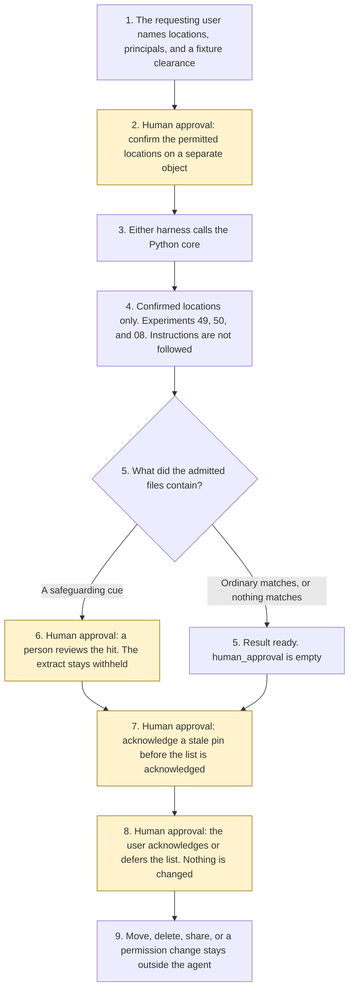

# OneDrive document finder

<span class="status status-available">Available</span> · Autonomy A0 · Experiment 55 · Catalogue ID M007

A starter for a requesting user in a UK public body or a regulated firm. The user selects the permitted locations. The assistant searches only there. A natural-language find returns a ranked list: the match reason, the location, the last modified date, and the sensitivity label. Likely stale or superseded versions and likely duplicates are flagged. When nothing in the permitted locations matches, the result says so in one sentence.

The organisation in the samples is Merrowfield Borough Council. It is invented. The clearance order in the fixture, which treats OFFICIAL-SENSITIVE as above OFFICIAL for the purpose of withholding content, is a starter rule. The Government Security Classifications Policy opened on 13 November 2026 names three tiers and describes the -SENSITIVE marking as an additional marking on OFFICIAL. It does not define this software order.

The folder contains the permissions manifest, a deterministic core, a synthetic file index, and build notes for two Copilot Studio harnesses. Both harnesses call the same Python core. The core calls [Experiment 49](49-records-classification.md) so a legal hold and a personal-data indicator are not re-coded, [Experiment 50](50-sharepoint-knowledge-curator.md) for duplicate signals among files already admitted, and [Experiment 08](08-uk-pii-redaction-gateway.md) for UK identifier types. Files outside the selection, files the user cannot read, and files above the fixture clearance contribute a count. Their titles and extracts are not copied. Nothing in the folder calls a live model, the network, Microsoft Graph, Work IQ, or Microsoft Purview.

If this page and [`agent-manifest.yaml`](https://github.com/rahul-bachina/copilot-agent-experiments/blob/main/experiments/55-onedrive-document-finder/agent-manifest.yaml) disagree, the manifest is the control.

## The problem

A search that opens the finance library because a file says "search all locations", or that quotes a file labelled above the user's clearance, is the failure this starter is built to refuse. The user still has to see the rank, the reason, the location, the date, and the label.

Pages opened for this starter on 13 November 2026:

- [UK GDPR Article 5](https://www.legislation.gov.uk/eur/2016/679/article/5). Article 5(1)(c) is data minimisation: adequate, relevant and limited to what is necessary. Article 5(2) is accountability. Article 6 and Article 9 were not opened. No lawful basis is asserted. `data_minimisation_met` stays false.
- [Freedom of Information Act 2000, section 1](https://www.legislation.gov.uk/ukpga/2000/36/section/1). Section 1(1) is the right to be told whether information of the description specified is held, and if so to have it communicated. Section 1(3) is further information needed to identify and locate it. The page said there are currently no known outstanding effects. This starter does not decide that duty. `foi_duty_decided` stays false.
- [Government Security Classifications Policy](https://www.gov.uk/government/publications/government-security-classifications/government-security-classifications-policy-html), updated 5 August 2024. Paragraph 1: not a statutory scheme. Paragraph 5: three tiers, OFFICIAL, SECRET and TOP SECRET. Paragraph 25: the -SENSITIVE marking is an additional marking on OFFICIAL. Principle Five is need-to-know balanced with need-to-share.
- [What is Microsoft Copilot?](https://learn.microsoft.com/en-us/microsoft-365-copilot/microsoft-365-copilot-overview). Experiences differ by grounding, integration, and licensing. Access is scoped by user permissions. Work-data grounding is described as Microsoft Graph and Work IQ where the experience includes work data.
- [Knowledge sources summary](https://learn.microsoft.com/en-us/microsoft-copilot-studio/knowledge-copilot-studio). SharePoint uses GraphSearch with the agent user's Entra ID authentication. The note says the agent only surfaces content that user can access. OneDrive files and folders are named as unstructured data with different limits. The limits page was not opened.
- [Search OneDrive and SharePoint](https://learn.microsoft.com/en-us/graph/search-concept-files) and [search query](https://learn.microsoft.com/en-us/graph/api/search-query?view=graph-rest-1.0). `POST /search/query` with `driveItem` searches files. Example 4 on the files page says the query covers content the signed-in user can read. The query page lists delegated Mail.Read as least privileged, and application Files.Read.All as least privileged. Whether a driveItem-only call accepts a narrower delegated scope, and whether application permissions are trimmed to one user, was not stated. This starter calls neither API.
- [Work IQ overview](https://learn.microsoft.com/en-us/microsoft-365/copilot/extensibility/work-iq/) and [API overview](https://learn.microsoft.com/en-us/microsoft-365/copilot/extensibility/work-iq/api-overview). Permission-aware. Delegated authentication. Application-only authentication is not supported. The API overview says Microsoft 365 permissions, sensitivity labels, and compliance policies are enforced automatically. The permissions reference lists delegated WorkIQ.Read and WorkIQ.Act. WorkIQ.Act is described as read and change. A general-availability date was not on the pages opened. That date is unverified. This starter does not call Work IQ.
- [Sensitivity labels](https://learn.microsoft.com/en-us/purview/sensitivity-labels). Labels are customisable. The page's examples include Personal, Public, General, Confidential, and Highly Confidential. A label is clear text in metadata and stays with the content. A document can carry one sensitivity label and a retention label. Copilot and agents are said to recognise sensitivity labels. Data Map labelling is described as currently in preview. The licensing table was not opened. A fixture's Government Security Classifications marking is not a Purview label.
- [Harnesses in Copilot Studio](https://learn.microsoft.com/en-us/microsoft-copilot-studio/harnesses-overview). Three harnesses are named: Microsoft Copilot harness, Customer Conversation harness, and standard harness. The standard harness follows the topics and rules the maker defines. The Microsoft Copilot harness is described for reasoning-heavy multi-step work, with skills, memory, file creation, and a sandbox, billed in Copilot Credits. The page states no price. The page does not use the words GitHub Copilot harness. Older wording that this harness is not the GitHub Copilot service is unverified against the page opened on this date.

No FCA Handbook provision was opened. This starter does not apply a Handbook rule.

## Who it helps

**A requesting user** who already knows which libraries they may search gets a ranked list of files in those libraries, with the reason, the location, the date, and the label. A file they cannot read is a count, not a title.

**An information governance lead** who is asked about a legal hold, a retention label, or a safeguarding cue gets those flags kept on the hit. The file is not moved, and the label is not cleared.

**A person the file is about** is not messaged. A snippet masks honorific names, email addresses, UK phone numbers, dates of birth next to a birth cue, and street addresses, on top of the UK identifiers Experiment 08 proposes. The output is not described as anonymised. A person is always offered. This starter does not publish a telephone number.

It does not help a team that wants the tool to search every library, or to delete a duplicate on its own.

## What it does

`src/find.py` reads one index, one request, and one selection object, and writes one JSON document. `human_approval` is null until the user acknowledges the list on a separate review object. Acknowledgement does not change a file.

| Situation | What the result says |
| --- | --- |
| Locations confirmed, and every query term is in an admitted file | A ranked hit: reason, location, last modified date, sensitivity label. |
| Nothing in the permitted locations matches | "Nothing in the permitted locations matches this request." |
| A file is outside the selection, unreadable, or above clearance | A withheld count. The title and the extract are not copied. |
| A later version the user cannot see | The visible file is flagged. The hidden file is not named. |
| A likely duplicate, or a file older than the configured 365 days | Flagged. The 365-day window is configuration, not a statutory period. |
| A legal hold or a retention label on an admitted file | Kept. Nothing is disposed of. |
| A safeguarding cue in the text that remains after negation | Not a routine hit. The extract is not copied. |
| "Search all locations" in the same note as a real title | The instruction is recorded and not followed. The title can still match. |
| "It is not true that this note includes the housing repairs budget" | The denial is not a positive match. |
| An index that is not marked synthetic | Refused. The text is not copied. |

`acknowledge_results` records `acknowledge` or `defer`. It refuses a decision to move, delete, share, or change permissions. `move_file`, `delete_file`, `share_file`, and `change_permissions` raise. Microsoft Graph, the Search API, Work IQ, and Purview are not called.

A deterministic smoke test of 18 synthetic cases passed in this folder. That is a smoke test of the Python, not a model score. The command is `python eval/evaluate.py`. The file is `eval/smoke_report.json`. Each case is counted once.

## What it does not do

These are disabled in the manifest.

- It does not search a location the user has not confirmed on the selection object.
- It does not return a title, an id, or an extract the user's principals cannot already read.
- It does not return content from a file labelled above the user's clearance in the fixture.
- It does not strip a sensitivity label, a retention label, or a legal hold.
- It does not move, delete, share, or change permissions, including after acknowledgement.
- It does not call Microsoft Graph, the Microsoft Search API, Work IQ, or Purview.
- It does not decide that Article 5(1)(c) was met. `data_minimisation_met` stays false.
- It does not decide the Freedom of Information Act 2000 section 1 duty to confirm or deny.
- It does not decide that a Government Security Classifications marking is correct.
- It does not treat a safeguarding or distress cue as an ordinary hit.

## How the work flows

Steps marked as human approval are the points where a person has to act. The agent has no file change to take after them. Moving, deleting, sharing, and changing permissions stay outside the agent even after a person acknowledges the list.

1. The requesting user names location ids that already exist on the synthetic index, plus principals and a fixture clearance.
2. **Human approval.** The user confirms that selection on a separate object. A sentence inside a file does not confirm it. Without that confirmation, nothing is searched.
3. Either harness calls the Python core. The standard harness is three topics. The Microsoft Copilot harness, packaged in this folder as the layout the common brief calls a GitHub Copilot harness, is four skills around the same calls.
4. The core admits only files in the confirmed locations, readable by a named principal, at or below the fixture clearance. It calls Experiments 49, 50, and 08 on those files. Instructions are recorded and not followed.
5. The result comes back with ranks, reasons, locations, dates, labels, and an empty `human_approval`. Withheld files are counts.
6. **Human approval.** If a hit is a safeguarding cue, a person reviews it before the list can be acknowledged. The extract stays withheld.
7. **Human approval.** Where a legal pin is stale, the user acknowledges that before the list is acknowledged. The pin is not quoted.
8. **Human approval.** The user may acknowledge or defer the list. That does not change a file.
9. Moving, deleting, sharing, or changing permissions stays in the organisation's own file process. The agent has no tool for that.



What is not a tool of the agent, even after steps 2, 6, 7, and 8: a search outside the confirmed locations, a title from a file above clearance, a move, a deletion, a share, a permission change, and a call to Microsoft Graph, Work IQ, or Purview.

## Architecture diagram

The diagram below is the file shipped in the experiment, copied into this site at build time.

![Architecture diagram titled OneDrive document finder, the user confirms the locations. The requesting user confirms location ids, principals, and clearance on a separate object. Either Copilot Studio harness, standard topics or Microsoft Copilot harness skills, calls the Python core. The core searches confirmed locations only, calls Experiments 49, 50, and 08, and turns a file above clearance into a count while keeping labels and legal holds. A highlighted box is the human approval: confirm the locations first, review a safeguarding hit, acknowledge a stale pin, and acknowledgement changes nothing. A separate box states what is not a tool of the agent: no move, no delete, no share, no permission change, Graph, Search, and Work IQ are not called, and a person is always offered.](img/55-onedrive-document-finder-architecture.png)

## Microsoft stack

| Piece | Role in this experiment |
| --- | --- |
| Python standard library | `src/find.py`. No Azure credentials and no network. |
| Experiment 49 | In-process call to `classify_record()` on admitted text. Legal hold and personal-data indicators are kept. The fixture label is not replaced. |
| Experiment 50 | In-process call to `curate_site()` for duplicate proposal ids among files already admitted. An archive proposal is not followed. SharePoint is not called. |
| Experiment 08 | In-process call to `propose()`. Entity types are kept. Values are not. The output is not described as anonymised. |
| pytest, PyYAML, jsonschema | Declared for tests. The core does not import them. |
| Copilot Studio, standard harness | Three topics. The user confirms locations, the flow returns JSON, the topic stops. The overview opened on 13 November 2026 says this harness follows the topics and rules the maker defines. |
| Copilot Studio, Microsoft Copilot harness | Four skills around the same JSON. The overview opened on 13 November 2026 uses this name. It describes skills, memory, file creation, and a sandbox, billed in Copilot Credits. No price is stated. The page does not use the words GitHub Copilot harness. Older wording that it is not the GitHub Copilot service is unverified against that page. The linked billing page was not opened. |
| Microsoft Graph search and Work IQ | The described route for a tenant search that is trimmed to the signed-in user, as far as the pages opened. Not connected. Application trimming to one user was not stated. WorkIQ.Act is not requested. |
| Microsoft Purview | Sensitivity labels were read. Not connected. A Government Security Classifications marking in a fixture is not one of those labels. |
| Microsoft Foundry | Optional narrative around the JSON. Not deployed. The core remains the system of record. |

The Customer Conversation harness is described on the same overview for customer voice and chat, with a route to a human representative, billed in Copilot Credits. It is not built here. The detail page linked from the overview was not opened.

## Security and permissions

Manifest `exp-55-onedrive-document-finder`, version 0.1.0. Autonomy **A0**. Writes disabled. Sends disabled. Approve or reject, regulated decision, production record change, external send, and spending are disabled. So are a move, a deletion, a share, a permission change, and revealing content above the user's clearance.

`permissions.yaml` is the same file as `agent-manifest.yaml`. It validates against `schemas/agent-manifest.schema.json`.

Microsoft Graph search, Work IQ, Copilot Studio knowledge, and Purview sensitivity labels were opened on 13 November 2026 and are described only as far as those pages went. These product pages were not opened. Treat the names as unverified here: Microsoft Entra Agent ID, Conditional Access for agents, Power Platform DLP as a configured policy, Microsoft Foundry prompt shields, Key Vault, and Application Insights. None of those objects is created in this folder.

The longer note is [security and permissions](https://github.com/rahul-bachina/copilot-agent-experiments/blob/main/experiments/55-onedrive-document-finder/docs/security-and-permissions.md).

## How to try it

Python 3.10 or newer. No credentials and no network. Experiments 08, 12, 19, 49, and 50 must be present beside this folder. Experiment 49 calls Experiments 08, 12, and 19. Experiment 50 calls Experiment 44 only when a snapshot includes queries. This call does not pass queries.

```bash
cd experiments/55-onedrive-document-finder
python -m pip install -r requirements.txt
python -m pytest tests/ -q
python eval/evaluate.py
python src/find.py --index examples/sample_index.json --request examples/sample_request.json --selection examples/sample_selection.json --as-of 2026-11-13
```

The sample is a fictional file index. The exit code is 0 when a result or a refusal is produced. An index that is not marked synthetic is refused without copying the text. The exit code is 2 when the input cannot be read.

## Limitations

- The matcher is a word list. A paraphrase that shares no word with the title, the location name, or the extract is a non-match. That is not a statement that the file is irrelevant.
- The fixture clearance order is not a sentence of the Government Security Classifications Policy.
- Experiment 08 does not detect names, email addresses, telephone numbers, or dates of birth. This starter also masks honorific names, email addresses, UK phone numbers, dates of birth next to a birth cue, and street addresses on any snippet. A name with no honorific is not masked. The output is not anonymised.
- A file over 20,000 characters is not scanned. A title can still match.
- Article 6, Article 9, and the Copilot Studio OneDrive limits page were not opened. A Work IQ general-availability date was not on the pages opened. Whether application search permissions are trimmed to one user was not stated.
- The smoke test is not a model score. No live Microsoft Foundry run has been done.
- Merrowfield Borough Council is fictional.
- This is not legal advice, a file plan, a DPIA, or an ATRS submission.

## Source

- [Experiment folder](https://github.com/rahul-bachina/copilot-agent-experiments/tree/main/experiments/55-onedrive-document-finder)
- [Permissions manifest](https://github.com/rahul-bachina/copilot-agent-experiments/blob/main/experiments/55-onedrive-document-finder/agent-manifest.yaml)
- [Security and permissions](https://github.com/rahul-bachina/copilot-agent-experiments/blob/main/experiments/55-onedrive-document-finder/docs/security-and-permissions.md)
