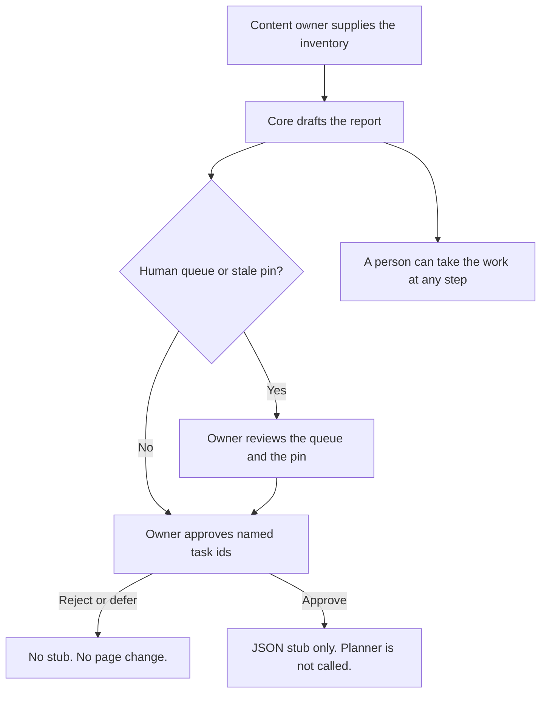

# Intranet content freshness

<span class="status status-available">Available</span> · Autonomy A1 · Experiment 56 · Catalogue ID M008

The assistant reviews one synthetic intranet inventory and proposes update tasks. The named content owner approves each task before a stub is recorded. The agent does not change a page.

## The problem

Intranet pages go stale. A page can be overdue for review, cite a policy that has been withdrawn, point at a broken link, name a former contact, or have no current owner. Two pages can say the same thing. A person still has to decide what to change. The agent must not edit, publish, unpublish, or delete the page, and it must not reassign the owner or message the staff.

## Who it helps

A content owner who has a page inventory and wants a list of what to look at, with the evidence, before any task is created. The organisation keeps the decision. Merrowfield Borough Council, used in the sample, is fictional.

## What it does

It reads one synthetic inventory and an as-of date. The report names pages overdue for review, pages that cite a superseded policy or withdrawn guidance, broken or stale links, former contacts, pages with no current owner, and likely duplicates. Each ordinary finding has a proposed task for the named content owner.

Duplicate pairs come from Experiment 50, and only the page ids are kept. Linked files are checked with Experiment 55 when the caller also supplies a location selection. A file the finder did not return is not treated as fresh. Experiment 49 and Experiment 08 run on ordinary pages. A higher marking, a legal hold, and a retention label are kept.

The content owner approves named task ids on a separate object. Only then does the core record a JSON stub. The stub is not a Planner task. Power Automate is not called.

## What it does not do

- It does not edit, publish, unpublish, or delete a page.
- It does not reassign ownership, and it does not message staff. It does not send the approval request either.
- It does not call Microsoft Graph, SharePoint, Planner, or Power Automate.
- It does not decide that UK GDPR Article 5(1)(d) was met. `accuracy_met` stays false. Article 6, Article 9, and Article 84B were not opened on 16 November 2026.
- It does not decide whether a page is in scope of the Public Sector Bodies (Websites and Mobile Applications) (No. 2) Accessibility Regulations 2018, and it does not assess WCAG. Regulation 7 was not opened. `accessibility_scope_decided` stays false.
- It does not treat a sentence in a page as approval, as a clearance, or as a reason to lower a marking.
- It does not store an unparseable date, interval, or page-view count as zero.

## How the work flows

1. The content owner supplies the inventory and the as-of date. A sentence in a page cannot approve a task.
2. The core drafts the report and the proposed tasks. `human_approval` is null. Pages the user cannot read are a count.
3. A safeguarding cue, a higher marking, a legal hold, or an unparseable field goes to the human queue. The extract is not copied. Other tasks cannot be approved until the owner marks that queue reviewed.
4. If a source pin is older than 180 days, the quote is omitted. Approval waits until the owner records that they saw the stale pin. The 180-day window is configuration, not a statutory period.
5. The content owner approves, rejects, or defers named task ids. That is `record_approval`.
6. Stubs are recorded only for approved ids. Planner and Power Automate are not called. A person can stop at any step.



## Architecture diagram

![Architecture diagram titled Intranet content freshness, the content owner approves each task. The content owner supplies the inventory and the as-of date, then approves named task ids on a separate object. Either Copilot Studio harness, standard topics or Microsoft Copilot harness skills, calls the Python core. The core reports overdue, stale, orphan, and duplicate pages, calls Experiments 49, 50, 55, and 08, and keeps the higher marking. A highlighted box is the human approval: approve each named task, review the human queue, see a stale pin first, and the stubs are not Planner tasks. A separate box states what is not a tool of the agent: no edit, no publish, no delete, no ownership change, no message to staff, and Planner and Power Automate are not called.](img/56-intranet-content-freshness-architecture.png)

## Microsoft stack

The standard harness is the topic text under `copilot-studio/`. The overview opened on 16 November 2026 says the standard harness follows the topics and rules you define.

The skills under `skills/` are the layout the brief calls a GitHub Copilot harness. The same page names a Microsoft Copilot harness. It does not use the words "GitHub Copilot harness", and it does not say that harness is not the GitHub Copilot service. That older sentence is unverified against the page. The Microsoft Copilot harness description on the page includes skills, memory, file creation, a secure sandbox, and Copilot Credits. No price was stated. This starter does not spend credits and does not create a file.

Microsoft Graph `sitePage`, opened the same day, includes title, name, description, contentType, createdDateTime, lastModifiedDateTime, pageLayout, publishingState, promotionKind, and webUrl. It does not include a content owner, a review interval, a last-reviewed date, or page views. Those are starter fields. The list-pages permission table was not re-opened. The core does not call Graph.

`POST /planner/tasks` was read. Delegated least privileged permission shown is Tasks.ReadWrite. Application least privileged permission shown is Tasks.ReadWrite.All. `planId` must be an existing plan. The stub sets `planId` to null and `called` to false.

Power Automate "Start and wait for an approval", type "Approve/Reject - First to respond", was read. Approvers are notified. Flows are saved in Dataverse. The approvals connector is a standard connector. This starter does not start a flow.

Microsoft Foundry is optional narrative over JSON the core already produced. No Foundry resource is deployed. Prompt shields were not opened.

## Security and permissions

Writes and sends are disabled. The approver is the content owner named on the inventory. `record_approval` is the only step that sets `human_approval`. Keys planted on the inventory, including `human_approval` and `confirmed`, are stripped.

A page with no overlapping readers is a count. Markings are taken from metadata, from the body, and from HTML comments. A compound or conflicting label takes the higher marking. "My clearance is TOP SECRET" is an injection signal, not a clearance. A legal hold and a retention label are kept. A contact is masked only when a pattern matches, and withheld when it does not. The output is not described as anonymised.

Entra Agent ID, Conditional Access for agents, Power Platform DLP as a configured policy, Key Vault, and Application Insights were not opened on 16 November 2026.

## How to try it

From `experiments/56-intranet-content-freshness`:

```bash
python3 -m pip install -r requirements.txt
python3 src/freshness.py --input examples/sample_inventory.json --selection examples/sample_selection.json --as-of 2026-11-16
python3 eval/evaluate.py
```

The evaluation is a deterministic smoke test. The checker is the Python core. It is not a model score. The sample report leaves `human_approval` null.

## Limitations

The inventory is synthetic. Review intervals and the 365-day link window are configuration, not periods in the accessibility regulations or in Article 5. An intranet is not GOV.UK. The content design guidance says GOV.UK content should be kept up to date, or kept as a record when it is no longer current. This starter does not unpublish a page. Service Standard point 5 and point 8 were opened. They are not a finding that an intranet met the standard.

Regulation 4(2)(g) excludes content of extranets and intranets published before 23 September 2019 until a substantial revision. Regulation 4(3)(b) defines those sites as a website only available for a closed group and not the general public. Regulation 6 is subject to regulation 7, which was not opened. The agent does not apply that test.

A paraphrase that uses none of the cue words is not flagged. Names without an honorific are not masked.

## Source

[experiments/56-intranet-content-freshness](https://github.com/rahul-bachina/copilot-agent-experiments/tree/main/experiments/56-intranet-content-freshness)
