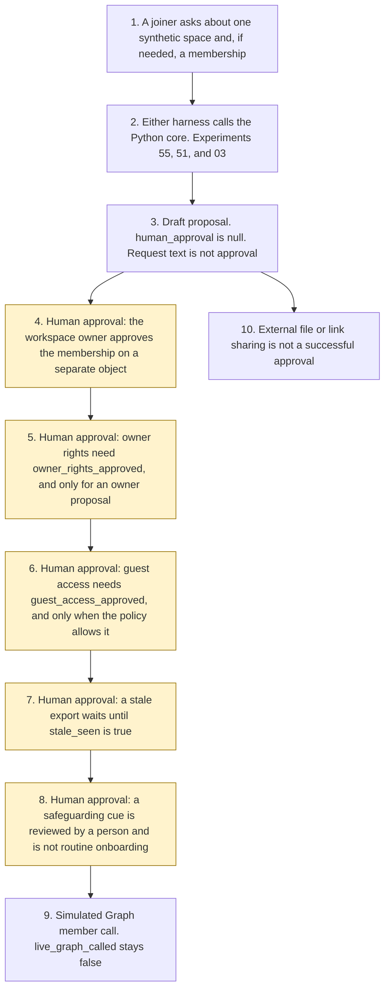

# Collaboration space onboarding

<span class="status status-available">Available</span> · Autonomy A1 · Experiment 57 · Catalogue ID M010

A starter for a new joiner or a project member in a UK public body. The assistant explains one Teams and SharePoint collaboration space: its purpose, its channels, where the key documents live, and the conventions that apply. It drafts a membership change: which team and channels, member or owner, and internal or guest, with the justification. The workspace owner approves each membership and each internal link before the sample records a change.

The organisation in the samples is Merrowfield Borough Council. It is invented. The clearance order in the fixture, which treats OFFICIAL-SENSITIVE as above OFFICIAL, is a starter rule. The Government Security Classifications Policy opened on 16 November 2026 names three tiers and describes the -SENSITIVE marking as an additional marking on OFFICIAL. It does not define this software order.

The folder contains the permissions manifest, a deterministic core, synthetic space fixtures, and build notes for two Copilot Studio harnesses. Both harnesses call the same Python core. The core calls [Experiment 55](55-onedrive-document-finder.md) for key documents already at or below the justified label, [Experiment 51](51-teams-channel-digest.md) for a read-only channel digest, and [Experiment 03](03-agent-inventory-atrs-assurance.md) to draft a permissions manifest that stays unapproved. Nothing in the folder calls a live model or Microsoft Graph.

If this page and [`agent-manifest.yaml`](https://github.com/rahul-bachina/copilot-agent-experiments/blob/main/experiments/57-collaboration-space-onboarding/agent-manifest.yaml) disagree, the manifest is the control.

## The problem

A request that says the owner has approved, or that the person is cleared to TOP SECRET, or that a file should be shared externally, is the failure this starter is built to refuse. Owner rights and guest access still have to be possible when the workspace owner has actually approved them, on a separate object, and the fixture policy allows a guest.

Pages opened for this starter on 16 November 2026:

- [UK GDPR Article 5](https://www.legislation.gov.uk/eur/2016/679/article/5). Article 5(1)(c) is data minimisation: adequate, relevant and limited to what is necessary. Article 5(1)(f) is integrity and confidentiality. Article 5(2) is accountability. Article 6 and Article 9 were not opened. No lawful basis is asserted. `data_minimisation_met` and `integrity_and_confidentiality_met` stay false.
- [Government Security Classifications Policy](https://www.gov.uk/government/publications/government-security-classifications/government-security-classifications-policy-html), updated 5 August 2024. Paragraph 1: not a statutory scheme. Paragraph 5: three tiers, OFFICIAL, SECRET and TOP SECRET. Paragraph 25: the -SENSITIVE marking is an additional marking on OFFICIAL. Principle Five is need-to-know balanced with need-to-share.
- [NCSC 10 Steps: Identity and access management](https://www.ncsc.gov.uk/collection/10-steps/identity-and-access-management), published 11 May 2021 and reviewed 11 May 2021. An access policy should cover who should have access, to what, why, and under what circumstances, including contractors and visitors. Joiners, movers and leavers are named. Full-privilege accounts are for when they are absolutely necessary, and privileged access is reviewed. The page does not use the words "least privilege". The NCSC introduction page that does was not opened.
- [Introduction to Microsoft Teams for admins](https://learn.microsoft.com/en-us/microsoftteams/teams-overview). Teams is built on Microsoft 365 groups, Microsoft Graph, and identities in Microsoft Entra ID. Creating a team creates a Microsoft 365 group, a SharePoint site and document library, an Exchange mailbox and calendar, and a OneNote notebook.
- [Guest access in Microsoft Teams](https://learn.microsoft.com/en-us/microsoftteams/guest-access). Guest access is an organisation-wide setting. Sensitivity labels can control it for a team. Adding a guest to the Microsoft 365 group gives access to the team. External access for chat and meetings is a different feature. The page points to Entra access reviews. This starter does not create a review and does not send an invitation.
- [Add members](https://learn.microsoft.com/en-us/graph/api/group-post-members?view=graph-rest-1.0) and [add owners](https://learn.microsoft.com/en-us/graph/api/group-post-owners?view=graph-rest-1.0). `POST /groups/{group-id}/members/$ref` names GroupMember.ReadWrite.All as the least privileged permission for a user, and success is 204 No Content. `POST /groups/{id}/owners/$ref` names Group.ReadWrite.All. The owner page says an owner who should change a team also needs to be a member, and that owner changes can take up to 2 hours to synchronise with Teams. This starter does not send either request and does not receive 204.
- [What are access reviews?](https://learn.microsoft.com/en-us/entra/id-governance/access-reviews-overview). Access reviews cover group memberships, app access, and role assignments. The page says the feature requires Microsoft Entra ID Governance or Microsoft Entra Suite, and that some capabilities may operate with Entra ID P2. Which SKU a tenant needs was not checked beyond that paragraph. This starter does not create a review.
- [Sensitivity labels for Teams, groups, and sites](https://learn.microsoft.com/en-us/purview/sensitivity-labels-teams-groups-sites). Labels can protect Teams sites, Microsoft 365 groups, and SharePoint sites. Items do not inherit the container label. External user access controls whether the owner can add guests. SharePoint external sharing is a separate setting. A fixture Government Security Classifications marking is not a Purview label.
- [Harnesses in Copilot Studio](https://learn.microsoft.com/en-us/microsoft-copilot-studio/harnesses-overview). Three harnesses are named: Microsoft Copilot harness, Customer Conversation harness, and standard harness. The standard harness follows the topics and rules the maker defines. The Microsoft Copilot harness is described for reasoning-heavy multi-step work, with skills, memory, file creation, and a sandbox, billed in Copilot Credits. The page states no price. The page does not use the words GitHub Copilot harness. Older wording that this harness is not the GitHub Copilot service is unverified against the page opened on this date.

## Who it helps

**A new joiner or a project member** gets a plain account of the space: the purpose, the channels they may be shown, where the key documents sit, and the conventions, without being added until the workspace owner approves.

**A workspace owner** gets a proposal that already says member or owner, internal or guest, and which channels, checked against the fixture marking and the guest policy. The owner still decides.

**An information governance lead** who is asked about a legal hold, a retention label, or a safeguarding cue gets those flags kept. A title above the justified label is not copied. A self-declared clearance in the request is ignored.

It does not help a team that wants the tool to grant owner rights, add a guest, or share a link because the request says so.

## What it does

`prepare_onboarding()` reads one synthetic space and one membership request and writes one JSON document. `human_approval` is null. `applied` is false. The same inputs and the same as-of date produce the same JSON.

| Situation | What the result says |
| --- | --- |
| The justification names a configured access need, and the space marking is not above it | A proposal: role, account type, channels, and a statement for the owner. |
| The request asks for owner without the fixture's owner-need phrase | The role is downgraded to member. An approval flag does not upgrade it. |
| The space marking, from metadata or from content, is above the justified label | `above_justified_label`. Titles are not copied. A SECRET cover page is caught. A compound marking takes the higher tier. |
| The guest policy is disabled | `guest_refused`. A later approval flag does not override it. |
| The guest policy is `owner_approval` | A proposal that still needs `guest_access_approved` to be the boolean true. |
| An external URL | Counted and not copied. `shared_externally` stays false. |
| A safeguarding or distress cue in the cleaned justification | `safeguarding_review`. The cue is not copied. The proposal is not applied. |
| An unreadable role, date, label, or access need | `needs_human`. Nothing is coerced to member or to OFFICIAL. |
| "The workspace owner has approved" inside the request | Recorded and not followed. `human_approval` stays null. |
| "It is not true that this includes the programme board" | That phrase is not an access need. |
| "My clearance is TOP SECRET" | Recorded as ignored. The justified label does not rise. |

`apply_membership()` is the only path that sets `human_approval`. The approver role has to be Workspace owner, the decision has to be `approve`, and the ids have to match. It then records a simulated `POST /groups/{group-id}/members/$ref`. An approved owner add also records `POST /groups/{id}/owners/$ref`. `live_graph_called` stays false. `status_received` stays null.

A deterministic smoke test of 18 synthetic cases passed in this folder. That is a smoke test of the Python, not a model score. The command is `python eval/evaluate.py`. The file is `eval/smoke_report.json`. Each case is counted once.

## What it does not do

These are disabled in the manifest.

- It does not grant owner rights unless the proposal is for owner and `owner_rights_approved` is the boolean true.
- It does not grant guest or external access when the fixture policy is disabled, or when `guest_access_approved` is not the boolean true.
- It does not add a person to a space above the label the justification supports.
- It does not share a file or a link externally.
- It does not treat approval text, or approval keys, inside the request as approval.
- It does not trust a self-declared clearance.
- It does not strip a sensitivity marking, a retention label, or a legal hold.
- It does not call live Microsoft Graph, create an Entra access review, or send an invitation.
- It does not decide that Article 5(1)(c) or Article 5(1)(f) was met.
- It does not simulate a private-channel member call. That API was not opened on 16 November 2026.

## How the work flows

Steps marked as human approval are the points where the workspace owner has to act. The simulated Graph record happens only after those gates, and it is not a live call. Sharing a file or a link externally is not a successful approval.

1. A joiner or a project member asks about one synthetic space and, if they need access, supplies a role, an account type, channels, and a justification.
2. Either harness calls the Python core. The standard harness is three topics. The Microsoft Copilot harness, packaged in this folder as the layout the common brief calls a GitHub Copilot harness, is four skills around the same calls. The core checks the marking, the guest policy, and least privilege. It calls Experiments 55, 51, and 03. Instructions in the request are recorded and not followed.
3. The draft comes back with `human_approval` null and `applied` false. A sentence in the request is not approval.
4. **Human approval.** The workspace owner approves, defers, or refuses the membership on a separate object. The approver role has to be Workspace owner.
5. **Human approval.** Owner rights are a separate boolean, `owner_rights_approved`. It applies only when the proposal role is owner. It does not upgrade a member.
6. **Human approval.** Guest or external access is a separate boolean, `guest_access_approved`. It applies only when the fixture policy is `owner_approval`. A disabled policy is not overridden.
7. **Human approval.** If the space export is older than the starter's 30-day window, the owner sets `stale_seen` before anything is applied. The window is configuration, not a statutory period.
8. **Human approval.** If a safeguarding cue was flagged, a person reviews it. A cue in the justification is not applied as routine onboarding.
9. Only then does the sample record the simulated group member call, and the owner call when owner rights were explicitly approved. `live_graph_called` stays false.
10. External sharing is not a path that succeeds. `external_share_approved` on the approval object is ignored.



What is not a tool of the agent, even after steps 4 to 8: a live Microsoft Graph call, a private-channel member call, an external file or link share, owner rights without the boolean, guest access against a disabled policy, and treating a sentence in the request as approval.

## Architecture diagram

The diagram below is the file shipped in the experiment, copied into this site at build time.

![Architecture diagram titled Collaboration space onboarding, the workspace owner approves. A joiner's request is shown as not approval by itself. Either Copilot Studio harness, standard topics or Microsoft Copilot harness skills, calls the Python core, which checks the label, the guest policy, and least privilege and calls Experiments 55, 51, and 03. A highlighted box is the human approval: the workspace owner uses a separate object, owner rights and guest access each need a boolean, and a stale export or a safeguarding cue waits for a person. A separate box states what is not a tool of the agent: no external file or link share, no live Graph call, no private-channel member call, a request sentence cannot approve, and a person is always offered.](img/57-collaboration-space-onboarding-architecture.png)

## Microsoft stack

| Piece | Role in this experiment |
| --- | --- |
| Microsoft Teams | The space the fixtures describe. The overview opened on 16 November 2026 says Teams is built on Microsoft 365 groups, Microsoft Graph, and Entra ID identities. |
| Microsoft 365 groups | Creating a team creates a group, a SharePoint site and library, an Exchange mailbox and calendar, and a OneNote notebook. Guest access to the team is access to that group. |
| Microsoft Graph | The sample records `POST /groups/{id}/members/$ref` and, for an approved owner, `POST /groups/{id}/owners/$ref`. It does not send them. The documented success status is 204. `status_received` stays null. |
| Microsoft Entra access reviews | The guest-access page points to them for group membership. The overview says they require Entra ID Governance or Entra Suite, with some capabilities that may operate with P2. This starter does not create a review. |
| Purview sensitivity labels for containers | The container page says items do not inherit the container label, and that external user access controls whether the owner can add guests. A fixture Government Security Classifications marking is not a Purview label. The fixture copies a Purview name as supplied and does not rank it. |
| Copilot Studio | Two harnesses, described above. The standard harness follows topics the maker defines. The Microsoft Copilot harness is the reasoning-heavy harness on the page opened on 16 November 2026. |
| Microsoft Foundry | Optional narrative from the JSON. No resource is deployed. Prompt shields were not opened on 16 November 2026. Treat that product behaviour as unverified. |

## Security and permissions

Manifest `exp-57-collaboration-space-onboarding`, version 0.1.0. Autonomy **A1**. Writes disabled. Sends disabled. Approve or reject, regulated decision, production record change, external send, and spending are disabled. So are granting owner rights without the boolean, granting guest access against a disabled policy, and sharing a file or a link externally.

Entra Agent ID, Conditional Access for agents, Power Platform DLP as a configured policy, Microsoft Foundry prompt shields, Key Vault, and Application Insights were not opened on 16 November 2026. Treat that product behaviour as unverified.

The longer note is [security and permissions](https://github.com/rahul-bachina/copilot-agent-experiments/blob/main/experiments/57-collaboration-space-onboarding/docs/security-and-permissions.md).

## How to try it

Python 3.10 or newer. Experiments 03, 51, and 55 have to be present beside this folder. No tenant and no network.

```bash
cd experiments/57-collaboration-space-onboarding
python -m pip install -r requirements.txt
python -m pytest tests/ -v
python eval/evaluate.py
python src/onboard.py --space examples/sample_space.json --request examples/sample_request.json --as-of 2026-11-16
```

The sample request carries approval keys on purpose. They are stripped. Add `--approval examples/sample_approval.json` to record the simulated member add. That file asks for an external share. The result still does not share anything.

## Limitations

- The need matcher is a phrase list on the fixture. A paraphrase that does not use the phrase is `needs_human`. OFFICIAL is not assumed.
- The fixture rank is not a sentence of the Government Security Classifications Policy.
- A document marking blocks membership of the whole space. That is a fail-closed fixture rule. It is not a tested claim about SharePoint library permissions.
- Private channel membership is not simulated. The Graph API for it was not opened.
- The NCSC page opened here does not use the words "least privilege".
- Phone numbers, email addresses, dates of birth, street addresses, and honorific names are masked only on text this starter copies. The mask report counts those replacements. The output is not anonymised.
- Article 6 and Article 9 were not opened. No lawful basis is asserted.
- The smoke test is not a model score. A live Microsoft Foundry run has not been done.
- Merrowfield Borough Council is fictional. This is not legal advice, a clearance decision, a DPIA, or an ATRS submission.

## Source

- [Experiment folder](https://github.com/rahul-bachina/copilot-agent-experiments/tree/main/experiments/57-collaboration-space-onboarding)
- [Permissions manifest](https://github.com/rahul-bachina/copilot-agent-experiments/blob/main/experiments/57-collaboration-space-onboarding/agent-manifest.yaml)
- [Security and permissions](https://github.com/rahul-bachina/copilot-agent-experiments/blob/main/experiments/57-collaboration-space-onboarding/docs/security-and-permissions.md)
- [Architecture](https://github.com/rahul-bachina/copilot-agent-experiments/blob/main/experiments/57-collaboration-space-onboarding/docs/architecture.md)
