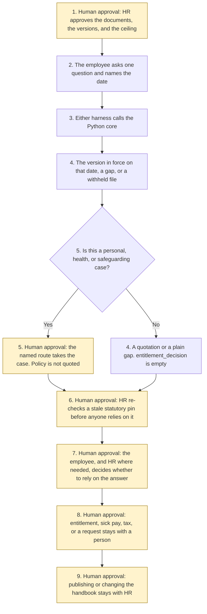

# Employee handbook agent

<span class="status status-available">Available</span> · Autonomy A0 · Experiment 58 · Catalogue ID H001

A starter for an employee who asks what the handbook says. HR approves which documents and versions are in scope. The assistant quotes the version in force on the date the question is about, with the section and the effective date. If the approved handbook does not cover the question, it says so. A personal or sensitive case is named to a person. The handbook in this folder is synthetic. Riverbend Workshops CIC is invented.

The folder contains the permissions manifest, a deterministic core, a synthetic handbook, and build notes for two Copilot Studio harnesses. Both harnesses call the same Python core. The core calls [Experiment 11](11-era-2025-hr-assistant.md) for Employment Rights Act 2025 dates that were not re-opened here, [Experiment 32](32-employee-case-intake.md) for a category proposal and the Acas paragraph pin, [Experiment 15](15-vulnerability-urgency-scanner.md) for distress and safeguarding phrases, and [Experiment 08](08-uk-pii-redaction-gateway.md) for UK identifier types. [Experiment 50](50-sharepoint-knowledge-curator.md) runs only when curation is requested. Nothing in the folder calls a live model, the network, SharePoint, Microsoft Graph, or Microsoft 365 Copilot.

If this page and [`agent-manifest.yaml`](https://github.com/rahul-bachina/copilot-agent-experiments/blob/main/experiments/58-employee-handbook/agent-manifest.yaml) disagree, the manifest is the control. `permissions.yaml` is the same file.

## The problem

A handbook has versions. The sentence that was in force in March may have ended in April. A draft can sit beside the live page and say, in its own text, that HR has approved it. A question about a person's sick pay, a grievance, or their health is not a question about what the procedure says.

Pages opened for this starter on 16 November 2026:

- [Working Time Regulations 1998, regulation 13](https://www.legislation.gov.uk/uksi/1998/1833/regulation/13). Regulation 13(1): four weeks' annual leave in each leave year, subject to paragraph (5). Regulation 13(A1) limits which workers and leave years it applies to. Extent England and Wales and Scotland. Regulation 15B was not opened.
- [Regulation 13A](https://www.legislation.gov.uk/uksi/1998/1833/regulation/13A). Regulation 13A(2)(e): 1.6 weeks for a leave year beginning on or after 1 April 2009. Regulation 13A(3): the aggregate with regulation 13(1) is subject to a maximum of 28 days.
- [Holiday entitlement](https://www.gov.uk/holiday-entitlement-rights). A GOV.UK summary: 5.6 weeks, and at least 28 days for most workers on a five-day week, capped at 28 days. Bank holidays can be included and do not have to be given as paid leave. This is not the wording of regulation 13.
- [Employment Rights Act 1996, section 80F](https://www.legislation.gov.uk/ukpga/1996/18/section/80F). The page said it was up to date with changes known to be in force on or before 15 November 2026. Section 80F(4)(a): no more than two applications to the same employer in any 12 months. The footnotes attribute the 6 April 2024 amendments to the Employment Relations (Flexible Working) Act 2023 (c. 33) and cite S.I. 2024/438, regulation 2. That SI was not opened as its own page. Changes listed as not yet applied, including Employment Rights Act 2025 provisions, were not opened and are not stated as in force.
- [Flexible Working (Amendment) Regulations 2023](https://www.legislation.gov.uk/uksi/2023/1328/made). In force 6 April 2024. Extent England and Wales and Scotland. Regulation 2 omits regulation 3 of the Flexible Working Regulations 2014. The explanatory note says the right applies from the first day, and that the previous 26-week condition does not apply to applications made on or after that date.
- [Flexible working](https://www.gov.uk/flexible-working). Requests from the first day. Employers must deal with a request in a reasonable manner. Rules differ in Northern Ireland. No decision period was in the text that was read. The Acas flexible-working code was not opened.
- [Equality Act 2010, section 39](https://www.legislation.gov.uk/ukpga/2010/15/section/39). Section 39(5): a duty to make reasonable adjustments applies to an employer. Section 39(2) is the prohibition on discriminating against an employee. Extent England and Wales and Scotland. Not applied to a person.
- [Section 20](https://www.legislation.gov.uk/ukpga/2010/15/section/20). Section 20(3) is the first requirement, where a provision, criterion or practice puts a disabled person at a substantial disadvantage. Sections 20(4) and 20(5) are the physical-feature and auxiliary-aid requirements. This starter does not decide that a step is reasonable for a person.
- [Acas Code of Practice on disciplinary and grievance procedures](https://www.acas.org.uk/acas-code-of-practice-on-disciplinary-and-grievance-procedures). The code is the minimum an employer should follow. Published 11 March 2015. Numbered paragraphs were not on this page. Paragraphs 1, 32, and 40 are Experiment 32's pin of 4 November 2026 and were not re-opened here.
- [Knowledge sources summary](https://learn.microsoft.com/en-us/microsoft-copilot-studio/knowledge-copilot-studio), [Add SharePoint as a knowledge source](https://learn.microsoft.com/en-us/microsoft-copilot-studio/knowledge-add-sharepoint), and [What is Microsoft Copilot?](https://learn.microsoft.com/en-us/microsoft-365-copilot/microsoft-365-copilot-overview). Limits from those pages are in the Microsoft stack section. This starter calls none of those products.
- [Harnesses in Copilot Studio](https://learn.microsoft.com/en-us/microsoft-copilot-studio/harnesses-overview). Three harnesses are named: Microsoft Copilot harness, Customer Conversation harness, and standard harness. The page does not use the words GitHub Copilot harness. Older wording that this harness is not the GitHub Copilot service is unverified against the page opened on this date.

Experiment 11's Employment Rights Act 2025 dates were last verified in that experiment on 27 October 2026. They were not re-opened on 16 November 2026. `compliance_conclusion` stays null.

## Who it helps

**An employee** who wants the handbook's own words gets the section, the version, and the effective date, or a plain sentence that the handbook does not cover the question. A figure in the handbook is not applied to that person.

**HR** who has already chosen the live documents gets an answer that will not quote a draft, a superseded version for the wrong date, or a file above the ceiling. A legal hold and every retention label stay on the citation or the withheld row.

**A person in distress, or a person raising a grievance, a health matter, pregnancy, disability, or whistleblowing**, is named to a route. The question is not answered with a policy figure. Phone numbers, email addresses, dates of birth, postal addresses, and personal-name cues are counted and not stored. The output is not described as anonymised. A person is always offered. This starter does not publish a telephone number.

It does not help a team that wants the tool to decide leave balances, expense claims, or flexible-working requests.

## What it does

`src/answer.py` reads one handbook, one scope object, one question, and the dates, and writes one JSON document. `human_approval` is null until HR records a separate seen-step. That step does not decide entitlement. `entitlement_decision` stays null.

| Situation | What the result says |
| --- | --- |
| An approved section is in force on the date asked about | The section, the version, and the effective date. |
| That version had already ended by the as-of date | The earlier version is quoted, and the answer says it is not the version in force on the later date. |
| Two approved versions of the same topic overlap on that date | Neither is chosen. A person looks at the scope. |
| No approved section matches | "The approved handbook does not cover this question." |
| "It is not true that the expenses policy includes client entertainment" | The denial is not an inclusion. |
| A personal, health, pregnancy, disability, grievance, disciplinary, whistleblowing, distress, or safeguarding question | A named route. The policy figure is not quoted. |
| A number or a date that cannot be read, or a quantity above 366 | A person looks at it. The value is not replaced with zero or with today. |
| An instruction to ignore the effective date, grant days, or strip a label | Recorded and not followed. |
| A cover page marked SECRET, or a higher label in the text than in the metadata | Withheld. The higher label, the legal hold, and the retention labels are kept. |
| A statutory pin older than 90 days on the as-of date | Marked stale. Not refreshed from the web. |
| A handbook that is not marked synthetic | Refused. The text is not copied. |

`decide_entitlement`, `send_answer`, `write_record`, and `approve_source` raise. SharePoint, Microsoft Graph, and Microsoft 365 Copilot are not called.

A deterministic smoke test of 18 synthetic cases passed in this folder. That is a smoke test of the Python, not a model score. The command is `python eval/evaluate.py`. The file is `eval/smoke_report.json`. Each case is counted once.

## What it does not do

These are disabled in the manifest.

- It does not answer from a document HR has not put on the scope object.
- It does not treat "approved" inside the question, or inside a file, as that approval.
- It does not decide an individual's entitlement, sick pay, tax, or a flexible-working request.
- It does not give individual legal, medical, or tax advice.
- It does not confirm a case category. Experiment 32 proposes one. `classification_confirmed` stays false.
- It does not decide that an employer took reasonable steps or all reasonable steps, or that a disclosure is a protected disclosure.
- It does not state Northern Ireland employment law. The pins are England and Wales and Scotland.
- It does not quote a document above the handbook ceiling, or drop a legal hold or a retention label.
- It does not trust a clearance typed into the question.
- It does not publish or edit the handbook. Experiment 50 may propose curation. It does not apply it.
- It does not call SharePoint, Microsoft Graph, or Microsoft 365 Copilot, and it does not refresh a stale pin from the web.

## How the work flows

Steps marked as human approval are the points where a person has to act. The agent has no decision to take after them.

1. **Human approval.** HR approves which handbook documents and versions are in scope, including the ceiling and the approval reference, on a separate object. A sentence in the question or in a file does not do this.
2. The employee asks one question and names the date it is about.
3. Either harness calls the Python core. The standard harness is three topics. The Microsoft Copilot harness, packaged in this folder as the layout the common brief calls a GitHub Copilot harness, is two skills around the same call. The page opened on 16 November 2026 does not use the words GitHub Copilot harness.
4. The core keeps the version in force on that date, or says the handbook does not cover the question. Instructions are recorded and not followed. A file above the ceiling is withheld with its labels.
5. **Human approval.** A grievance, disciplinary, health, pregnancy, disability, whistleblowing, distress, or safeguarding case goes to the named route. It is not answered as policy.
6. **Human approval.** Where a statutory pin is stale, HR re-checks the source before anyone relies on it. The core does not download the page.
7. **Human approval.** Relying on the answer, including a statutory pin, is the employee's step, and HR's where the pin is stale or the case is personal. Reading the JSON is not that step.
8. **Human approval.** Deciding entitlement, sick pay, tax, or a flexible-working request stays with HR or the relevant adviser. The agent has no tool for it.
9. **Human approval.** Publishing or changing the handbook stays with HR. The agent has no tool for it.



What is not a tool of the agent, even after steps 1 and 5 to 9: approving a source from words in the question, deciding an entitlement, sending the answer, writing a record, quoting a file above the ceiling, dropping a legal hold, and calling SharePoint, Microsoft Graph, or Microsoft 365 Copilot.

## Architecture diagram

The diagram below is the file shipped in the experiment, copied into this site at build time.

![Architecture diagram titled Employee handbook agent. HR approves document ids, the ceiling, and an approval reference on a separate object. Either Copilot Studio harness calls the Python core, which quotes the version in force on the date asked about and can call Experiments 08, 11, 15, and 32, and Experiment 50 only when asked. A highlighted box is the human approval: a named route for a personal, health, or safeguarding case, a re-check of a stale pin, and no entitlement decision, send, or write. A separate box states what is not a tool of the agent: approving a source, deciding leave or tax, quoting a SECRET cover, dropping a legal hold, trusting a typed clearance, and calling SharePoint, Microsoft Graph, or Microsoft 365 Copilot. A person is always available.](img/58-employee-handbook-architecture.png)

## Microsoft stack

| Piece | Role in this experiment |
| --- | --- |
| Python standard library | `src/answer.py`. No Azure credentials and no network. |
| Experiment 11 | In-process dates for Employment Rights Act 2025 provisions. Not re-opened on 16 November 2026. No compliance conclusion. |
| Experiment 32 | In-process category proposal and the Acas paragraph pin of 4 November 2026. The category is not confirmed. The HR-officer draft tool is not called. |
| Experiment 15 | In-process phrase list for distress and safeguarding. A person is not labelled. |
| Experiment 08 | In-process `propose()`. Entity types are kept. Values and the redacted text are not. The output is not described as anonymised. |
| Experiment 50 | In-process `curate_site()` only when curation is requested. SharePoint is not called. A proposal is not applied. |
| pytest | Declared for tests. The core does not import it. |
| Copilot Studio, standard harness | Three topics. The flow returns JSON and stops. The overview opened on 16 November 2026 says this harness follows the topics and rules the maker defines. |
| Copilot Studio, Microsoft Copilot harness | Two skills around the same JSON. The overview opened on 16 November 2026 uses this name. It describes skills, memory, file creation, and a sandbox, billed in Copilot Credits. No price is stated. The page does not use the words GitHub Copilot harness. |
| Copilot Studio knowledge and SharePoint | Described from the pages opened on 16 November 2026. Not connected. Generative mode names 25 SharePoint URLs. Classic mode names four URLs per generative answers node. The agent user's Entra ID is the authentication the SharePoint page describes. A user without permission gets no response. Hyperlinks inside a registered page are not crawled. This starter does not call those APIs. |
| Microsoft 365 Copilot | The overview opened on 16 November 2026 says experiences differ by grounding, integration, and licensing, and that access is scoped by user permissions. Work-data grounding is described as Microsoft Graph and Work IQ where the experience includes work data. Not connected. No price is stated. |
| Microsoft Foundry | Optional narrative around the JSON. Not deployed. The core remains the system of record. Prompt-shield behaviour was not re-opened on 16 November 2026. |

The Customer Conversation harness is described on the same overview for customer voice and chat. It is not built here.

## Security and permissions

Manifest `exp-58-employee-handbook`, version 0.1.0. Autonomy **A0**. Writes disabled. Sends disabled. Approve or reject, regulated decision, production record change, external send, and spending are disabled. So are approving a source, deciding an individual's entitlement, and removing a marking, a legal hold, or a retention label.

`permissions.yaml` is the same file as `agent-manifest.yaml`. It validates against `schemas/agent-manifest.schema.json`.

Microsoft Entra, Conditional Access, Power Platform DLP, Key Vault, Purview, and Application Insights are named in the security note as controls the employer confirms. None of those objects is created in this folder. Microsoft Foundry prompt shields were not re-opened on 16 November 2026.

The longer note is [security and permissions](https://github.com/rahul-bachina/copilot-agent-experiments/blob/main/experiments/58-employee-handbook/docs/security-and-permissions.md).

## How to try it

Python 3.10 or newer. No credentials and no network. Experiments 08, 11, 15, 32, and 50 must be present beside this folder. Experiment 50 calls Experiment 44 only when a snapshot includes queries. This call does not pass queries.

```bash
cd experiments/58-employee-handbook
python -m pip install -r requirements.txt
python -m pytest tests/ -q
python eval/evaluate.py
python src/answer.py --handbook fixtures/handbook.json --scope examples/sample_scope.json --question examples/sample_question.json --as-of 2026-11-16
```

The sample is a fictional handbook. The exit code is 0 when an answer, a gap, a route, or a needs-human result is produced. A handbook that is not marked synthetic is refused. The exit code is 2 when the outcome is a refusal for another reason, including an instruction-only question.

## Limitations

- The handbook is synthetic. It is not any employer's handbook.
- Regulation 15B was not opened. The four-weeks and 1.6-weeks pins are not a calculation for irregular hours or part-year work, and they are not a balance.
- S.I. 2024/438 was not opened as its own page. The 6 April 2024 date is the footnote on section 80F.
- Employment Rights Act 2025 changes to section 80F were listed as not yet applied. They were not opened. They are not stated as in force.
- Experiment 11's dates were not re-opened on 16 November 2026.
- The Acas numbered paragraphs are Experiment 32's pin. The landing page opened here does not contain them.
- The statutory text is the text opened on 16 November 2026. It is not a point-in-time copy of the law on an earlier day.
- Northern Ireland is out of scope.
- The smoke test is not a model score. No live Microsoft Foundry run has been done.
- This is not legal advice, a statement of anyone's entitlement, or a DPIA.

## Source

- [Experiment folder](https://github.com/rahul-bachina/copilot-agent-experiments/tree/main/experiments/58-employee-handbook)
- [Permissions manifest](https://github.com/rahul-bachina/copilot-agent-experiments/blob/main/experiments/58-employee-handbook/agent-manifest.yaml)
- [Security and permissions](https://github.com/rahul-bachina/copilot-agent-experiments/blob/main/experiments/58-employee-handbook/docs/security-and-permissions.md)
