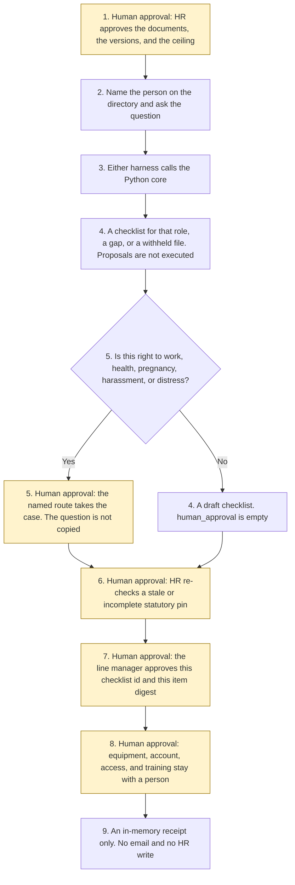

# New starter guide

<span class="status status-available">Available</span> · Autonomy A1 · Experiment 59 · Catalogue ID H002

A starter for a new employee and their line manager. HR approves which onboarding documents are in scope. The assistant drafts a checklist for the role on the synthetic directory and answers a how-do-I question with the section and the effective date. The line manager approves that exact list before it is shared. Equipment, accounts, access, and training stay proposals. The pack is synthetic. Riverbend Workshops CIC is invented.

The folder contains the permissions manifest, a deterministic core, a synthetic pack, and build notes for two Copilot Studio harnesses. Both harnesses call the same Python core. The core calls [Experiment 58](58-employee-handbook.md) for handbook markings and, when the question is about leave, a fixed leave question. It calls [Experiment 57](57-collaboration-space-onboarding.md) for a team-space proposal that is not applied. It calls [Experiment 21](21-it-service-desk.md) with a fixed question about service desk hours, and it does not grant access. It calls [Experiment 11](11-era-2025-hr-assistant.md) for Employment Rights Act 2025 dates that were not re-opened here, [Experiment 15](15-vulnerability-urgency-scanner.md) for distress and safeguarding phrases, and [Experiment 08](08-uk-pii-redaction-gateway.md) for UK identifier types. Nothing in the folder calls a live model or the network.

If this page and [`agent-manifest.yaml`](https://github.com/rahul-bachina/copilot-agent-experiments/blob/main/experiments/59-new-starter-guide/agent-manifest.yaml) disagree, the manifest is the control. `permissions.yaml` is the same file.

## The problem

The first weeks mix a written statement, a right-to-work check that HR must do, a privacy notice, and a list of IT and facilities steps that are easy to treat as if the tool had already ordered them. Policies have dates. A draft can say, in its own words, that HR has approved it. A message can say the manager has already approved the list.

Pages opened for this starter on 17 November 2026:

- [Employment Rights Act 1996, section 1](https://www.legislation.gov.uk/ukpga/1996/18/section/1). The page said it was up to date with all changes known to be in force on or before 16 November 2026. Section 1(1) requires a written statement of particulars when a worker begins employment. Section 1(2)(b): the statement must be given not later than the beginning of the employment. That subsection is subject to sections 2(2) to (4), which were not opened. Extent England and Wales and Scotland. The footnote attributes the 6 April 2020 substitution to S.I. 2018/1378. That instrument was not opened.
- [Written statement of employment particulars](https://www.gov.uk/employment-contracts-and-conditions/written-statement-of-employment-particulars). GOV.UK says the principal statement is provided on the first day and the wider written statement within 2 months. That is the GOV.UK summary, not the text of section 2.
- [Immigration, Asylum and Nationality Act 2006, section 15](https://www.legislation.gov.uk/ukpga/2006/13/section/15). The page said it was up to date with all changes known to be in force on or before 16 November 2026. Extent United Kingdom. Section 15(1) sets out when employing an adult subject to immigration control is contrary to the section. Section 15(3) is the excuse where the employer shows compliance with prescribed requirements. Section 15(7)(d) allows an order to require action before employment begins. The order was not opened. This starter does not carry out the check.
- [Right to work checks: an employer's guide](https://www.gov.uk/government/publications/right-to-work-checks-employers-guide). The HTML page, last updated 1 October 2026, describes checks before employment. The 83-page PDF of the same date was not opened. No paragraph from that PDF is cited.
- [Equality Act 2010, section 39(5)](https://www.legislation.gov.uk/ukpga/2010/15/section/39) and [section 20(3)](https://www.legislation.gov.uk/ukpga/2010/15/section/20). A duty to make reasonable adjustments applies to an employer. The first requirement is the provision, criterion or practice. Schedule 8 was not opened. A step is not decided for a person.
- [UK GDPR, Article 13](https://www.legislation.gov.uk/eur/2016/679/article/13). Where personal data are collected from the data subject, the controller provides the listed information at the time the data are obtained. A currency banner was not in the text returned. An ICO page tried the same day was not opened. Article 6 and Article 9 are not asserted.
- [Harnesses in Copilot Studio](https://learn.microsoft.com/en-us/microsoft-copilot-studio/harnesses-overview). Three harnesses are named: Microsoft Copilot harness, Customer Conversation harness, and standard harness. The page does not use the words GitHub Copilot harness.

Experiment 11's dates were last verified in that experiment on 27 October 2026. They were not re-opened on 17 November 2026. `compliance_conclusion` stays null.

## Who it helps

**A new starter** who wants the first-week list gets the steps that HR has put in scope for their directory role, with the section and the effective date. A proposal is labelled as a proposal. A question the pack does not cover is said to be uncovered.

**A line manager** approves one checklist, identified by its id and its item digest, before it is shared. An approval for a different list does not carry over. Words in the starter's message are not that approval.

**HR** keeps right-to-work evidence, reasonable adjustments, health, pregnancy, and harassment. The assistant names the route and does not collect the document.

**Someone in distress, or a safeguarding concern**, including a paraphrase such as struggling to cope, is named to a person. The question is not stored. A person is always offered.

It does not help a team that wants the tool to order a laptop, create an account, grant access, or enrol a course.

## What it does

`src/guide.py` reads one pack, one directory, one scope, one request, and one as-of date, and writes one JSON document. `human_approval` is null until the line manager's separate step. That step does not provision anything.

| Situation | What the result says |
| --- | --- |
| An approved section is in force for the directory role | A checklist item, the section, and the effective date. |
| The section is a laptop, an account, access, training, or a pass | A proposal. `executed` is false. |
| "It is not true that the induction includes client entertainment" | The denial is not an inclusion. A later sentence can still include a fire briefing. |
| A right-to-work, adjustment, health, pregnancy, harassment, distress, or safeguarding question | A named route. The question is not copied. |
| A number or a date that cannot be read, or a quantity outside 1 to 5 | A person looks at it. The value is not replaced with zero or with today. |
| An instruction to enrol, grant access, or strip a label | Recorded and not followed. A sentence that says the agent does not do it is kept. |
| A cover page marked SECRET, or a higher label in the text than in the metadata | Withheld. The higher label, the legal hold, and the retention labels are kept. |
| A statutory pin older than 180 days on the as-of date, or a pin that names an unopened section | Marked. Not refreshed from the web. `may_be_relied_on` stays false. |
| A pack that is not marked synthetic | Refused. The text is not copied. |

`request_equipment`, `create_account`, `grant_access`, `enrol_training`, `send_externally`, `write_hr_record`, and `collect_special_category` raise. SharePoint, Microsoft Graph, and Microsoft 365 Copilot are not called.

A deterministic smoke test of 18 synthetic cases passed in this folder. That is a smoke test of the Python, not a model score. The command is `python eval/evaluate.py`. The file is `eval/smoke_report.json`. Each case is counted once.

## What it does not do

These are disabled in the manifest.

- It does not draft from a document HR has not put on the scope object.
- It does not treat "approved" inside the request, or inside a file, as the line manager's approval.
- It does not trust a role or a clearance typed into the request. Both come from the directory, or the clearance is ignored.
- It does not request equipment, create an account, grant access, or enrol training, including after the checklist is shared.
- It does not collect special-category data or decide a right-to-work check or a reasonable adjustment.
- It does not produce the written statement or decide that section 1 was met.
- It does not quote a document above the ceiling, or drop a legal hold or a retention label.
- It does not call SharePoint, Microsoft Graph, or Microsoft 365 Copilot, and it does not refresh a stale pin from the web.

## How the work flows

Steps marked as human approval are the points where a person has to act. The agent has no provisioning decision to take after them.

1. **Human approval.** HR approves which onboarding documents are in scope, including the ceiling and the approval reference, on a separate object. A sentence in the request or in a file does not do this.
2. The starter or the manager names the synthetic person id and the question. The role and the line manager are read from the directory.
3. Either harness calls the Python core. The standard harness is the topics in the folder. The Microsoft Copilot harness, packaged in this folder as the layout the common brief calls a GitHub Copilot harness, is three skills around the same call. The page opened on 17 November 2026 does not use the words GitHub Copilot harness.
4. The core keeps the in-force steps for that role, or says the sources do not cover the question. Instructions are recorded and not followed. A file above the ceiling is withheld with its labels. Proposals stay unexecuted.
5. **Human approval.** A right-to-work, adjustment, health, pregnancy, harassment, distress, or safeguarding case goes to the named route. It is not answered as a routine checklist item.
6. **Human approval.** Where a statutory pin is stale or names a section that was not opened, HR re-checks the source before anyone relies on it. The core does not download the page.
7. **Human approval.** The line manager approves this checklist id and this item digest. Reading the JSON is not that step. An approval for a different list is not reused.
8. **Human approval.** Requesting equipment, creating an account, granting access, or enrolling training stays with the line manager or the service desk. The agent has no tool for it, including after step 7.
9. The in-memory receipt, if a person runs the share step outside the model, does not send email and does not write the HR system.



What is not a tool of the agent, even after steps 1 and 5 to 8: approving the list from words in the request, ordering equipment, creating an account, granting access, enrolling training, quoting a file above the ceiling, dropping a legal hold, and calling SharePoint, Microsoft Graph, or Microsoft 365 Copilot.

## Architecture diagram

The diagram below is the file shipped in the experiment, copied into this site at build time.

![Architecture diagram titled New starter guide. HR approves document ids, the ceiling, and an approval reference. The role and the line manager come from the directory. Either Copilot Studio harness calls the Python core, which drafts the checklist for the role in force on the as-of date and can call Experiments 58, 57, 21, and 11. Proposals are not executed. A highlighted box is the human approval: the line manager approves this checklist id and digest, then an in-memory receipt, with no email, no HR write, and no provisioning. A separate box states what is not a tool of the agent: ordering equipment, creating an account, granting access, enrolling training, collecting a passport or a health detail, quoting a SECRET cover, dropping a legal hold, and trusting approval words or a typed clearance. A person is always available.](img/59-new-starter-guide-architecture.png)

## Microsoft stack

**Copilot Studio, standard harness.** Topics for the first week, a how-do-I question, and a request to share. The flow returns JSON and stops. This is a build guide, not an importable solution. See the experiment's `copilot-studio/` notes.

**Copilot Studio, Microsoft Copilot harness.** The reasoning-heavy harness described on the page opened on 17 November 2026. Skills, memory, and file creation are on that page. This folder packages three skills. It does not assign trigger phrases or routing weights. Agents on that harness use Copilot Credits. No price was on the page. The page does not call this the GitHub Copilot harness.

**Microsoft Foundry.** Optional narrative of JSON that is already in the result. No live call has been made. Citations and the approval gate stay in Python. Prompt shields were not opened on 17 November 2026. See the experiment's Foundry note.

**Power Platform.** No connector in this starter. DLP should block mail and HR connectors if someone adds them later.

## Security and permissions

Manifest `exp-59-new-starter-guide`, version 0.1.0. Autonomy **A1**. Writes disabled. Sends disabled. Approve or reject, regulated decision, production record change, external send, and spending are disabled. So are requesting equipment, creating an account, granting access, enrolling training, collecting special-category data, and removing a marking, a legal hold, or a retention label.

HR approves the scope. The line manager approves the personalised checklist. A right-to-work check or a reasonable adjustment stays with HR. Distress goes to the named route.

Article 6 is not asserted. Article 9 is not asserted. The question is not copied. Identifier counts do not store the values and are not described as anonymisation.

The longer note is [security and permissions](https://github.com/rahul-bachina/copilot-agent-experiments/blob/main/experiments/59-new-starter-guide/docs/security-and-permissions.md).

## How to try it

Python 3.10 or newer. No Azure credentials and no network. From the experiment folder:

```bash
python -m pip install -r requirements.txt
python -m pytest tests/ -q
python eval/evaluate.py
python src/guide.py --pack fixtures/pack.json --directory fixtures/directory.json --scope examples/sample_scope.json --request examples/sample_request.json --as-of 2026-11-17
```

Experiments 08, 11, 15, 21, 57, and 58 need to sit beside the folder. The smoke test is deterministic. It is not a model score.

## Limitations

- The pack is synthetic. It is not any employer's onboarding.
- Sections 2(2) to 2(4) of the Employment Rights Act 1996 were not opened. Section 1(2) is subject to them. The GOV.UK timing sentences are not section 2.
- The Home Office PDF of 1 October 2026 was not opened. The section 15 order was not opened. This starter does not do the check.
- Schedule 8 was not opened. A reasonable adjustment is not decided.
- Article 13 had no currency banner in the text returned. The ICO page was not opened. Article 6 is not asserted.
- Experiment 11 was not re-opened on 17 November 2026.
- `may_be_relied_on` stays false while a cited pin is incomplete or stale.
- The in-memory receipt is not an email and not an HR record.
- Northern Ireland employment law was not opened.
- The smoke test is not a model score. No price is stated for Copilot Credits.

This is not legal advice.

## Source

- [Experiment folder](https://github.com/rahul-bachina/copilot-agent-experiments/tree/main/experiments/59-new-starter-guide)
- [Permissions manifest](https://github.com/rahul-bachina/copilot-agent-experiments/blob/main/experiments/59-new-starter-guide/agent-manifest.yaml)
- [Security and permissions](https://github.com/rahul-bachina/copilot-agent-experiments/blob/main/experiments/59-new-starter-guide/docs/security-and-permissions.md)
