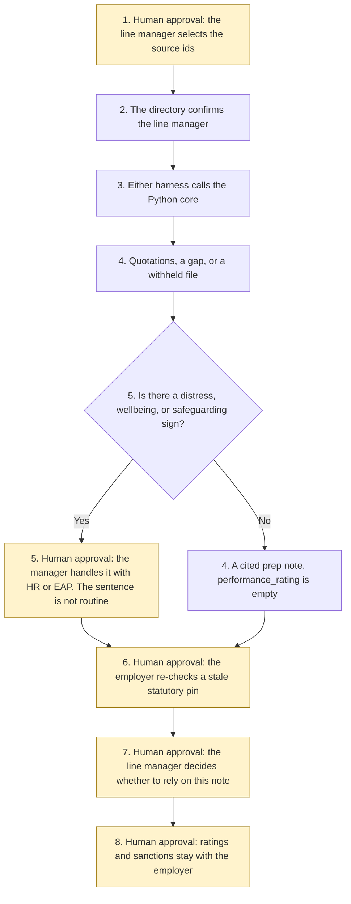

# Manager one-to-one preparation

<span class="status status-available">Available</span> · Autonomy A0 · Experiment 60 · Catalogue ID H003

A starter for a line manager preparing one one-to-one. The manager selects the context first. The assistant quotes follow-ups, agreed objectives, the employee's own shared updates, and team calendar items, each with a citation, and suggests open questions beside those lines. The notes in this folder are synthetic. Harbourside Instruments Ltd is invented.

The folder contains the permissions manifest, a deterministic core, a synthetic pack, and build notes for two Copilot Studio harnesses. Both harnesses call the same Python core. The core calls [Experiment 15](15-vulnerability-urgency-scanner.md) for distress and safeguarding phrases, [Experiment 41](41-case-summary.md) so each quoted line is checked against its source, [Experiment 51](51-teams-channel-digest.md) for an action or a decision on a line, and [Experiment 08](08-uk-pii-redaction-gateway.md) for UK identifier types. Nothing in the folder calls a live model, the network, Microsoft Graph, or Work IQ.

If this page and [`agent-manifest.yaml`](https://github.com/rahul-bachina/copilot-agent-experiments/blob/main/experiments/60-manager-one-to-one-prep/agent-manifest.yaml) disagree, the manifest is the control. `permissions.yaml` is the same file.

## The problem

The useful context for a one-to-one is what was agreed last time, what the employee has chosen to share, and what is on the team calendar. The same place often also holds a mailbox, a chat, or a sentence that tells a tool to rate the person or to ignore its instructions.

Pages opened for this starter on 17 November 2026:

- [UK GDPR Article 5](https://www.legislation.gov.uk/eur/2016/679/article/5). Article 5(1)(a) is lawfulness, fairness and transparency. Article 5(1)(c) is data minimisation. Article 6 and Article 9 were not opened. A lawful basis is not asserted.
- [Article 22A](https://www.legislation.gov.uk/eur/2016/679/article/22A), [Article 22B](https://www.legislation.gov.uk/eur/2016/679/article/22B), [Article 22C](https://www.legislation.gov.uk/eur/2016/679/article/22C), and [Article 22D](https://www.legislation.gov.uk/eur/2016/679/article/22D). Substituted for Article 22 on 19 June 2025 for specified purposes, and on 5 February 2026 in so far as not already in force, by the Data (Use and Access) Act 2025 sections 80(1) and 142(1) and (2)(h) and S.I. 2026/82 regulation 2(j), with regulation 5. Regulation 5 was not opened. Article 22B(2) was not in the text returned and is not quoted. No Article 22D regulations were read. Whether any have been made is unverified.
- [Equality Act 2010, section 4](https://www.legislation.gov.uk/ukpga/2010/15/section/4) lists the protected characteristics. [Section 39](https://www.legislation.gov.uk/ukpga/2010/15/section/39) prohibits discrimination against an employee and states the reasonable-adjustment duty. Extent England and Wales and Scotland. This starter does not decide that either has been met or breached, and it does not infer a characteristic.
- [ICO, monitoring workers](https://ico.org.uk/for-organisations/uk-gdpr-guidance-and-resources/employment/monitoring-workers/) and the [solely automated processes](https://ico.org.uk/for-organisations/uk-gdpr-guidance-and-resources/employment/monitoring-workers/what-do-we-need-to-do-if-we-use-monitoring-tools-that-use-solely-automated-processes/) page. Both are under review because of the Data (Use and Access) Act. The automated page still names Article 22. Reconciliation with Articles 22A to 22D is unverified. This starter does not decide that a prep note is monitoring.
- [Harnesses in Copilot Studio](https://learn.microsoft.com/en-us/microsoft-copilot-studio/harnesses-overview). Three harnesses are named. The page does not use the words GitHub Copilot harness.

## Who it helps

**A line manager** who has already chosen the notes for one meeting gets the follow-ups, the objectives, the shared update, and the calendar item, each with a source id and a line. An open question sits beside the quotation. It is not a rating.

**The employee** is not scored, compared, or profiled. A mailbox and a chat are not read. A phone number, an email address, a date of birth, a postal address, and another person's name are masked and not stored. The output is not described as anonymised.

**A person who has shared distress, a wellbeing concern, or a safeguarding worry** is not turned into a routine agenda item. The manager is pointed to HR and the employee assistance programme, and is asked to handle it humanely. A person is always available.

It does not help a manager who wants the tool to decide a rating, start a disciplinary step, or browse messages the employee did not share for the meeting.

## What it does

`src/prepare.py` reads one pack and one as-of date and writes one JSON document. `human_approval` is null until the directory line manager records a separate seen-step for that meeting and those source ids. That step does not rate performance.

| Situation | What the result says |
| --- | --- |
| The manager selected notes, objectives, an update, and a calendar item | Quoted lines, citations, and open questions. |
| "It is not true that the objective includes a client entertainment budget" | The denial is not an inclusion. |
| A distress phrase, including a paraphrase such as finding it hard to keep going | A human flag. The sentence is not copied. |
| "It is not true that the note includes self-harm" | Not a flag, and the sentence is not copied. |
| A mailbox or a chat, selected or not | Not read. A SECRET cover, a legal hold, and retention labels are kept. |
| An instruction to rate performance or to ignore instructions | Recorded and not followed. |
| A date or a stale window that cannot be read, including zero | A person looks at it. The value is not replaced with today or with zero. |
| A guest who writes that they are the line manager | Refused. The directory is the role. |
| "Approved" inside the pack | Ignored. `human_approval` stays null. |

`rate_performance`, `read_mailbox`, `read_chat`, and `send_note` raise. Microsoft Graph and Work IQ are not called.

A deterministic smoke test of 14 synthetic cases passed in this folder. That is a smoke test of the Python, not a model score. The command is `python eval/evaluate.py`. The file is `eval/smoke_report.json`. Each case is counted once.

## What it does not do

These are disabled in the manifest.

- It does not quote a source the manager did not select.
- It does not read a mailbox or a chat, even if the selection names one.
- It does not treat "approved" inside a note as the selection or as the seen-step.
- It does not rate performance, compare employees, or profile a person.
- It does not infer health, a protected characteristic, or personal circumstances.
- It does not recommend disciplinary or capability action.
- It does not quote a document above the ceiling, or drop a legal hold or a retention label.
- It does not trust a clearance or a role typed into a note.
- It does not call Microsoft Graph or Work IQ, and it does not refresh a stale pin from the web.

## How the work flows

Steps marked as human approval are the points where a person has to act. The agent has no decision to take after them.

1. **Human approval.** The line manager selects which source ids are in scope for this meeting, on a separate object. A sentence in a note does not do this.
2. The directory is checked. The selector must be that employee's line manager. A self-declared role is ignored.
3. Either harness calls the Python core. The standard harness is three topics. The Microsoft Copilot harness, packaged in this folder as the layout the common brief calls a GitHub Copilot harness, is two skills around the same call. The page opened on 17 November 2026 does not use the words GitHub Copilot harness.
4. The core quotes follow-ups and objectives, or says the line was not a follow-up, or withholds a file. Instructions are recorded and not followed.
5. **Human approval.** A distress, wellbeing, safeguarding, or personal-circumstance sign goes to the manager to handle humanely, with HR or the employee assistance programme. It is not a routine agenda item.
6. **Human approval.** Where a statutory pin is stale, the employer re-checks the source before anyone relies on the legal row. The core does not download the page.
7. **Human approval.** Relying on the note is the line manager's seen-step, for this meeting id and these source ids. Reading the JSON is not that step.
8. **Human approval.** Rating performance, comparing employees, or starting a disciplinary or capability step stays with the employer's own process. The agent has no tool for it.



What is not a tool of the agent, even after steps 1 and 5 to 8: selecting a source from words in a note, rating performance, reading a mailbox or a chat, quoting a file above the ceiling, dropping a legal hold, and calling Microsoft Graph or Work IQ.

## Architecture diagram

The diagram below is the file shipped in the experiment, copied into this site at build time.

![Architecture diagram titled Manager one-to-one preparation. The line manager selects source ids on a separate object, and the directory names the line manager. Either Copilot Studio harness calls the Python core, which quotes follow-ups and objectives and can call Experiments 08, 15, 41, and 51. A highlighted box is the human approval: HR or an employee assistance programme for distress, the manager relying on the note, and no rating, sanction, send, or write. A separate box states what is not a tool of the agent: selecting a source from words in a note, rating or comparing employees, recommending disciplinary or capability action, inferring health, quoting a SECRET cover, dropping a legal hold, trusting a typed clearance, and reading a mailbox or a chat. A person is always available.](img/60-manager-one-to-one-prep-architecture.png)

## Microsoft stack

| Piece | Role in this experiment |
| --- | --- |
| Python standard library | `src/prepare.py`. No Azure credentials and no network. |
| Experiment 15 | In-process phrase flags. A denial is not a flag. The sentence is not copied. |
| Experiment 41 | In-process check that a quoted line is the line that was cited. |
| Experiment 51 | In-process cue for an action or a decision on one line. The neighbour's text is not copied. |
| Experiment 08 | In-process UK identifier types. Values are not stored. |
| Copilot Studio, standard harness | Three topics. A build guide, not an import. |
| Copilot Studio, Microsoft Copilot harness | Two skills. Copilot Credits. No price was on the page opened on 17 November 2026. |
| Microsoft Foundry | Optional narrative of JSON that is already decided. Not called by the tests. |
| Microsoft 365 and Work IQ | Named in the catalogue. Not called. Current Work IQ behaviour is unverified here. |

## Security and permissions

Manifest `exp-60-manager-one-to-one-prep`, version 0.1.0. Autonomy **A0**. Writes disabled. Sends disabled. Approve or reject, regulated decision, production record change, external send, and spending are disabled. So are rating performance, reading a mailbox or a chat, and removing a marking, a legal hold, or a retention label.

No lawful basis is asserted. Article 5(1)(a) and Article 5(1)(c) are the pins for transparency and data minimisation. Articles 22A to 22D are the pins against a solely automated significant decision. This note is not one.

The longer note is [security and permissions](https://github.com/rahul-bachina/copilot-agent-experiments/blob/main/experiments/60-manager-one-to-one-prep/docs/security-and-permissions.md).

## How to try it

```bash
cd experiments/60-manager-one-to-one-prep
python -m pip install -r requirements.txt
python -m pytest tests/ -q
python eval/evaluate.py
python src/prepare.py --pack examples/sample_pack.json --as-of 2026-11-17
```

Python 3.10 or newer. No credentials. The smoke test is deterministic. It is not a model score.

## Limitations

- The notes are synthetic.
- Article 22B(2), S.I. 2026/82 regulation 5, and any Article 22D regulations were not read. Whether those regulations exist is unverified.
- The ICO pages are under review and still name Article 22. They were not reconciled with Articles 22A to 22D.
- Northern Ireland equality law was not opened.
- The 180-day window is not a statutory retention period.
- Work IQ was not called, and its current behaviour is unverified here.
- The smoke test is not a model score. No price is stated for Copilot Credits.

## Source

- [Experiment folder](https://github.com/rahul-bachina/copilot-agent-experiments/tree/main/experiments/60-manager-one-to-one-prep)
- [Permissions manifest](https://github.com/rahul-bachina/copilot-agent-experiments/blob/main/experiments/60-manager-one-to-one-prep/agent-manifest.yaml)
- [Security and permissions](https://github.com/rahul-bachina/copilot-agent-experiments/blob/main/experiments/60-manager-one-to-one-prep/docs/security-and-permissions.md)
