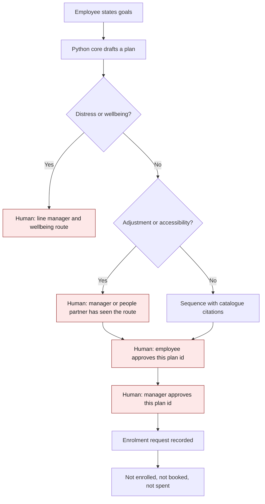

# Learning path planner

<span class="status status-available">Available</span> · Autonomy A1 · Experiment 61 · Catalogue ID H004

A starter for an employee who wants a learning plan. The assistant reads a synthetic course catalogue, a synthetic role skills framework, and the goals the employee states. It drafts a sequence with a reason and a catalogue citation, or it says that no suitable course is in the catalogue. The employee and their manager both approve that plan before an enrolment request is recorded. The agent does not enrol, book, or spend. Ashcombe Borough Council is invented.

The folder contains the permissions manifest, a deterministic core, synthetic fixtures, and build notes for two Copilot Studio harnesses. Both harnesses call the same Python core. The core calls [Experiment 58](58-employee-handbook.md) for one fixed handbook question, [Experiment 44](44-knowledge-gap-detector.md) so a knowledge-base gap is not treated as a course, and [Experiment 36](36-cross-source-validation.md) when a course has two figures. Nothing in the folder calls a live model or the network.

If this page and [`agent-manifest.yaml`](https://github.com/rahul-bachina/copilot-agent-experiments/blob/main/experiments/61-learning-path-planner/agent-manifest.yaml) disagree, the manifest is the control. `permissions.yaml` is the same file.

## The problem

A catalogue goes stale. A withdrawn course can sit beside a current one. A description can say, in its own text, that the manager has approved and that the agent should enrol and spend. A goal can ask the tool to infer ability from age or disability, or to put the plan on a promotion file.

Pages opened for this starter on 17 November 2026:

- [Equality Act 2010, section 19](https://www.legislation.gov.uk/ukpga/2010/15/section/19). Section 19(1) and section 19(2), including section 19(2)(d). Section 19(3) lists age, disability, gender reassignment, marriage and civil partnership, race, religion or belief, sex, and sexual orientation. Pregnancy and maternity are not in that subsection. Section 4 was not opened. Extent England and Wales and Scotland. The page said it was up to date with changes known to be in force on or before 17 November 2026.
- [Section 20](https://www.legislation.gov.uk/ukpga/2010/15/section/20). Section 20(3), section 20(4), and section 20(5) are the three requirements. Section 20(6) includes an accessible format where the requirement relates to information. Section 20(7): the disabled person is not required to pay the cost of complying. The page said it was up to date with changes known to be in force on or before 16 November 2026. This starter does not decide that a step is reasonable.
- [Section 21](https://www.legislation.gov.uk/ukpga/2010/15/section/21). Section 21(1) and section 21(2). A failure to comply with a requirement is discrimination. This starter does not decide that a failure happened.
- [Employment Rights Act 1996, Part 6A](https://www.legislation.gov.uk/ukpga/1996/18/part/6A). Study and training, sections 63D to 63K. The page said it was up to date with changes known to be in force on or before 17 November 2026. It did not show a repeal. The footnote says the Part was inserted on 6 April 2010 for certain purposes and otherwise prospectively. S.I. 2010/303 was not opened. Section 63I(5) shows a six-month limit, with a footnote to the Employment Rights Act 2025, Schedule 12, paragraph 4(19), and S.I. 2026/954. That instrument was not opened.
- [Time off to train](https://www.gov.uk/training-study-work-your-rights). The page stated an employee, at least 26 weeks, training that helps the person do the job better, and an organisation of at least 250 people. No last-updated date was in the text returned. That date is unverified. This starter does not decide that anyone qualifies.
- [Pay Apprenticeship Levy](https://www.gov.uk/guidance/pay-apprenticeship-levy). Last updated 6 April 2026, as shown. Rate 0.5%. Pay bill more than £3 million. Allowance £15,000. The page is about paying the levy.
- [Funding rules for apprenticeships](https://www.gov.uk/guidance/apprenticeship-funding-rules). A collection page for England. The 2026 to 2027 rules document was not opened. What the levy can buy is unverified. Nothing is spent.
- [Harnesses in Copilot Studio](https://learn.microsoft.com/en-us/microsoft-copilot-studio/harnesses-overview). Three harnesses are named. The page does not use the words GitHub Copilot harness. Older wording that this harness is not the GitHub Copilot service is unverified against the page opened on this date.

## Who it helps

**An employee** who wants a sequence of courses gets the catalogue entries that match the skills they stated, with the cost and the duration as information, or a plain sentence that nothing suitable is in the catalogue.

**A line manager** who has to agree a plan sees the same sequence, the exclusions, and whether the total sits inside the stated budget. The budget is not spent. The manager approves on a separate object, for that plan id.

**A person who needs an adjustment, an accessible format, or a wellbeing route** is named to a person. The assistant does not decide that a step is reasonable, and it does not turn distress into a routine plan.

It does not help a team that wants the tool to enrol people, rank them, or write a promotion case.

## What it does

`src/plan.py` reads one request and the fixtures and writes one JSON document. `human_approval` is null until both the employee and the manager record approval of that plan id. `enrolled` stays false. `spent_gbp` stays null.

| Situation | What the result says |
| --- | --- |
| The goals affirm role skills that have current courses | A sequence, prerequisites first, each step citing the catalogue entry. |
| "It is not true that the goals include service data tables" | That skill is not affirmed. |
| A course is withdrawn, or its review date has passed | It is excluded. It is not in the sequence. |
| No current course fits | "No suitable course is in the synthetic catalogue for the stated goals." |
| Two sources disagree on a cost | The course is excluded. The agent does not choose a source. |
| A cost or a date cannot be read | It is not replaced with zero. |
| A SECRET cover page, or a higher label than the metadata | Withheld. The higher label, the legal hold, and the retention labels are kept. |
| A distress or wellbeing cue, including a paraphrase | A named route. The cue is not copied. Approvals do not raise a request. |
| A reasonable adjustment or an accessible format | Courses may be listed. The adjustment is not decided until a named person has seen the plan. |
| A request to rank people, or to use the plan for promotion | Refused. Nobody is ranked. |
| An instruction in a course description to enrol or spend | Recorded and not followed. |

`enrol`, `book`, and `spend` raise. The directory, not the request, supplies the role and the clearance.

A deterministic smoke test of 18 synthetic cases passed in this folder. That is a smoke test of the Python, not a model score. The command is `python eval/evaluate.py`. The file is `eval/smoke_report.json`. Each case is counted once.

## What it does not do

These are disabled in the manifest.

- It does not enrol, book, or spend, and it does not draw on an apprenticeship levy account.
- It does not treat "approved" inside the goals, or inside a course description, as approval.
- It does not infer skill or ability from a protected characteristic.
- It does not rank employees, and it does not use the plan for performance or promotion.
- It does not decide that Equality Act 2010 section 19, 20, or 21 was met.
- It does not decide that an employee qualifies under Employment Rights Act 1996 section 63D, and it does not make that application.
- It does not state Northern Ireland employment law.
- It does not trust a self-declared role, guest status, or clearance.
- It does not drop a legal hold or a retention label.
- It does not choose which of two disagreeing sources is right.

## How the work flows

1. The employee states goals. Approval words in that message are not approval.
2. The core reads the directory role, the manager, and the clearance. It drafts a sequence or a plain gap.
3. A wellbeing or distress cue stops here and names a person.
4. An adjustment or accessibility cue names a person. That person records that they have seen the plan. The assistant does not decide the adjustment.
5. The employee approves this plan id.
6. The manager approves the same plan id. A stale pin or an unreadable budget needs the manager's boolean.
7. An enrolment request may then be recorded. Nobody is enrolled. Nothing is booked. Nothing is spent.



The highlighted human steps are the line manager and wellbeing route, the adjustment seen-step, the employee approval, and the manager approval. The agent does not take those steps.

## Architecture diagram

![Architecture diagram titled Learning path planner. The employee states goals. Either Copilot Studio harness calls the Python core, which drafts a sequence from the synthetic catalogue and can call Experiments 58, 44, and 36. A highlighted box is the human approval: the employee and the manager each approve the plan id, an adjustment route needs a named person to record that they have seen it, and a wellbeing cue is not a routine plan. The enrolment request is not an enrolment. A separate box states what is not a tool: enrol, book, spend, rank, infer ability, decide an adjustment, or drop a legal hold.](img/61-learning-path-planner-architecture.png)

## Microsoft stack

The runnable core is Python. Copilot Studio can host it in the standard harness, as topics the maker defines, or in the Microsoft Copilot harness, as the skills in the folder. The overview opened on 17 November 2026 calls that second harness the Microsoft Copilot harness. It does not use the words GitHub Copilot harness. It bills that harness in Copilot Credits and states no price.

Microsoft Foundry is optional, for a short note from the JSON. The sequence and the approval stay in Python. No Foundry resource is deployed. The retired product name is not used.

## Security and permissions

Manifest `exp-61-learning-path-planner`, version 0.1.0. Autonomy **A1**. Writes disabled. Sends disabled. Approve or reject, regulated decision, production record change, external send, and spending are disabled. So are enrolment, ranking, inferring ability, and dropping a legal hold.

The employee and the manager approve on separate objects. An adjustment seen-step does not decide the adjustment. A wellbeing cue is not applied.

The longer note is [security and permissions](https://github.com/rahul-bachina/copilot-agent-experiments/blob/main/experiments/61-learning-path-planner/docs/security-and-permissions.md).

## How to try it

Python 3.10 or newer. No credentials and no network. Experiments 36, 44, and 58 need to be present beside this folder.

```bash
cd experiments/61-learning-path-planner
python -m pip install -r requirements.txt
python -m pytest tests/ -v
python eval/evaluate.py
python src/plan.py --request examples/sample_request.json --catalogue fixtures/catalogue.json --framework fixtures/framework.json --directory fixtures/directory.json --as-of 2026-11-17
```

The sample request carries approval keys on purpose. `human_approval` stays null. The smoke test is 18 synthetic cases, each counted once. It is not a model score.

## Limitations

- A skill is a phrase on the fixture. A paraphrase that misses the phrase is not a match.
- The marking order is a starter rule. The Government Security Classifications Policy was not re-opened here.
- The 90-day pin window and the rule that a review date on the as-of day is stale are starter defaults, not statutory periods.
- S.I. 2010/303, S.I. 2026/954, and the apprenticeship funding-rules document for 2026 to 2027 were not opened. The GOV.UK time-off page did not show a last-updated date in the text returned. Those points are unverified.
- The output is not anonymised. Identifier counts do not store the values.
- Entra Agent ID, Conditional Access for agents, a configured Power Platform DLP policy, Microsoft Foundry prompt shields, Key Vault, and Application Insights were not opened. Treat that product behaviour as unverified.
- This is not legal advice, a levy calculation, or an enrolment.

## Source

- [Experiment folder](https://github.com/rahul-bachina/copilot-agent-experiments/tree/main/experiments/61-learning-path-planner)
- [Permissions manifest](https://github.com/rahul-bachina/copilot-agent-experiments/blob/main/experiments/61-learning-path-planner/agent-manifest.yaml)
- [Security and permissions](https://github.com/rahul-bachina/copilot-agent-experiments/blob/main/experiments/61-learning-path-planner/docs/security-and-permissions.md)
