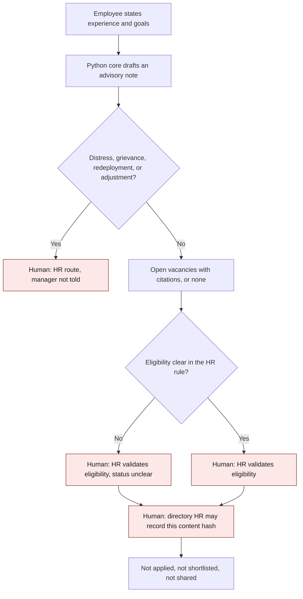

# Internal mobility explorer

<span class="status status-available">Available</span> · Autonomy A0 · Experiment 62 · Catalogue ID H005

A starter for an employee who wants to see which open internal vacancies look relevant. The assistant reads a synthetic vacancy feed, the HR eligibility rules, a synthetic role skills framework, and the experience the employee states. It explains the match and cites the vacancy and the rule, or it says that no open vacancy looks relevant. It flags a closed or stale vacancy. Where eligibility is unclear, it says so. HR validates eligibility. The agent does not apply, nominate, shortlist, or contact anyone, and it does not make a selection decision. Ashcombe Borough Council is invented.

The folder contains the permissions manifest, a deterministic core, synthetic fixtures, and build notes for two Copilot Studio harnesses. Both harnesses call the same Python core. The core calls [Experiment 58](58-employee-handbook.md) for one fixed handbook question, [Experiment 36](36-cross-source-validation.md) when a vacancy has two closing dates, and [Experiment 61](61-learning-path-planner.md) only when the employee asks for a learning plan. That plan is not a selection factor. Nothing in the folder calls a live model or the network.

If this page and [`agent-manifest.yaml`](https://github.com/rahul-bachina/copilot-agent-experiments/blob/main/experiments/62-internal-mobility-explorer/agent-manifest.yaml) disagree, the manifest is the control. `permissions.yaml` is the same file.

## The problem

A vacancy feed goes stale. A closed vacancy can sit beside an open one. A description can say, in its own text, that the reader is already eligible and that the agent should shortlist them and tell their manager. An employee can ask the tool to infer suitability from age, length of service, part-time status, sickness absence, or maternity absence.

Pages opened for this starter on 18 November 2026:

- [Equality Act 2010, section 13](https://www.legislation.gov.uk/ukpga/2010/15/section/13). Section 13(1) is direct discrimination: less favourable treatment because of a protected characteristic. Section 13(2) is the age justification. This starter does not apply it. Extent England and Wales and Scotland. The page said it was up to date with changes known to be in force on or before 18 November 2026.
- [Section 19](https://www.legislation.gov.uk/ukpga/2010/15/section/19). Section 19(1) and section 19(2), including section 19(2)(d). Section 19(3) lists age, disability, gender reassignment, marriage and civil partnership, race, religion or belief, sex, and sexual orientation. Pregnancy and maternity are not in that subsection. Section 4 was not opened.
- [Section 20](https://www.legislation.gov.uk/ukpga/2010/15/section/20). Section 20(3), section 20(4), and section 20(5) are the three requirements. Section 20(6) includes an accessible format. Section 20(7): the disabled person is not required to pay the cost of complying. The page said it was up to date with changes known to be in force on or before 16 November 2026. That banner date is what the page showed when it was opened on 18 November 2026. This starter does not decide that a step is reasonable.
- [Section 21](https://www.legislation.gov.uk/ukpga/2010/15/section/21). Section 21(1) and section 21(2). This starter does not decide that a failure happened. The page said 18 November 2026.
- [Section 39](https://www.legislation.gov.uk/ukpga/2010/15/section/39). Employees and applicants. Section 39(2)(b) covers access to opportunities for promotion, transfer, or training. Section 39(5): a duty to make reasonable adjustments applies to an employer. This starter does not decide that access was afforded or refused.
- [UK GDPR Article 5](https://www.legislation.gov.uk/eur/2016/679/article/5). Article 5(1)(b) is purpose limitation, as amended, including not further processing in a manner incompatible with the purposes for which the controller collected the data. Article 5(3) was read and is not a lawful basis. The footnotes name S.I. 2026/82. That instrument was not opened. The extract did not include a revision-date banner. That banner date is unverified. Article 6 was not opened.
- [UK GDPR Article 22](https://www.legislation.gov.uk/eur/2016/679/article/22). The body was omitted. Chapter 3 Section 4A was substituted by the Data (Use and Access) Act 2025, section 80(1). The old Article 22 wording is not quoted.
- [Article 22A](https://www.legislation.gov.uk/eur/2016/679/article/22A) and [section 80](https://www.legislation.gov.uk/ukpga/2025/18/section/80). A decision is based solely on automated processing if there is no meaningful human involvement. Articles 22B, 22C, and 22D are on the section 80 page. This starter does not take a selection decision and does not decide whether a note would be a significant decision. S.I. 2026/82 was not opened.
- [Harnesses in Copilot Studio](https://learn.microsoft.com/en-us/microsoft-copilot-studio/harnesses-overview). Three harnesses are named. The page does not use the words GitHub Copilot harness. Older wording that this harness is not the GitHub Copilot service is unverified against the page opened on this date.

## Who it helps

**An employee** who wants to see which open vacancies match phrases in the experience they stated gets a list with a reason and a citation, or a plain sentence that nothing open looks relevant. Eligibility is left with HR.

**HR** who owns the eligibility rules sees the same citations, the closed and stale flags, and a seen-step that is bound to that exact note. The seen-step does not decide eligibility and does not tell the manager.

**A person who needs an adjustment, who is at risk of redeployment, or who shows distress or a grievance** is named to HR. The assistant does not turn that into a vacancy list.

It does not help a team that wants the tool to shortlist people, score them, or tell a manager who is interested.

## What it does

`src/explore.py` reads one request and the fixtures and writes one JSON document. `hr_seen.recorded` is false until a directory HR reviewer records that they have seen that exploration id and that content hash. `applied`, `nominated`, `shortlisted`, and `contacted` stay false. `selection_made` stays false. `eligibility_decided` stays false.

| Situation | What the result says |
| --- | --- |
| The experience affirms a phrase the vacancy lists | The vacancy is listed, in vacancy-id order, with a citation to the vacancy and the HR rule. |
| "It is not true that my experience includes service data tables" | That phrase is not affirmed. |
| A vacancy is closed, past its closing date, or due for review | It is flagged. It is not listed as open. |
| No open vacancy fits | "No open vacancy in the synthetic feed looks relevant." |
| Two closing dates disagree | The vacancy is flagged. The agent does not choose a date. |
| A date cannot be read | It is not replaced with zero or with today. |
| The HR rule is missing or not clear | "Eligibility is unclear. HR validates eligibility." |
| A SECRET cover page, or a higher label than the metadata | Flagged. The higher label, the legal hold, and the retention labels are kept. |
| A distress, grievance, redeployment, or adjustment cue, including a paraphrase | A named route to HR. The cue is not copied. No vacancy list. |
| A request to rank, score, shortlist, or tell the manager | Refused. Nothing is sent. |
| An instruction in a vacancy to shortlist or to strip a label | Recorded and not followed. |

`apply`, `nominate`, `shortlist`, and `contact` raise. The directory, not the request, supplies the role and the clearance. Length of service, part-time status, age, sickness, and maternity on the directory are not read.

A deterministic smoke test of 18 synthetic cases passed in this folder. That is a smoke test of the Python, not a model score. The command is `python eval/evaluate.py`. The file is `eval/smoke_report.json`. Each case is counted once.

## What it does not do

These are disabled in the manifest.

- It does not apply, nominate, shortlist, or contact anyone.
- It does not share the employee's interest with their manager or with recruiters.
- It does not make or imply a selection decision, and it does not rank or score employees.
- It does not decide that a person is eligible or ineligible.
- It does not infer suitability from a protected characteristic or from age, length of service, part-time status, sickness absence, or maternity absence.
- It does not decide that Equality Act 2010 section 13, 19, 20, 21, or 39 was met.
- It does not decide that UK GDPR Article 5 or Articles 22A to 22D were met.
- It does not state Northern Ireland employment equality law.
- It does not trust a self-declared role, guest status, or clearance.
- It does not drop a legal hold or a retention label.
- It does not choose which of two closing dates is right.

## How the work flows

1. The employee states experience and goals. Approval words in that message are not a seen-step.
2. The core reads the directory role and the clearance. It lists open vacancies that match a stated phrase, or it says none do. It flags closed and stale vacancies.
3. A wellbeing, grievance, redeployment, or adjustment cue stops here and names HR. The manager is not told.
4. HR validates eligibility. The assistant does not.
5. A directory HR reviewer may record that they have seen this exact note, by exploration id and content hash. A manager or a recruiter cannot record that step.
6. Nothing is applied. Nobody is nominated, shortlisted, or contacted.



The highlighted human steps are the HR route, eligibility validation, and the optional seen-step bound to the content hash. The agent does not take those steps. The manager and the recruiter are not notified.

## Architecture diagram

![Architecture diagram titled Internal mobility explorer. The employee states experience. Either Copilot Studio harness calls the Python core, which lists relevant vacancies from the synthetic feed and can call Experiments 58, 36, and 61. A highlighted box is the human point: HR validates eligibility, a directory HR reviewer may record that they have seen the exact note, and a distress, grievance, redeployment, or adjustment cue is a route to HR. The manager is not told. A separate box states what is not a tool: apply, nominate, shortlist, contact, share with a manager, rank or score, decide eligibility, or drop a legal hold.](img/62-internal-mobility-explorer-architecture.png)

## Microsoft stack

The runnable core is Python. Copilot Studio can host it in the standard harness, as topics the maker defines, or in the Microsoft Copilot harness, as the skills in the folder. The overview opened on 18 November 2026 calls that second harness the Microsoft Copilot harness. It does not use the words GitHub Copilot harness. It bills that harness in Copilot Credits and states no price.

Microsoft Foundry is optional, for a short note from the JSON. The vacancy list and the eligibility wording stay in Python. No Foundry resource is deployed. The retired product name is not used.

## Security and permissions

Manifest `exp-62-internal-mobility-explorer`, version 0.1.0. Autonomy **A0**. Writes disabled. Sends disabled. Approve or reject, regulated decision, production record change, external send, and spending are disabled. So are applying, shortlisting, sharing interest, ranking, inferring suitability, and dropping a legal hold.

HR validates eligibility. The seen-step does not decide it. A manager or a recruiter cannot record it. A human route is not a vacancy list.

The longer note is [security and permissions](https://github.com/rahul-bachina/copilot-agent-experiments/blob/main/experiments/62-internal-mobility-explorer/docs/security-and-permissions.md).

## How to try it

Python 3.10 or newer. No credentials and no network. Experiments 36, 58, and 61 need to be present beside this folder.

```bash
cd experiments/62-internal-mobility-explorer
python -m pip install -r requirements.txt
python -m pytest tests/ -v
python eval/evaluate.py
python src/explore.py --request examples/sample_request.json --vacancies fixtures/vacancies.json --rules fixtures/eligibility.json --framework fixtures/framework.json --directory fixtures/directory.json --as-of 2026-11-18
```

The sample request carries approval keys on purpose. `hr_seen.recorded` stays false. The smoke test is 18 synthetic cases, each counted once. It is not a model score.

## Limitations

- A criterion is a phrase on the fixture. A paraphrase that misses the phrase is not a match.
- The list order is vacancy id. It is not a measure of fit. There is no score.
- The marking order is a starter rule. The Government Security Classifications Policy was not re-opened here.
- The 90-day pin window, the rule that a review date on the as-of day is stale, and the rule that a closing date on the as-of day is still open are starter defaults, not statutory periods.
- S.I. 2026/82 was not opened. The Article 5 extract did not include a revision-date banner. The old Article 22 wording was not on the page. Those points are unverified.
- The output is not anonymised. Identifier counts do not store the values.
- Entra Agent ID, Conditional Access for agents, a configured Power Platform DLP policy, Microsoft Foundry prompt shields, Key Vault, and Application Insights were not opened. Treat that product behaviour as unverified.
- This is not legal advice, an eligibility decision, or an application.

## Source

- [Experiment folder](https://github.com/rahul-bachina/copilot-agent-experiments/tree/main/experiments/62-internal-mobility-explorer)
- [Permissions manifest](https://github.com/rahul-bachina/copilot-agent-experiments/blob/main/experiments/62-internal-mobility-explorer/agent-manifest.yaml)
- [Security and permissions](https://github.com/rahul-bachina/copilot-agent-experiments/blob/main/experiments/62-internal-mobility-explorer/docs/security-and-permissions.md)
