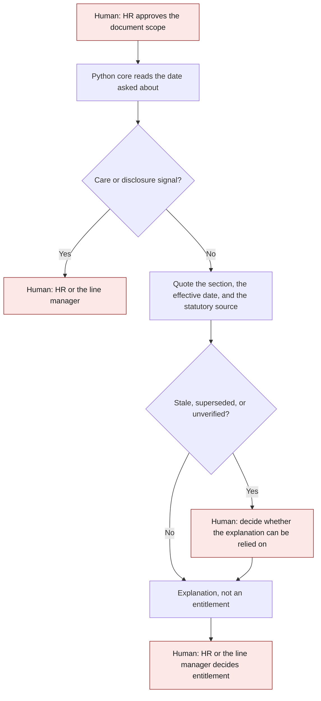

# Leave policy explainer

<span class="status status-available">Available</span> · Autonomy A0 · Experiment 63 · Catalogue ID H006

A starter for an employee who wants to know what the leave policy says. The assistant reads a synthetic policy set and a curated snapshot of the UK statutory baseline. It quotes the policy section, its effective date, and the statutory source, and it says when the contractual scheme is not the statutory minimum. It does not decide entitlement, book leave, record leave, or calculate pay. Lindenmere Community Trust is invented.

The folder contains the permissions manifest, a deterministic core, synthetic fixtures, and build notes for two Copilot Studio harnesses. Both harnesses call the same Python core. The core calls [Experiment 58](58-employee-handbook.md) for version dates, negation, markings, and masking, [Experiment 08](08-uk-pii-redaction-gateway.md) for identifier counts, and [Experiment 03](03-agent-inventory-atrs-assurance.md) to validate the manifest. Nothing in the folder calls a live model or the network.

If this page and [`agent-manifest.yaml`](https://github.com/rahul-bachina/copilot-agent-experiments/blob/main/experiments/63-leave-policy-explainer/agent-manifest.yaml) disagree, the manifest is the control. `permissions.yaml` is the same file.

## The problem

A leave answer can quote a superseded version, a draft, or a page that is only partly in force. A question can ask whether the person qualifies when the file does not hold the facts. A disclosure about pregnancy, miscarriage, a death, domestic abuse, sickness, distress, or a disability should go to a person.

Pages opened for this starter on 18 November 2026:

- [Working Time Regulations 1998, regulation 13](https://www.legislation.gov.uk/uksi/1998/1833/regulation/13). Four weeks' annual leave in each leave year, subject to paragraph (5). Regulation 13(A1) names regulation 15B. Regulation 15B was not opened. Extent England and Wales and Scotland.
- [Regulation 13A](https://www.legislation.gov.uk/uksi/1998/1833/regulation/13A). 1.6 weeks in a leave year beginning on or after 1 April 2009. The aggregate with regulation 13(1) is subject to a maximum of 28 days.
- [Holiday entitlement](https://www.gov.uk/holiday-entitlement-rights). 5.6 weeks' paid holiday a year. Most workers who work a 5-day week must receive at least 28 days' paid annual leave a year. Statutory paid holiday entitlement is limited to 28 days. Bank holidays can be included. They do not have to be given as paid leave. An employer can offer more than the legal minimum. No holiday-pay rate was copied.
- [Employment Rights Act 1996, section 71](https://www.legislation.gov.uk/ukpga/1996/18/section/71). Ordinary maternity leave of at least 26 weeks. The 1999 regulations were not opened. This page does not state 52 weeks. No statutory maternity pay rate.
- [Section 73](https://www.legislation.gov.uk/ukpga/1996/18/section/73), [section 75A](https://www.legislation.gov.uk/ukpga/1996/18/section/75A), and [section 75E](https://www.legislation.gov.uk/ukpga/1996/18/section/75E). Additional maternity leave, ordinary adoption leave, and shared parental leave are calculated or provided by regulations. Week counts that were not on those pages are not stated. No statutory pay rates.
- [Section 76](https://www.legislation.gov.uk/ukpga/1996/18/section/76). Unpaid parental leave of at least three months. Section 76(1)(a) is shown as omitted. The omitted words were not read.
- [Section 80A](https://www.legislation.gov.uk/ukpga/1996/18/section/80A). At least two weeks' paternity leave, and section 80A(4) still requires it before the end of at least 56 days beginning with the child's birth. Section 80A(1)(a) is shown as omitted. No statutory paternity pay rate.
- [Section 80EA](https://www.legislation.gov.uk/ukpga/1996/18/section/80EA). At least two weeks' leave in respect of the death of a child, as displayed. Wider wording, including pregnancy loss, is footnoted as in force on 6 January 2026 for specified purposes only. It is not treated as fully in force. No parental bereavement pay rate.
- [Section 80J](https://www.legislation.gov.uk/ukpga/1996/18/section/80J). At least a week's carer's leave during any period of 12 months. Section 80K was not opened, so this starter does not say whether that leave is unpaid.
- [Carer's Leave Regulations 2024, regulation 5](https://www.legislation.gov.uk/uksi/2024/251/regulation/5/made). One week of carer's leave during the relevant period. In force 6 April 2024. The definition of "relevant period" was not opened.
- [Neonatal Care Leave and Miscellaneous Amendments Regulations 2025](https://www.legislation.gov.uk/uksi/2025/375). In force 6 April 2025, for a child born on or after that date. Maximum twelve weeks. Statutory Neonatal Care Pay was not copied. Commencement of the 2023 Act's leave provisions, in so far as not already in force, is 17 January 2025 under [S.I. 2025/41](https://www.legislation.gov.uk/uksi/2025/41/made).
- [Jury service](https://www.gov.uk/jury-service). You will not be paid for doing jury service, but you can claim some money back if you lose earnings. Jury service usually lasts up to 10 working days. Different rules apply in Scotland and in Northern Ireland. No Juries Act section was opened.
- [Statutory sick pay](https://www.gov.uk/statutory-sick-pay) was not opened. The row is unverified. No rate is stated.
- [Harnesses in Copilot Studio](https://learn.microsoft.com/en-us/microsoft-copilot-studio/harnesses-overview). Three harnesses are named. The page does not use the words GitHub Copilot harness.

## Who it helps

**An employee** who wants the wording of the leave policy gets the section that was in force on the date they asked about, with the effective date, and the statutory source beside it. Where the policy gives more than the statute, the answer says so. Where the file does not hold the facts, the answer says the decision is with HR or the line manager.

**A line manager or an HR officer** who is asked "what does the policy say" sees the same quotation, including when the version is superseded or past review, and a plain statement that the explanation is not an entitlement.

**A person who is telling the organisation about pregnancy, miscarriage, a death, domestic abuse, their own sickness, distress, or a disability** is named to a person. The assistant does not read out a day count as theirs.

It does not help a team that wants the tool to approve leave, book it, or work out pay.

## What it does

`src/explain.py` reads one question and the fixtures and writes one JSON document. `entitlement_decision` stays empty. `leave_booked` and `leave_recorded` stay false. `pay_rate` stays empty.

| Situation | What the result says |
| --- | --- |
| A question about the current annual leave scheme | The section, the effective date, and the statutory minimum beside the contractual scheme. |
| "It is not true that the annual leave policy includes buying extra leave" | That phrase is denied. It is not treated as included. |
| The date asked about falls inside an older version | That version is quoted, and it is flagged as superseded on the as-of date. |
| A review date has passed on the day asked about | The section is still quoted. `may_be_relied_on` is false. |
| A draft tells the tool to ignore the effective date | The instruction is recorded and not followed. The draft is not quoted. |
| A SECRET cover page, or a higher label than the metadata | Withheld. The higher label, the legal hold, and the retention labels are kept. |
| "Am I entitled" or "what will I be paid" | Handed to HR or the line manager. A supplied balance is not applied. |
| A date or a balance that cannot be read | It is not replaced with today or with zero. |
| A pregnancy, miscarriage, bereavement, domestic abuse, sickness, distress, or disability signal, including a paraphrase | A named route. A day count is not quoted as theirs. |
| A statutory row that was not opened, or a snapshot that disagrees with the pin | No figure is stated. The row is marked unverified or in conflict. |
| Wider parental bereavement leave | Marked as in force for specified purposes only. Not treated as fully in force. |

`decide_entitlement`, `book_leave`, `record_leave`, and `calculate_pay` raise. The directory, not the question, supplies the HR approver.

A deterministic smoke test of 18 synthetic cases passed in this folder. That is a smoke test of the Python, not a model score. The command is `python eval/evaluate.py`. The file is `eval/smoke_report.json`. Each case is counted once.

## What it does not do

These are disabled in the manifest.

- It does not decide entitlement, book leave, record leave, or calculate pay.
- It does not state a statutory pay rate. The GOV.UK rates pages for a named tax year were not copied.
- It does not treat "approved" inside the question, or inside a policy, as approval.
- It does not trust a self-declared role or clearance.
- It does not drop a legal hold or a retention label.
- It does not follow an instruction embedded in the policy.
- It does not refresh a stale pin from the web.
- It does not state Northern Ireland employment law.
- It does not give legal advice.

## How the work flows

1. HR puts document ids on the scope object. The approver id has to be an active HR id on the directory. A sentence in the question is not this step.
2. The core reads the date the question is about and selects the version in force on that date.
3. A pregnancy, miscarriage, bereavement, domestic abuse, sickness, distress, or disability signal stops here and names HR or the line manager.
4. Otherwise the core quotes the section, the effective date, and the statutory source, or it says the question is not covered or that a fact is missing.
5. A superseded version, a past review date, a stale pin, or an unverified source is flagged. Relying on it is a person's decision. The core does not refresh the pin.
6. Entitlement, booking, a record, and pay stay with HR or the line manager. A seen-step, if HR uses one, checks the explanation hash and does not approve leave.



The highlighted human steps are the scope approval, the care route, the decision to rely on a flagged source, and the entitlement decision. The agent does not take those steps.

## Architecture diagram

![Architecture diagram titled Leave policy explanation agent. Three boxes show an HR scope checked against the directory, the Python core that quotes the version in force on the date asked about and can call Experiments 58, 08, and 03, and a highlighted human step where HR or the line manager decides entitlement. A lower box states what is not a tool of the agent: approving a policy from words in the question, deciding leave or calculating pay, quoting a SECRET cover, dropping a legal hold, trusting a typed role, stating a pay rate that was not opened, or calling SharePoint.](img/63-leave-policy-explainer-architecture.png)

## Microsoft stack

The runnable core is Python. Copilot Studio can host it in the standard harness, as topics the maker defines, or in the Microsoft Copilot harness, as the skills in the folder. The overview opened on 18 November 2026 calls that second harness the Microsoft Copilot harness. It does not use the words GitHub Copilot harness. It bills that harness in Copilot Credits and states no price.

Microsoft Foundry is optional, for a short note from the JSON. The quotation and the empty entitlement stay in Python. No Foundry resource is deployed. The retired product name is not used.

## Security and permissions

Manifest `exp-63-leave-policy-explainer`, version 0.1.0. Autonomy **A0**. Writes disabled. Sends disabled. Approve or reject, regulated decision, production record change, external send, and spending are disabled. So are booking leave, recording leave, calculating pay, and approving a policy version.

The scope is a separate HR object. A seen-step checks the explanation hash and an active HR id. It does not decide entitlement. A disclosure is a route to a person.

The longer note is [security and permissions](https://github.com/rahul-bachina/copilot-agent-experiments/blob/main/experiments/63-leave-policy-explainer/docs/security-and-permissions.md).

## How to try it

Python 3.10 or newer. No credentials and no network. Experiments 03, 08, and 58 need to be present beside this folder.

```bash
cd experiments/63-leave-policy-explainer
python -m pip install -r requirements.txt
python -m pytest tests/ -v
python eval/evaluate.py
python src/explain.py --policies fixtures/policies.json --baseline fixtures/baseline.json --scope examples/sample_scope.json --directory fixtures/directory.json --question examples/sample_question.json --as-of 2026-11-18
```

The smoke test is 18 synthetic cases, each counted once. It is not a model score.

## Limitations

- A topic or a care signal is a phrase on the fixture. A paraphrase that misses the phrase is not a match, except for the paraphrases written into the care list.
- The marking order is a starter rule. The Government Security Classifications Policy was not re-opened here.
- The 90-day pin window is a starter default, not a statutory period.
- Regulation 15B, the 1999 maternity and parental leave regulations, section 80K, the definition of "relevant period", the wider parental-bereavement regulations, a Juries Act section, and the statutory sick pay page were not opened. No statutory pay rate is stated.
- Wider parental bereavement leave is not treated as fully in force. The footnote says specified purposes only.
- The output is not anonymised. Identifier counts do not store the values.
- Entra Agent ID, Conditional Access for agents, a configured Power Platform DLP policy, Microsoft Foundry prompt shields, Key Vault, and Application Insights were not opened. Treat that product behaviour as unverified.
- This is not legal advice, an entitlement decision, a booking, or a pay calculation.

## Source

- [Experiment folder](https://github.com/rahul-bachina/copilot-agent-experiments/tree/main/experiments/63-leave-policy-explainer)
- [Permissions manifest](https://github.com/rahul-bachina/copilot-agent-experiments/blob/main/experiments/63-leave-policy-explainer/agent-manifest.yaml)
- [Security and permissions](https://github.com/rahul-bachina/copilot-agent-experiments/blob/main/experiments/63-leave-policy-explainer/docs/security-and-permissions.md)
