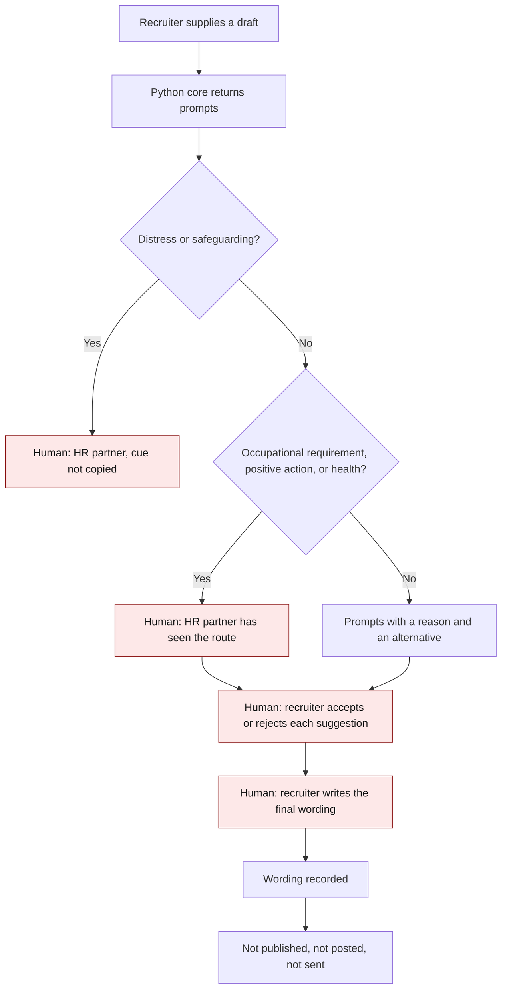

# Job description quality checker

<span class="status status-available">Available</span> · Autonomy A0 · Experiment 64 · Catalogue ID H007

A starter for a recruiter who is writing a job description. The assistant reads one synthetic draft and one synthetic style and grading guide. It returns prompts: a reason and a suggested alternative for wording a person should look at. The recruiter accepts or rejects each suggestion and writes the final wording. The agent does not publish, post, or send an advert. Ashcombe Borough Council is invented.

The folder contains the permissions manifest, a deterministic core, synthetic fixtures, and build notes for two Copilot Studio harnesses. Catalogue row H007 names the Microsoft Copilot harness first. Both harnesses call the same Python core. The core calls [Experiment 08](08-uk-pii-redaction-gateway.md) when an identifier is pasted in, and [Experiment 36](36-cross-source-validation.md) when a salary or a grade is stated in two places. Nothing in the folder calls a live model or the network.

If this page and [`agent-manifest.yaml`](https://github.com/rahul-bachina/copilot-agent-experiments/blob/main/experiments/64-job-description-quality/agent-manifest.yaml) disagree, the manifest is the control. `permissions.yaml` is the same file.

## The problem

A draft can demand a native English speaker, a degree the grade does not record, or a health history before a job is offered. It can also say, in its own text, that the recruiter has already approved it and that the tool should publish it. A right-to-work sentence or a Disability Confident sentence has to stay.

Pages opened for this starter on 18 November 2026:

- [Equality Act 2010, section 13](https://www.legislation.gov.uk/ukpga/2010/15/section/13). Section 13(1). Extent E+W+S. The page said it was up to date with changes known to be in force on or before 18 November 2026. This starter does not decide that less favourable treatment occurred.
- [Section 19](https://www.legislation.gov.uk/ukpga/2010/15/section/19). Section 19(1) and 19(2), including 19(2)(d). Section 19(3) lists age, disability, gender reassignment, marriage and civil partnership, race, religion or belief, sex, and sexual orientation. The page stamp was 18 November 2026. This starter does not apply that test.
- [Section 39](https://www.legislation.gov.uk/ukpga/2010/15/section/39). Section 39(1)(a) to (c), on arrangements for deciding to whom to offer employment. The page stamp was 18 November 2026. This starter does not decide a contravention.
- [Section 60](https://www.legislation.gov.uk/ukpga/2010/15/section/60). Section 60(1) on questions about health before an offer of work. Section 60(6) lists purposes the section does not apply to. This starter does not decide that a purpose is met. The page stamp was 17 November 2026.
- [Section 159](https://www.legislation.gov.uk/ukpga/2010/15/section/159). Section 159(4) on positive action in recruitment or promotion. The page stamp was 15 November 2026. This starter does not decide that the section permits the draft.
- [Schedule 9, paragraph 1](https://www.legislation.gov.uk/ukpga/2010/15/schedule/9/paragraph/1). Paragraph 1(1) on an occupational requirement. The page stamp was 14 November 2026. This starter does not decide that the paragraph is met.
- [Immigration, Asylum and Nationality Act 2006, section 15](https://www.legislation.gov.uk/ukpga/2006/13/section/15). Section 15(1) and 15(2), as context for keeping a right-to-work statement. The order under section 15(3) was not opened. No person's leave is checked. The page stamp was 16 November 2026.
- [Harnesses in Copilot Studio](https://learn.microsoft.com/en-us/microsoft-copilot-studio/harnesses-overview). Three harnesses are named. The page does not use the words GitHub Copilot harness. Older wording that this harness is not the GitHub Copilot service is unverified against the page opened on this date.

The Disability Confident scheme page was not opened. A phrase is kept when the organisation's guide marks it as mandated.

## Who it helps

**A recruiter** who is still drafting gets a list of prompts, each with a reason and a suggested alternative, or a plain statement that nothing in the example list was affirmed.

**An HR partner** who is asked about an occupational requirement, positive action, or a health question gets a route. The assistant does not decide the legal question.

**A person named in a distress or safeguarding cue** is not turned into a routine wording review. The cue is not copied. A person is the route.

It does not help a team that wants the tool to publish the advert, score candidates, or decide that the wording is lawful.

## What it does

`src/review.py` reads one request and the fixtures and writes one JSON document. `human_approval` is null until the recruiter records the final wording. `published` stays false.

| Situation | What the result says |
| --- | --- |
| The draft affirms an example phrase, such as "young and dynamic" or "native English speaker" | A prompt, with a suggested alternative. The list is an example the organisation must review. It is not a statistic and it is not legal advice. |
| "It is not true that the role requires a native English speaker" | That phrase is not affirmed. |
| A salary or a location the guide requires is missing | A prompt. The figure is not invented. |
| A salary cannot be read | It is not replaced with zero. |
| Two salary figures disagree | Experiment 36 compares them. The agent does not choose a source. |
| A duty the guide says is not this grade | A prompt. The grade is not rewritten. |
| An essential criterion is not linked to a duty | A prompt. The criterion is not held to be unlawful. |
| Words that may be an occupational requirement, positive action, or a health question | A route to HR. The question is not decided. |
| A right-to-work or Disability Confident sentence the guide lists | Kept. An instruction to strip it is not followed. |
| A SECRET cover page, or a higher label than the metadata | Withheld. The higher label, the legal hold, and the retention labels are kept. |
| A distress or safeguarding cue, including a paraphrase | A named route. The cue is not copied. |
| A request to score candidates | Refused. Nobody is scored. |
| An instruction in the draft to publish | Recorded and not followed. |

`publish`, `post`, and `send` raise. The directory, not the draft, supplies the role and the clearance.

A deterministic smoke test of 20 synthetic cases passed in this folder. That is a smoke test of the Python, not a model score. The command is `python eval/evaluate.py`. The file is `eval/smoke_report.json`. Each case is counted once.

## What it does not do

These are disabled in the manifest.

- It does not publish, post, or send an advert.
- It does not treat "approved" inside the draft as approval.
- It does not score candidates, rank applicants, or score an advert against people.
- It does not decide that Equality Act 2010 section 13, 19, 39, 60, or 159, or Schedule 9 paragraph 1, was met or contravened.
- It does not check a person's right to work and it does not give a penalty under the Immigration, Asylum and Nationality Act 2006, section 15.
- It does not state Northern Ireland employment law.
- It does not trust a self-declared role, guest status, or clearance.
- It does not drop a legal hold, a retention label, or a mandated statement that was present.
- It does not choose which of two disagreeing figures is right.
- It does not give legal advice.

## How the work flows

1. The recruiter supplies a draft and the question date. Approval words in that draft are not approval.
2. The core reads the directory role and the clearance. It returns prompts, or it stops for a person.
3. A distress, vulnerability, or safeguarding cue stops here and names a person.
4. An occupational requirement, positive action, or a health question names HR. That person records that they have seen the route. The assistant does not decide it.
5. The recruiter accepts or rejects each suggestion, for that suggestion's hash and the draft hash.
6. The recruiter writes the final wording. The record is bound to the hash of that text. A stale guide or an unconfirmed pin needs the recruiter's boolean.
7. Nothing is published, posted, or sent.



The highlighted human steps are the HR route for a cue, the HR seen-step, the recruiter's decision on each suggestion, and the recruiter's own wording. The agent does not take those steps.

## Architecture diagram

![Architecture diagram titled Job description quality checker. A draft and a guide enter either Copilot Studio harness, which calls the Python core. The core can call Experiments 08 and 36 and returns prompts. A highlighted box is the human approval: the recruiter accepts or rejects each suggestion, HR sees a route, and the recruiter writes the final wording. Nothing is published. A separate box lists what is not a tool: publish, score candidates, decide Schedule 9 or section 159, or strip a mandated statement.](img/64-job-description-quality-architecture.png)

## Microsoft stack

The runnable core is Python. Copilot Studio can host it in the standard harness, as topics the maker defines, or in the Microsoft Copilot harness, as the skills in the folder. The overview opened on 18 November 2026 calls that second harness the Microsoft Copilot harness. It does not use the words GitHub Copilot harness. The prose says that harness uses Copilot Credits and states no price. Catalogue row H007 names it first. The approval gates are the same in both harnesses.

Microsoft Foundry is optional, for a short note from the JSON. The prompts and the approval stay in Python. No Foundry resource is deployed. The retired product name is not used.

## Security and permissions

Manifest `exp-64-job-description-quality`, version 0.1.0. Autonomy **A0**. Writes disabled. Sends disabled. Approve or reject, regulated decision, production record change, external send, and spending are disabled. So are publication, scoring, deciding an occupational requirement, and dropping a legal hold.

The recruiter and the HR partner act on separate objects. A seen-step does not decide the legal question. A distress cue is not a routine review.

The longer note is [security and permissions](https://github.com/rahul-bachina/copilot-agent-experiments/blob/main/experiments/64-job-description-quality/docs/security-and-permissions.md).

## How to try it

Python 3.10 or newer. No credentials and no network. Experiments 08 and 36 need to be present beside this folder.

```bash
cd experiments/64-job-description-quality
python -m pip install -r requirements.txt
python -m pytest tests/ -v
python eval/evaluate.py
python src/review.py --request examples/sample_request.json --guide fixtures/guide.json --directory fixtures/directory.json --as-of 2026-11-14
```

The sample request carries approval keys on purpose. `human_approval` stays null. The smoke test is 20 synthetic cases, each counted once. It is not a model score.

## Limitations

- A phrase is an example on the list. A paraphrase that misses the phrase is not a match. The list is not a statistic.
- The marking order is a starter rule. The Government Security Classifications Policy was not re-opened here.
- Treating the guide as stale on its review-due date is a starter rule, not a statutory period.
- The order under section 15(3) was not opened. The Disability Confident scheme page was not opened. Those points are unverified.
- A question date later than a page stamp is not treated as covered by that pin.
- The output is not anonymised. Identifier counts do not store the values.
- Entra Agent ID, Conditional Access for agents, a configured Power Platform DLP policy, Microsoft Foundry prompt shields, Key Vault, Purview, and Application Insights were not opened. Treat that product behaviour as unverified.
- This is not legal advice, a recruitment decision, or an advert.

## Source

- [Experiment folder](https://github.com/rahul-bachina/copilot-agent-experiments/tree/main/experiments/64-job-description-quality)
- [Permissions manifest](https://github.com/rahul-bachina/copilot-agent-experiments/blob/main/experiments/64-job-description-quality/agent-manifest.yaml)
- [Security and permissions](https://github.com/rahul-bachina/copilot-agent-experiments/blob/main/experiments/64-job-description-quality/docs/security-and-permissions.md)
