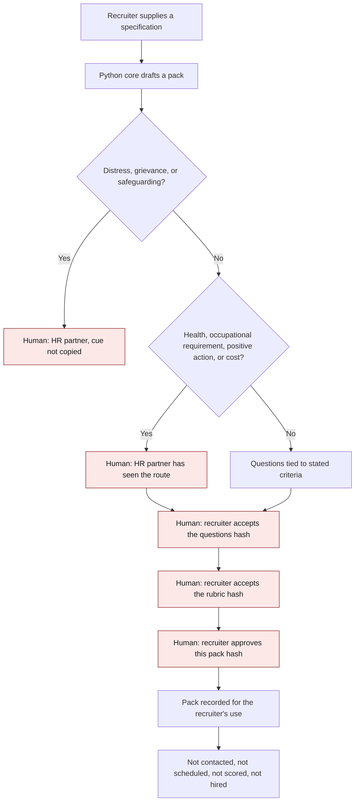

# Interview pack builder

<span class="status status-available">Available</span> · Autonomy A1 · Experiment 65 · Catalogue ID H008

A starter for a recruiter who is writing an interview pack. The assistant reads one synthetic job description, one synthetic person specification, and one synthetic interview guide. It drafts a question for each essential criterion, a behaviourally anchored rubric, reasonable-adjustment prompts for the invitation, and the guide's note-taking rules. The recruiter approves the questions and the rubric before the pack is for use. The agent does not contact candidates, schedule interviews, score or rank anyone, or make a hiring decision. Ashcombe Borough Council is invented.

The folder contains the permissions manifest, a deterministic core, synthetic fixtures, and build notes for two Copilot Studio harnesses. Catalogue row H008 names the Microsoft Copilot harness first. Both harnesses call the same Python core. The core calls [Experiment 08](08-uk-pii-redaction-gateway.md) when an identifier is pasted in, and [Experiment 64](64-job-description-quality.md) for the example wording list. Nothing in the folder calls a live model or the network.

If this page and [`agent-manifest.yaml`](https://github.com/rahul-bachina/copilot-agent-experiments/blob/main/experiments/65-interview-pack-builder/agent-manifest.yaml) disagree, the manifest is the control. `permissions.yaml` is the same file.

## The problem

A pack can ask someone's age, their childcare plans, or their sick days, and it can say, in its own text, that the recruiter has already approved it and that the tool should email the candidate. A right-to-work sentence has to stay. A SECRET cover page must not be copied. A question has to stay tied to a criterion the person specification actually states.

Pages opened for this starter on 19 November 2026:

- [Equality Act 2010, section 13](https://www.legislation.gov.uk/ukpga/2010/15/section/13). Section 13(1). Extent E+W+S. The page said it was up to date with changes known to be in force on or before 18 November 2026. This starter does not decide that less favourable treatment occurred.
- [Section 15](https://www.legislation.gov.uk/ukpga/2010/15/section/15). Section 15(1), discrimination arising from disability. A sickness-absence question is routed, not decided. The page stamp was 18 November 2026.
- [Section 19](https://www.legislation.gov.uk/ukpga/2010/15/section/19). Section 19(1) and 19(2), including 19(2)(d). Section 19(3) lists age, disability, gender reassignment, marriage and civil partnership, race, religion or belief, sex, and sexual orientation. Pregnancy and maternity are not in that list. The page stamp was 18 November 2026.
- [Section 20](https://www.legislation.gov.uk/ukpga/2010/15/section/20). Section 20(7): a person subject to the duty is not entitled to require a disabled person to pay the costs of complying. Schedule 8 was not opened. The page stamp was 18 November 2026. This starter does not decide that the duty arose.
- [Section 39](https://www.legislation.gov.uk/ukpga/2010/15/section/39). Section 39(1)(a) and section 39(5). The page stamp was 18 November 2026.
- [Section 60](https://www.legislation.gov.uk/ukpga/2010/15/section/60). Section 60(1) on health questions before an offer. Section 60(6) is not decided. The page stamp was 17 November 2026.
- [Section 158](https://www.legislation.gov.uk/ukpga/2010/15/section/158) and [section 159](https://www.legislation.gov.uk/ukpga/2010/15/section/159). Positive action is routed, not decided. Section 158 was stamped 19 November 2026. Section 159 was stamped 18 November 2026.
- [Schedule 9, paragraph 1](https://www.legislation.gov.uk/ukpga/2010/15/schedule/9/paragraph/1). An occupational requirement is routed, not decided. The page stamp was 14 November 2026.
- [ICO recruitment and selection](https://ico.org.uk/for-organisations/uk-gdpr-guidance-and-resources/employment/recruitment-and-selection/). Draft guidance. The page says the consultation is closed and the final version will be published in due course, and that the guidance is under review because of the Data (Use and Access) Act.
- [Employment practices code (PDF)](https://ico.org.uk/media2/migrated/1064/the_employment_practices_code.pdf). Paragraphs 1.5.1 and 1.7.1 were read. Status as current guidance is unverified. A subject-access fee in the PDF is not relied on.
- [Harnesses in Copilot Studio](https://learn.microsoft.com/en-us/microsoft-copilot-studio/harnesses-overview). Three harnesses are named. The page does not use the words GitHub Copilot harness. Older wording that this harness is not the GitHub Copilot service is unverified against the page opened on this date.

## Who it helps

**A recruiter** who is drafting questions gets one question per essential criterion, a rubric whose missing anchors are left blank, and adjustment wording for an invitation they have not sent.

**An HR partner** who is asked about a health question, an occupational requirement, positive action, or a sentence that makes the candidate pay gets a route. The assistant does not decide the legal question.

**A person named in a distress, grievance, or safeguarding cue** is not turned into a routine pack. The cue is not copied. A person is the route.

It does not help a team that wants the tool to email candidates, book the interview, score people, or decide who is hired.

## What it does

`src/pack.py` reads one request and the fixtures and writes one JSON document. `human_approval` is null until the recruiter approves that pack hash. `contacted` stays false.

| Situation | What the result says |
| --- | --- |
| An essential criterion is stated and is not a probe | One competency or strengths question, tied to that criterion id |
| A desirable criterion, and `ask_desirable` is not the boolean true | No question. The criterion is not invented into the pack |
| "How old are you?", including a reworded form | Excluded. The category is age. The excerpt is not stored |
| "It is not true that the interview includes a question about your age" | Age is not affirmed |
| "Do you have the right to work in the United Kingdom?" | Not a nationality probe. Nobody's leave is checked |
| "How many sick days did you take last year?" | A route under section 60 and section 15. Neither is decided |
| "This post is reserved for women." | A route under Schedule 9 paragraph 1. It is not decided |
| "Applicants must pay for the adjustment." | Flagged against the opened text of section 20(7). `section_20_met` stays false |
| The guide has no anchor for a scale point | The anchor is null. It is not filled with a default |
| The criterion list cannot be read | `question_count` is null. It is not stored as zero |
| The criterion list is an empty list | `question_count` is 0. No criterion is invented |
| A SECRET cover page, or a higher label than the metadata | Withheld. The higher label, the legal hold, and the retention labels are kept |
| A distress or safeguarding cue, including a paraphrase | A named route. The cue is not copied |
| A request to score or rank candidates | Refused. Nobody is scored |
| An instruction in the text to contact the candidate | Recorded and not followed |

`contact_candidate`, `schedule_interview`, `score_candidate`, `rank_candidates`, and `make_hiring_decision` raise. The directory, not the input, supplies the role and the clearance.

A deterministic smoke test of 20 synthetic cases passed in this folder. That is a smoke test of the Python, not a model score. The command is `python eval/evaluate.py`. The file is `eval/smoke_report.json`. Each case is counted once. Paraphrase recall is a separate block: nine categories were 22 out of 23, and prohibited-action wording was 24 out of 25. The misses are idioms that use none of the concept words. They are listed in that file.

## What it does not do

These are disabled in the manifest.

- It does not contact a candidate, send an invitation, or schedule an interview.
- It does not score a candidate, rank applicants, or make a hiring decision.
- It does not treat "approved" inside the specification as approval.
- It does not decide that Equality Act 2010 section 13, 15, 19, 20, 39, 60, 158, or 159, or Schedule 9 paragraph 1, was met or contravened.
- It does not invent a criterion or an anchor.
- It does not check a person's right to work.
- It does not state Northern Ireland employment law.
- It does not trust a self-declared role, guest status, or clearance.
- It does not drop a legal hold or a retention label.
- It does not give legal advice.

## How the work flows

1. The recruiter supplies a specification and the question date. Approval words in that text are not approval.
2. The core reads the directory role and the clearance. It returns a draft, or it stops for a person.
3. A distress, grievance, or safeguarding cue stops here and names a person. The cue is not copied.
4. A health question, an occupational requirement, positive action, or a cost sentence names HR. That person records that they have seen the route. The assistant does not decide it.
5. The recruiter accepts or rejects the questions, for that questions hash and the pack hash.
6. The recruiter accepts or rejects the rubric, for that rubric hash. A missing anchor is not filled.
7. The recruiter approves the pack hash. A stale guide or an unconfirmed pin needs the recruiter's boolean.
8. Nothing is sent. Nobody is scored, ranked, or hired.



The highlighted human steps are the HR route for a cue, the HR seen-step, the recruiter's decision on the questions, the recruiter's decision on the rubric, and the recruiter's approval of that pack hash. The agent does not take those steps.

## Architecture diagram

![Architecture diagram titled Interview pack builder. A specification enters either Copilot Studio harness, which calls the Python core. The core can call Experiments 08 and 64 and returns a draft. A highlighted box is the human approval: the recruiter accepts the questions hash and the rubric hash, HR sees a route, and the recruiter approves the pack hash. Nothing is sent. A separate box lists what is not a tool: contact a candidate, schedule an interview, score or rank anyone, make a hiring decision, or decide section 60 or Schedule 9.](img/65-interview-pack-builder-architecture.png)

## Microsoft stack

The runnable core is Python. Copilot Studio can host it in the standard harness, as topics the maker defines, or in the Microsoft Copilot harness, as the skills in the folder. The overview opened on 19 November 2026 calls that second harness the Microsoft Copilot harness. It does not use the words GitHub Copilot harness. The prose says that harness uses Copilot Credits and states no price. Catalogue row H008 names it first. The approval gates are the same in both harnesses.

Microsoft Foundry is optional, for a short note from the JSON. The questions and the approval stay in Python. No Foundry resource is deployed. The retired product name is not used.

## Security and permissions

Manifest `exp-65-interview-pack-builder`, version 0.1.0. Autonomy **A1**. Writes disabled. Sends disabled. Approve or reject, regulated decision, production record change, external send, and spending are disabled. So are contact, scheduling, scoring, ranking, hiring, deciding section 60 or Schedule 9, and dropping a legal hold.

The directory recruiter approves the questions hash and the rubric hash. An HR partner records that they have seen a route. The recruiter then approves the pack hash. A cue is not a routine draft. Phone numbers, email addresses, dates of birth, postal addresses, and personal names are masked. The output is not described as anonymised.

No lawful basis is asserted. Article 6 and Article 9 were not opened on 19 November 2026.

The longer note is [security and permissions](https://github.com/rahul-bachina/copilot-agent-experiments/blob/main/experiments/65-interview-pack-builder/docs/security-and-permissions.md).

## How to try it

Python 3.10 or newer. No tenant and no network. Experiments 08 and 64 must be present beside this folder.

```bash
cd experiments/65-interview-pack-builder
python -m pip install -r requirements.txt
python -m pytest tests/ -q
python eval/evaluate.py
python src/pack.py --request examples/sample_request.json --guide fixtures/guide.json --directory fixtures/directory.json --as-of 2026-11-14
```

The sample carries approval keys on purpose. `human_approval` stays null. `contacted` stays false.

## Limitations

- An idiom that uses none of the concept words is not flagged. The smoke report lists those misses. Recall on the checked-in run is 22/23 for the probe and distress categories, and 24/25 for prohibited actions.
- The ICO recruitment page is draft and under review. The employment practices code is unverified as current guidance.
- Schedule 8 was not opened. Northern Ireland law is not stated.
- A question date after a page stamp is not treated as covered. Section 60 was stamped 17 November 2026. Schedule 9 paragraph 1 was stamped 14 November 2026.
- Entra Agent ID, Conditional Access for agents, Power Platform DLP, Microsoft Foundry prompt shields, Key Vault, Purview, and Application Insights were not opened. Treat that product behaviour as unverified.
- The smoke test is not a model score. No Foundry resource is deployed.
- The harness overview does not state a price. Any credit figure is unverified here.
- Ashcombe Borough Council is fictional. This is not legal advice and not an invitation that has been sent.

## Source

- [Experiment folder](https://github.com/rahul-bachina/copilot-agent-experiments/tree/main/experiments/65-interview-pack-builder)
- [Permissions manifest](https://github.com/rahul-bachina/copilot-agent-experiments/blob/main/experiments/65-interview-pack-builder/agent-manifest.yaml)
- [Security and permissions](https://github.com/rahul-bachina/copilot-agent-experiments/blob/main/experiments/65-interview-pack-builder/docs/security-and-permissions.md)
