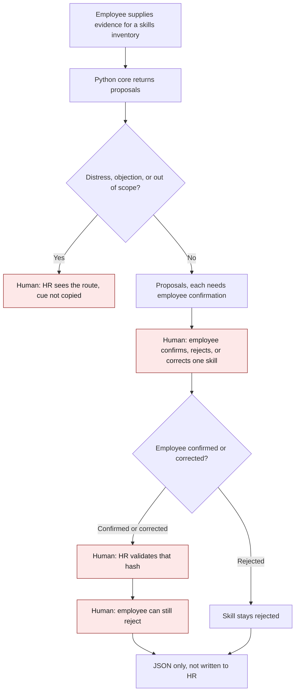

# Workforce skills inventory

<span class="status status-available">Available</span> · Autonomy A0 · Experiment 66 · Catalogue ID H010

A starter for an employee and for HR. The assistant reads synthetic evidence the employee supplied for a skills inventory, and a synthetic example skills framework. It proposes skills. Each proposal has a cited snippet, a confidence band, and the state `needs employee confirmation`. The employee can reject or correct any skill. HR validates only after that step. The agent does not write to an HR system, rate performance, or feed pay, promotion, redundancy, or disciplinary decisions. Ashcombe Borough Council is invented.

The folder contains the permissions manifest, a deterministic core, synthetic fixtures, and build notes for two Copilot Studio harnesses. Catalogue row H010 names Microsoft Fabric and Microsoft 365. Both harnesses call the same Python core. The core calls [Experiment 08](08-uk-pii-redaction-gateway.md) on a cited sentence, [Experiment 61](61-learning-path-planner.md) only after the employee has confirmed a skill, and [Experiment 62](62-internal-mobility-explorer.md) only from experience the employee states. Nothing in the folder calls a live model or the network. No Fabric item is deployed.

If this page and [`agent-manifest.yaml`](https://github.com/rahul-bachina/copilot-agent-experiments/blob/main/experiments/66-workforce-skills-inventory/agent-manifest.yaml) disagree, the manifest is the control. `permissions.yaml` is the same file.

## The problem

A CV can say the employee has already confirmed every skill, or that a legal hold should be stripped. A pack can include a keystroke log, a sickness sentence, or a request to infer a skill from age. A team count of two people names them if it is published.

Pages opened for this starter on 19 November 2026:

- [UK GDPR Article 5](https://www.legislation.gov.uk/eur/2016/679/article/5). Article 5(1)(a) to (f), Article 5(2), and Article 5(3). Article 5(3) says processing is not lawful by virtue only of being compatible with the purposes for which the personal data was collected. Article 5(1)(e) refers to Article 84B. Article 84B was not opened. The extract had no up-to-date banner. That date line is unverified.
- [Article 6](https://www.legislation.gov.uk/eur/2016/679/article/6). Article 6(1)(a) to (f), including point (ea). Points (ea) and (f) shall not apply to processing carried out by public authorities in the performance of their tasks. This starter does not choose a basis. No stamp was in the extract. That date line is unverified.
- [Article 13](https://www.legislation.gov.uk/eur/2016/679/article/13). Article 13(1) and 13(2), including 13(2)(b) and 13(2)(f). A missing field is flagged. `article_13_met` stays false. Article 22C, which 13(2)(f) refers to, was not opened. No banner was in the extract. That date line is unverified.
- [Article 21](https://www.legislation.gov.uk/eur/2016/679/article/21). Article 21(1) and 21(4) were read. An objection stops the inventory. Paragraphs 2 and 3 were not in the extract and are not quoted. No banner was in the extract. That date line is unverified.
- [Article 22](https://www.legislation.gov.uk/eur/2016/679/article/22). The body was omitted. Chapter 3 Section 4A was substituted by the Data (Use and Access) Act 2025, section 80(1). The old wording is not quoted. S.I. 2026/82 was not opened.
- [Article 22A](https://www.legislation.gov.uk/eur/2016/679/article/22A). Article 22A(1) and 22A(2). This starter does not take a decision and does not decide that a skills note would be a significant decision. Articles 22B, 22C, and 22D were not opened. No banner was in the extract. That date line is unverified.
- [Data Protection Act 2018, section 4](https://www.legislation.gov.uk/ukpga/2018/12/section/4). Section 4(1) and 4(2). The page said it was up to date with all changes known to be in force on or before 18 November 2026. Article 2 was not opened.
- [Section 10](https://www.legislation.gov.uk/ukpga/2018/12/section/10). Section 10(1) refers to Article 9(1). Article 9 and Schedule 1 were not opened. The page said it was up to date on or before 19 November 2026. This starter does not decide that a condition was met.
- [ICO, monitoring workers](https://ico.org.uk/for-organisations/uk-gdpr-guidance-and-resources/employment/monitoring-workers/data-protection-and-monitoring-workers/). The page says the purpose must be clear and documented, and that workers should not be monitored just in case. The ethernet example says workspace data should not be reused for performance management without a new lawful basis. The page says the guidance is under review because of the Data (Use and Access) Act.
- [ICO, how do we ensure lawfulness in AI?](https://ico.org.uk/for-organisations/uk-gdpr-guidance-and-resources/artificial-intelligence/guidance-on-ai-and-data-protection/how-do-we-ensure-lawfulness-in-ai/). The controller decides the purpose and the lawful basis. An inference is likely special category data if you can or intend to infer it, or intend to treat someone differently because of it. Latest update on the page: 28 October 2024. The page says the guidance is under review.
- [What is Microsoft Fabric](https://learn.microsoft.com/en-us/fabric/fundamentals/microsoft-fabric-overview). Fabric is described as a SaaS analytics platform with OneLake. Fabric IQ is marked preview. This starter does not deploy a Fabric item. No last-updated line was in the extract. That date is unverified.
- [Harnesses in Copilot Studio](https://learn.microsoft.com/en-us/microsoft-copilot-studio/harnesses-overview). Three harnesses are named. The page does not use the words GitHub Copilot harness. Older wording that this harness is not the GitHub Copilot service is unverified against the page opened on this date.

The framework is an example. It is not SFIA. The organisation must license any SFIA-style framework and review the phrases.

## Who it helps

**An employee** who has supplied a CV extract, a completed learning record, or a project summary for a skills inventory gets proposals they can confirm, reject, or correct. A sentence in the evidence is not that confirmation.

**HR** who is asked to validate a skill the employee has already decided gets a second step, bound to the same hash or to the correction hash. Validation does not write an HR record and does not set a rating.

**A person named in a distress, grievance, or safeguarding cue** is not turned into a skills proposal. The cue is not copied. A person is the route. An objection, or a request to use the inventory for pay, promotion, redundancy, or discipline, is also a route to HR.

It does not help a team that wants the tool to rate performance, select people for redundancy, or infer a skill from health data or from a keystroke log.

## What it does

`src/inventory.py` reads one request and the fixtures and writes one JSON document. Every proposal starts as `needs employee confirmation`. `wrote_to_hr_system` stays false.

| Situation | What the result says |
| --- | --- |
| A sentence affirms a framework phrase | A proposal, with the snippet, a band, and the state `needs employee confirmation`. The band is not a performance rating. |
| "It is not true that this evidence includes depot forklift" | That phrase is not affirmed. |
| The same phrase is affirmed in two evidence items | The band is `high`. One learning record or project summary is `medium`. One CV extract is `low`. There is no score. |
| An item was not supplied for this purpose, or consent is not the boolean true | Skipped. A string `"true"` is not coerced. |
| A monitoring log, a mailbox, an absence record, manager notes, or a health record | Skipped. The person is not profiled from it. |
| A request to infer a skill from age, disability, or health | Refused. No proposal is drawn from that sentence. |
| A distress, grievance, or safeguarding cue, including a paraphrase | A route to HR. The cue is not copied. |
| An objection | The inventory stops. Compelling grounds are not decided. |
| A request to use the skills for redundancy, performance, pay, promotion, or discipline | Out of scope. No proposals. "Do not use this for performance management" is not that request. |
| A team view, and the cell or its complement is below the threshold | The count is null. People are not listed. The view is not described as anonymised. |
| A threshold that cannot be read | Not replaced with zero. No counts are published. |
| A SECRET cover page, or a higher label than the metadata | The body is withheld when it is above the directory clearance. The higher label, the legal hold, and the retention labels are kept. |
| An instruction in the evidence to confirm every skill | Recorded and not followed. |

`write_hr`, `rate_performance`, `set_pay`, `decide_promotion`, `select_for_redundancy`, `decide_discipline`, `infer_from_protected`, and `profile_unsupplied` raise. The directory, not the request, supplies the role and the clearance.

A deterministic smoke test of 16 synthetic cases passed in this folder. That is a smoke test of the Python, not a model score. The command is `python eval/evaluate.py`. The file is `eval/smoke_report.json`. Each case is counted once. Paraphrase recall is a separate block and is not added into the case total. Each checked category in that file is 24 of 24.

## What it does not do

These are disabled in the manifest.

- It does not write to an HR system, a payroll system, or a performance form.
- It does not rate performance or set a numeric score.
- It does not feed pay, promotion, redundancy selection, or a disciplinary decision.
- It does not infer a skill from a protected characteristic or from health data.
- It does not profile a person from data they did not supply for this purpose.
- It does not treat confirmation text inside the evidence as the deterministic step.
- It does not trust a self-declared role or clearance.
- It does not decide that UK GDPR Article 5, 6, 13, 21, or 22A was met, or that Data Protection Act 2018 section 10 was met.
- It does not drop a sensitivity marking, a retention label, or a legal hold.
- It does not describe the output, or the team view, as anonymised.
- It does not give legal advice.

## How the work flows

1. The employee supplies evidence marked for a skills inventory, and the question date. Approval words in that evidence are not approval.
2. The core reads the directory role and the clearance. It returns proposals, or it stops for a person.
3. A distress, grievance, safeguarding, objection, or out-of-scope use stops here and names HR. HR can record that they have seen the reason code. The assistant does not decide the case.
4. The employee confirms, rejects, or corrects each skill, for that inventory hash and that skill hash. A correction is bound to the hash of the correction text.
5. HR validates only a skill the employee has confirmed or corrected, for the same hash or the correction hash.
6. The employee can still reject the skill after that validation.
7. Nothing is written to an HR system. Nothing is rated.



The highlighted human steps are the HR route, the employee's decision on each skill, HR's validation, and the employee's later rejection. The agent does not take those steps.

## Architecture diagram

![Architecture diagram titled Workforce skills inventory. Evidence enters either Copilot Studio harness, which calls the Python core. The core can call Experiments 08, 61, and 62 and returns proposals that need employee confirmation. A highlighted box is the human approval: the employee confirms, rejects, or corrects each skill, HR validates only after that step, and the employee can still reject. Nothing is written to an HR system. A separate box lists what is not a tool: write to HR, rate performance, set pay or promotion, select for redundancy, or drop a legal hold.](img/66-workforce-skills-inventory-architecture.png)

## Microsoft stack

The runnable core is Python. Copilot Studio can host it in the standard harness, as topics the maker defines, or in the Microsoft Copilot harness, as the skills in the folder. The overview opened on 19 November 2026 calls that second harness the Microsoft Copilot harness. It does not use the words GitHub Copilot harness. The prose says that harness uses Copilot Credits and states no price. The approval gates are the same in both harnesses.

Catalogue row H010 names Microsoft Fabric and Microsoft 365. The Fabric overview describes a SaaS analytics platform, OneLake, and integration with Microsoft 365 and Microsoft Foundry. Fabric IQ is marked preview on that page. This starter does not create a lakehouse, a notebook, a semantic model, or a Power BI report, and it does not claim the Python core runs inside Fabric. A later report could show the suppressed team view. That report is not this repository, and the view would still not be anonymised.

Microsoft Foundry is optional, for a short note from the JSON. The proposals and the approval stay in Python. No Foundry resource is deployed. The retired product name is not used.

## Security and permissions

Manifest `exp-66-workforce-skills-inventory`, version 0.1.0. Autonomy **A0**. Writes disabled. Sends disabled. Approve or reject, regulated decision, production record change, external send, and spending are disabled. So are an HR write, a performance rating, pay, promotion, redundancy selection, a disciplinary decision, and inferring a skill from health or from a protected characteristic.

The employee and HR act on separate objects. A seen-step does not decide the case. A distress cue is not a routine inventory.

The longer note is [security and permissions](https://github.com/rahul-bachina/copilot-agent-experiments/blob/main/experiments/66-workforce-skills-inventory/docs/security-and-permissions.md).

## How to try it

Python 3.10 or newer. No credentials and no network. Experiments 08, 61, and 62 need to be present beside this folder, with the neighbours those experiments load.

```bash
cd experiments/66-workforce-skills-inventory
python -m pip install -r requirements.txt
python -m pytest tests/ -v
python eval/evaluate.py
python src/inventory.py --request examples/sample_request.json --evidence fixtures/evidence.json --framework fixtures/framework.json --directory fixtures/directory.json --transparency fixtures/transparency.json --as-of 2026-11-18
```

The sample request carries approval keys on purpose. Every skill stays `needs employee confirmation`. The smoke test is 16 synthetic cases, each counted once. It is not a model score.

## Limitations

- A phrase is an example on the list. A paraphrase that misses the phrase is not a skill. The list is not a statistic.
- Paraphrase recall on the checked set is a smoke figure. A sentence that uses none of the patterns is not caught.
- The threshold of 5, and the complement rule, are starter controls. They are not a statutory test and they are not anonymisation. The ICO anonymisation guidance was not opened.
- The marking order is a starter rule. The Government Security Classifications Policy was not re-opened here.
- Treating a review date before the question date as stale is a starter rule, not a statutory period. The 180-day pin window is a starter default.
- Article 84B, Article 2, Article 9, Article 22B, Article 22C, Article 22D, and Schedule 1 were not opened. Article 21 paragraphs 2 and 3 were not in the extract. S.I. 2026/82 was not opened. The UK GDPR article extracts had no revision-date banner. Those points are unverified where this page says so.
- The ICO pages say they are under review because of the Data (Use and Access) Act.
- Entra Agent ID, Conditional Access for agents, a configured Power Platform DLP policy, Microsoft Foundry prompt shields, Key Vault, and Application Insights were not opened. Treat that product behaviour as unverified.
- No Fabric item is deployed. A connector was not tested. Fabric IQ is preview on the overview page.
- This is not legal advice, a performance rating, or an HR record.

## Source

- [Experiment folder](https://github.com/rahul-bachina/copilot-agent-experiments/tree/main/experiments/66-workforce-skills-inventory)
- [Permissions manifest](https://github.com/rahul-bachina/copilot-agent-experiments/blob/main/experiments/66-workforce-skills-inventory/agent-manifest.yaml)
- [Security and permissions](https://github.com/rahul-bachina/copilot-agent-experiments/blob/main/experiments/66-workforce-skills-inventory/docs/security-and-permissions.md)
