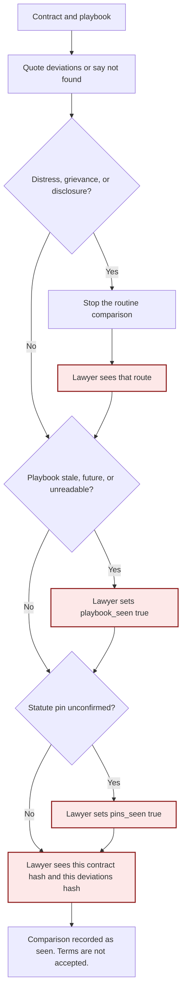

# Contract clause review

Catalogue row L001. Autonomy A0. The starter quotes clauses and deviations for a lawyer. The lawyer owns the legal interpretation. This page is a briefing, not legal advice.

## The problem

A contract and an organisational playbook are long. A lawyer still has to see the exact sentence that differs from the preferred, fallback, or unacceptable position, and the clauses the playbook expected and the contract does not contain. Paraphrase hides the words. A missing clause should stay "not found", not a guess that the law fills the gap.

## Who it helps

A lawyer or a contracts reviewer at an organisation that keeps a clause playbook. The organisation gets a record of the quoted deviations, the clause references, and the playbook position, with a seen step bound to that comparison. The counterparty is not contacted. Terms are not accepted.

Ashcombe Borough Council and Northbridge Supplies Ltd, used in the sample, are fictional.

## What it does

From one synthetic contract and one synthetic playbook, the starter extracts limitation of liability, indemnities, data protection and processor terms, termination, governing law, intellectual property, confidentiality, and auto-renewal. Each topic is compared with the playbook. A deviation lists the exact quoted sentence, the clause reference, and the playbook position. A topic with no affirmed sentence is `not found`.

An ambiguous sentence, two clauses that conflict, a sum or a notice period that cannot be read, and a clause outside the playbook are flagged for the lawyer. Negation is read in the same sentence: "it is not true that the clause includes a cap" is not a cap. "Nothing excludes liability for death" is a carve-out, not an exclusion of that liability.

UK GDPR Article 28(3) is a presence checklist when the contract is, or may be, a processor contract. A missing point is `not found`. Phrase presence is not a finding of compliance. For a business contract whose stated law is England, England and Wales, or Northern Ireland, an exclusion of liability for death or personal injury caused by negligence is flagged against Unfair Contract Terms Act 1977 section 2(1) as context. For a consumer contract the same exclusion is flagged against Consumer Rights Act 2015 section 65(1). Section 11 is context only and is not applied. The starter does not decide voidness, reasonableness, or fairness.

The date on the question is the date used. A playbook past its review date, or not yet in force, is flagged. Protective markings are read from the metadata and from the page, and a higher label wins. A legal hold and retention labels are kept. UK identifiers in a quote are masked. Distress, a grievance, or a disclosure, including a paraphrase, stops the routine comparison.

## What it does not do

It does not give legal advice, redline, accept terms, sign, or send. It does not mark a term safe. It does not say Article 28 is complied with. It does not choose between conflicting governing-law clauses. It does not confirm that a file is genuine or that the playbook is the organisation's live policy. It does not follow instructions written inside the contract. It does not treat a typed role, a clearance, or the word approved in the contract as the seen step.

## How the work flows

1. A person supplies one synthetic contract, one playbook, the caller reference, and the date the question is about.
2. The comparison quotes deviations and says `not found` where a topic is absent. Instructions in the text are recorded and not followed.
3. If the text shows distress, a grievance, or a disclosure, the routine comparison stops. **Human approval:** a directory lawyer records that they have seen that route. The cue text is not copied.
4. If the playbook is stale, not yet in force, or unreadable, **human approval:** the lawyer sets `playbook_seen` to the boolean true on the seen step. A string is not enough.
5. Article 28 and Unfair Contract Terms Act 1977 sections 2 and 11 had no currency date when they were opened. **Human approval:** the lawyer sets `pins_seen` to the boolean true before the comparison can be recorded as seen. The pins are still not confirmed.
6. **Human approval:** a directory lawyer records `seen` for this contract hash and this deviations hash. A guest cannot. A hash from another comparison cannot. Seeing the comparison does not accept, sign, or send.
7. Accepting terms, signing, and sending are not tools. There is no approval that makes them happen.



## Architecture diagram


## Microsoft stack

Both Copilot Studio harnesses call the same Python core.

The standard harness is a topic that runs the comparison and stops. The seen step is a second call with an object from the lawyer, not with words copied out of the contract.

Catalogue row L001 names the Microsoft Copilot harness first, with Azure. The skills in the experiment folder are that reasoning-heavy harness, in the layout the common brief calls the GitHub Copilot harness. On 19 November 2026 the harness overview used the name Microsoft Copilot harness. It did not use the words GitHub Copilot harness, and it stated no price. Older wording that the harness is not the GitHub Copilot service was not on that page. That point is unverified.

Microsoft Foundry is an optional note written from the JSON. No Foundry resource is deployed. The quotes and the hashes stay in the Python core. The retired product name is not used.

## Security and permissions

Writes and sends are off. `give_legal_advice`, `redline`, `accept_terms`, `sign`, and `send` raise. `human_approval` stays null until `record_lawyer_seen` matches a directory lawyer, the item, the decision `seen`, the contract hash, and the deviations hash.

A legal hold and every retention label are kept. Content above the caller's directory clearance is not copied. The caller's clearance comes from the directory, not from a sentence in the contract.

Entra Agent ID, Conditional Access, Power Platform DLP as a configured policy, Microsoft Foundry prompt shields, Key Vault, Purview, and Application Insights were not opened on 19 November 2026. Treat that product behaviour as unverified.

The manifest is `agent-manifest.yaml` in the experiment folder. `permissions.yaml` is the same file.

## How to try it

From `experiments/67-contract-clause-review`, install the requirements and run:

```bash
python3 src/review.py \
  --request examples/sample_request.json \
  --playbook fixtures/playbook.json \
  --directory fixtures/directory.json \
  --as-of 2026-11-14
```

`python3 eval/evaluate.py` runs the deterministic smoke test of 20 synthetic cases. It is not a model score. The paraphrase block is reported separately and is not added to that total. The committed report is `eval/smoke_report.json`.

## Limitations

Article 28 and Unfair Contract Terms Act 1977 sections 2 and 11 did not show a currency date. Their currency is unverified, so the comparison may not be relied on as current law. Consumer Rights Act 2015 Part 2, sections 61, 62, and 65 showed dates, and a question date after the stamp is not confirmed. Part II of the 1977 Act, the schedules, and section 66 of the 2015 Act were not applied.

Phrase matching is not legal interpretation. The paraphrase set is a fixture, not a live recall rate. A Scots law or mixed-jurisdiction contract is flagged and section 2 is not applied. The playbook is synthetic. Masking counts identifiers and does not claim the text is anonymised. No tenant is configured.

## Source

The folder is [experiments/67-contract-clause-review](https://github.com/rahul-bachina/copilot-agent-experiments/tree/main/experiments/67-contract-clause-review) on GitHub. The runnable comparison is `src/review.py`. The licence is MIT.
