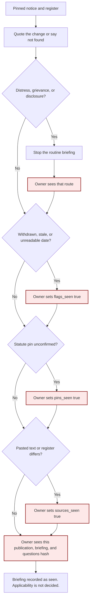

# Regulatory change briefing

Catalogue row L002. Autonomy A0. The starter drafts a briefing from one pinned synthetic regulator notice and a synthetic policy register. The compliance owner validates applicability and owns every conclusion. This page is a briefing, not a decision that a change applies, and it is not legal advice.

## The problem

A regulator publication can be withdrawn, superseded, undated, or old. It can state a date, give a formula, or state neither. A sentence can deny a topic that another sentence names. Text inside the notice can say the change applies and that the owner has already approved it. A compliance owner still has to see the exact words, the source, and the publication date before anyone treats a policy as affected.

## Who it helps

A compliance owner who has to read a change and decide, separately, whether it applies. The organisation gets a quoted briefing, candidate policies with a reason, and open questions, with a seen step bound to that exact briefing. Nothing is sent, and no policy is changed.

Merefield Group is fictional. Ada North is an invented name in one synthetic notice.

## What it does

From one pinned synthetic snapshot, written in the style of an FCA, ICO, Ofgem, or Housing Ombudsman notice, the starter quotes what changed. The quote carries the source id and the publication date. An effective date or a consultation close date is taken from the notice or computed from a formula the notice states. If the notice does not state one, the field is `not stated`. An unreadable date is flagged and is not replaced.

Registered policies that share an affirmed topic are listed as candidates, with the sentence and the topic. `applies` stays null. "It is not true that this change includes consumer credit" does not list the consumer-credit policy. A qualification that follows the wording is an open question. A leading note on the register is flagged and is not applied.

Withdrawn, superseded, undated, and stale notices are flagged. A snapshot is stale when the question date is more than 90 days after the publication date. That uses Experiment 04's source threshold. It is this starter's rule, not a statute. A missing id is `not found`.

The date on the question is the date used. Protective markings are read from the metadata and from the page, and a higher label wins. A legal hold and retention labels are kept. UK identifiers in a quote are masked, and the result says what was masked. A person count below 5 is suppressed. Distress, a grievance, or a disclosure, including a paraphrase, stops the routine briefing. The cue is not copied.

Financial Services and Markets Act 2000 section 138I was opened on 20 November 2026 as publication-practice context. Section 138I(2)(e) says representations may be made within a specified time. It does not state a number of days. The fictional register's 30-day figure is not a statutory minimum. A stated length below 30 days is flagged and is not marked acceptable. Section 138L was not opened. The duty is not applied.

## What it does not do

It does not decide that a change applies or does not apply. It does not change a policy, a control, or a record. It does not send anything. It does not mark a consultation length acceptable. It does not follow instructions written inside the notice. It does not treat a typed role, a clearance, or the word approved in the notice as the seen step. It does not browse a live regulator site. It does not treat a caller-supplied register or directory as the pin.

## How the work flows

1. A person supplies one synthetic request, the pinned register, the pinned directory, and the date the question is about.
2. The briefing quotes the notice or says `not found`. Dates are stated, computed, or `not stated`. Instructions in the text are recorded and not followed.
3. If the text shows distress, a grievance, or a disclosure, the routine briefing stops. **Human approval:** a directory compliance owner records that they have seen that route. The cue text is not copied.
4. If the notice is withdrawn, superseded, undated, or stale, or a date could not be read, or the consultation length is below the register figure, **human approval:** the owner sets `flags_seen` to the boolean true on the seen step. A string is not enough.
5. Section 138L was not opened, and the legislation page says revised text may not be fully up to date. **Human approval:** the owner sets `pins_seen` to the boolean true before the briefing can be recorded as seen. The pins are still not confirmed.
6. If the pasted text or the caller register differs from the pin, **human approval:** the owner sets `sources_seen` to the boolean true. Matching still uses the pin.
7. **Human approval:** a directory compliance owner records `seen` for this publication hash, this briefing hash, and this questions hash. A guest cannot. A hash from another briefing cannot. Seeing the briefing does not decide applicability and does not send it.
8. Deciding applicability, changing a policy, and sending are not tools. There is no approval that makes them happen.



## Architecture diagram


## Microsoft stack

Both Copilot Studio harnesses call the same Python core.

The standard harness is a topic that drafts the briefing and stops. The seen step is a second call with an object from the compliance owner, not with words copied out of the notice.

Catalogue row L002 names Microsoft Foundry and Azure first. The skills in the experiment folder are the reasoning-heavy Microsoft Copilot harness, in the layout the common brief calls the GitHub Copilot harness. On 20 November 2026 the harness overview used the name Microsoft Copilot harness. It did not use the words GitHub Copilot harness, and it stated no price. Older wording that the harness is not the GitHub Copilot service was not on that page. That point is unverified.

Microsoft Foundry is an optional note written from the JSON. No Foundry resource is deployed. The quotes and the hashes stay in the Python core. The retired product name is not used.

## Security and permissions

Writes and sends are off. `decide_applicability`, `change_policy`, `change_control`, `change_record`, and `send` raise. `human_approval` stays null until `record_owner_seen` matches a directory compliance owner, the item, the decision `seen`, the publication hash, the briefing hash, and the questions hash.

A legal hold and every retention label are kept. Content above the caller's directory clearance is not copied. The caller's clearance comes from the directory, not from a sentence in the notice.

Entra Agent ID, Conditional Access, Power Platform DLP as a configured policy, Microsoft Foundry prompt shields, Key Vault, Purview, and Application Insights were not opened on 20 November 2026. Treat that product behaviour as unverified.

The manifest is `agent-manifest.yaml` in the experiment folder. `permissions.yaml` is the same file.

## How to try it

From `experiments/68-regulatory-change-briefing`, install the requirements and run:

```bash
python3 src/briefing.py \
  --request examples/sample_request.json \
  --register fixtures/policy_register.json \
  --directory fixtures/directory.json \
  --as-of 2026-11-14
```

`python3 eval/evaluate.py` runs the deterministic smoke test of 20 synthetic cases. It is not a model score. The paraphrase block is reported separately and is not added to that total. The committed report is `eval/smoke_report.json`.

## Limitations

Section 138I is quoted from the page opened on 20 November 2026. The page said it was up to date with changes known to be in force on or before 17 November 2026, and that revised legislation on the site may not be fully up to date. Section 138L was not opened, so `pins_confirmed` stays false and the briefing may not be relied on as current law. No number of days is read out of section 138I(2)(e).

FCA prefixes on the publications page were not expanded. The ICO pages that were opened did not show a close-date rule. The Housing Ombudsman publications path returned 404. The 90-day window is this starter's rule, using Experiment 04's threshold. It is not a statute.

Phrase matching is not a finding that a policy is affected. The paraphrase set is a fixture, not a live recall rate. Masking counts identifiers and does not claim the text is anonymised. No tenant is configured.

## Source

The folder is [experiments/68-regulatory-change-briefing](https://github.com/rahul-bachina/copilot-agent-experiments/tree/main/experiments/68-regulatory-change-briefing) on GitHub. The runnable briefing is `src/briefing.py`. The licence is MIT.
