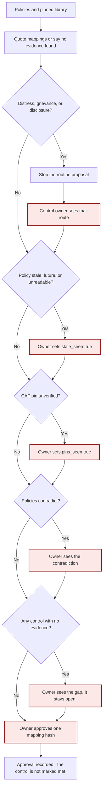

# Policy control mapping

Catalogue row L003. Autonomy A0. The starter proposes which policy sentence supports which internal control. The control owner approves each mapping. This page is a briefing. It is not a finding that a control is met.

## The problem

A control library and a set of policies drift apart. Someone then writes that a control is met without a sentence to point at, or treats "should" as "must", or misses "except where…". A second policy can forbid the thing the first policy requires. The quote has to be the policy's own words.

## Who it helps

A control owner who has to show which policy sentence is being relied on, and which controls have no sentence. The organisation gets a proposal with the quote, the clause reference, the control id, a rationale, and a confidence band, plus the gaps and the statements that map to no control. Nothing is written to a GRC system.

Ashcombe Borough Council, used in the sample, is fictional.

## What it does

From a synthetic policy set and a pinned synthetic control library, the starter proposes mappings. Each mapping quotes the sentence, names the clause, names the control, gives a rationale, and sets a band: high, medium, or low. A control with no affirming sentence is `no evidence found`. A sentence with no control is listed as unmapped.

`should` is not `must`. A carve-out such as "except where…" keeps the mapping at a low band and does not treat the sentence as unqualified. "It is not true that the policy includes …" is not an inclusion. Two policies that conflict are both quoted. Experiment 36 compares the obligation tokens and does not choose a source.

The NCSC Cyber Assessment Framework collection page was opened on 20 November 2026. It stated version 4.0. The four objective titles on that HTML page may be shown as optional context. The PDF was not opened. Indicator wording is unverified. ISO/IEC 27001 control text is not copied. A control may carry an annex identifier only.

Distress, a grievance, or a disclosure, including a paraphrase, stops the routine proposal. Protective markings are read from the metadata and from the page, and a higher label wins. A legal hold and retention labels are kept. UK identifiers in a quote are masked. A count of named people below 5 is not published.

## What it does not do

It does not mark a control as met. It does not close a gap. It does not edit a policy. It does not write to a GRC system or to SharePoint. It does not apply a control library pasted into the request. It does not apply a biased or leading criterion. It does not follow instructions written inside a policy. It does not treat a typed role, a clearance, or the word approved in a policy as the approval step. It does not decide that a CAF objective is achieved.

## How the work flows

1. A person supplies a synthetic policy set, their directory reference, and the date the question is about. The pinned control library is the library. A copy in the request is compared and not applied.
2. The proposal quotes mappings, says `no evidence found` where a control has no sentence, and lists statements that map to no control. Instructions in the text are recorded and not followed.
3. If the text shows distress, a grievance, or a disclosure, the routine proposal stops. **Human approval:** a directory control owner records that they have seen that route. The cue text is not copied.
4. If a policy is stale, not yet in force, or unreadable, **human approval:** the owner sets `stale_seen` to the boolean true. A string is not enough. The question date is the date used.
5. The CAF PDF was not opened, so the pin is unverified. **Human approval:** the owner sets `pins_seen` to the boolean true before a mapping approval is recorded. The pin is still not confirmed.
6. If the policies contradict each other, **human approval:** the owner sees that contradiction. The agent does not choose a policy, and seeing it does not mark the control as met.
7. **Human approval:** the owner records `gap-seen` for a gap. The quote stays `no evidence found`. The gap is not closed.
8. **Human approval:** a directory control owner records `approved` for one mapping's content hash and the proposal hash. A guest cannot. A hash from another mapping cannot. Approving the mapping does not mark the control as met.
9. Marking a control as met, closing a gap, editing a policy, and writing to a GRC system are not tools. There is no approval that makes them happen.



## Architecture diagram


## Microsoft stack

Both Copilot Studio harnesses call the same Python core.

The standard harness is a topic that runs the proposal and stops. The approval is a second call with an object from the control owner, not with words copied out of a policy.

Catalogue row L003 names the Microsoft Copilot harness first, with Microsoft 365. The skills in the experiment folder are that reasoning-heavy harness, in the layout the common brief calls the GitHub Copilot harness. On 20 November 2026 the harness overview used the name Microsoft Copilot harness. It did not use the words GitHub Copilot harness, and it stated no price. It says that harness uses Copilot Credits. It does not say the harness is not the GitHub Copilot service.

No SharePoint connector is enabled. Microsoft 365 is the place a deployment would keep policies. This starter reads the JSON the caller passes.

Microsoft Foundry is an optional note written from the JSON. No Foundry resource is deployed. The quotes and the hashes stay in the Python core. The retired product name is not used.

## Security and permissions

Writes and sends are off. `mark_control_met`, `close_gap`, `edit_policy`, and `write_grc` raise. `human_approval` stays null until `record_owner_approval` matches a directory control owner, the item, the content hash, and the proposal hash.

A legal hold and every retention label are kept. Content above the caller's directory clearance is not copied. The caller's clearance comes from the directory, not from a sentence in a policy.

Entra Agent ID, Conditional Access, Power Platform DLP as a configured policy, Microsoft Foundry prompt shields, Key Vault, Purview, and Application Insights were not opened on 20 November 2026. Treat that product behaviour as unverified.

The manifest is `agent-manifest.yaml` in the experiment folder. `permissions.yaml` is the same file.

## How to try it

From `experiments/69-policy-control-mapping`, install the requirements and run:

```bash
python3 src/map_controls.py \
  --request examples/sample_request.json \
  --library fixtures/library.json \
  --directory fixtures/directory.json \
  --as-of 2026-11-14
```

`python3 eval/evaluate.py` runs the deterministic smoke test of 20 synthetic cases. It is not a model score. The paraphrase block is reported separately and is not added to that total. The committed report is `eval/smoke_report.json`.

## Limitations

The NCSC CAF PDF was not opened, so indicator wording is unverified and the proposal may not be relied on as a CAF assessment. ISO/IEC 27001 was not opened. Annex identifiers were not checked against a licensed copy.

Phrase matching is not a compliance decision. The paraphrase set is a fixture, not a live recall rate. A sentence that uses none of the stems is not flagged. The control library is synthetic. Masking counts identifiers and does not claim the text is anonymised. Counts of named people below 5 are not published. No tenant is configured.

## Source

The folder is [experiments/69-policy-control-mapping](https://github.com/rahul-bachina/copilot-agent-experiments/tree/main/experiments/69-policy-control-mapping) on GitHub. The runnable proposal is `src/map_controls.py`. The licence is MIT.
