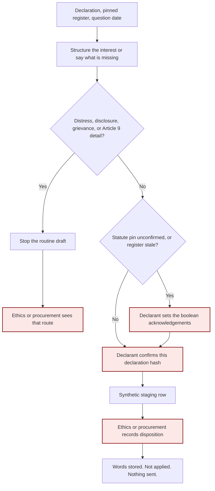

# Conflict-of-interest intake

Catalogue row L005. Autonomy A1. The starter drafts a declaration for a member of staff. The ethics or procurement team decides whether a conflict exists. This page is a briefing, not a conflicts assessment and not legal advice.

## The problem

A free-text declaration is easy to misread. One sentence can deny an interest and the next can state one. The same note can claim the ethics team has already approved it, name a relative, or include a political opinion the record does not need. A contracting authority still has to identify and keep under review conflicts and potential conflicts in a covered procurement. That duty is the authority's. It is not a conclusion an agent should reach from the wording.

## Who it helps

A member of staff who needs a structured declaration: interest type, parties, the procurement or contract, dates, and whether the interest is financial or non-financial. An ethics or procurement officer who needs the missing questions and any potential link to a live procurement, without a decision already made.

The organisation gets a synthetic staging row only after the declarant confirms that exact draft. Disposition and mitigation stay with the team.

Ashcombe Borough Council and the supplier names in the sample are fictional.

## What it does

From one synthetic declaration, a pinned supplier list, a pinned procurement register, and a pinned directory, the starter drafts the structure and asks for what is missing. A supplier named outside a negation is compared with procurements that are live on the date the question is about. The link is marked for the ethics team. `conflict_exists` stays null.

Personal data stays to what the draft needs. A phone number, email address, date of birth, postal address, or personal name is counted and not stored. A family link keeps a relationship label. A political opinion, and the other categories in UK GDPR Article 9(1), are flagged, minimised, and routed to a person. The detail is not copied. Article 9(1) does not list family relationships. That sentence is context, not a finding that Article 5(1)(c) was met.

Procurement Act 2023 section 81(1), section 82(1), and section 83(1) are quoted for the ethics team from the text opened on 20 November 2026. The extracts had no "up to date on or before" date. Currency is unverified. The starter does not prepare a conflicts assessment and does not treat anyone as an excluded supplier.

Negation is read in the same sentence. "It is not true that this declaration includes a shareholding" is not a shareholding. Instructions in the declaration are not followed. A self-declared role or clearance is not the directory. A pasted register is not the pinned register. A SECRET cover is caught from the page. A legal hold and retention labels are kept.

## What it does not do

It does not decide that a conflict exists or that it does not. It does not clear, exclude, or approve a person or a supplier. It does not send the declaration. It does not treat the word approved inside the note as the confirm step. It does not apply a leading criterion or mark a carve-out acceptable. It does not coerce an unreadable amount or date to zero or to today. It does not write a production procurement register.

## How the work flows

1. A member of staff supplies one synthetic declaration, their directory reference, and the date the question is about.
2. The draft structures the interest, lists missing questions, and highlights live procurements. Instructions in the text are recorded and not followed. A pasted register is flagged and not used.
3. If the text shows distress, whistleblowing, a grievance, or special-category detail, including a paraphrase, the routine draft stops. **Human approval:** an ethics or procurement officer records that they have seen that route. The cue text is not copied.
4. Sections 81 to 83 and UK GDPR Articles 5 and 9 had no currency date in the extract. **Human approval:** the declarant sets `pins_seen` to the boolean true. A string is not enough. The pins are still not confirmed.
5. If the register is stale on the question date, or a caller-supplied source differs from the pinned file, **Human approval:** the declarant sets the matching acknowledgement to the boolean true.
6. **Human approval:** the directory member of staff confirms this declaration hash. A guest cannot. An ethics officer cannot confirm on the declarant's behalf. A hash from another draft cannot. The synthetic staging row is written only then.
7. **Human approval:** an ethics or procurement officer records disposition and any mitigation against that staged hash. The words are stored and not applied. Clearing, excluding, approving, and sending are not tools.



## Architecture diagram


## Microsoft stack

Both Copilot Studio harnesses call the same Python core.

The standard harness is a topic that returns the draft and stops. The confirm step is a second call with an object from the declarant, not with words copied out of the declaration. Power Platform, in this folder, is the flow note that calls that core. It is not an importable solution.

Catalogue row L005 names Copilot Studio and Power Platform first. The skills in the experiment folder are the Microsoft Copilot harness, in the layout the common brief calls the GitHub Copilot harness. On 20 November 2026 the harness overview used the name Microsoft Copilot harness. It did not use the words GitHub Copilot harness, and it stated no price. Older wording that the harness is not the GitHub Copilot service was not on that page. That point is unverified.

Microsoft Foundry is an optional note written from the JSON. No Foundry resource is deployed. The hashes and the links stay in the Python core. The retired product name is not used.

## Security and permissions

The synthetic staging write is on, and only after `confirm_declaration` matches the directory declarant and the declaration hash. Sends are off. Production writes are off. `decide_conflict`, `clear_person`, `exclude_supplier`, `approve_person`, `send`, and `write_production` raise. `conflict_exists` stays null.

A legal hold and every retention label are kept. Content above the caller's directory clearance is not copied. The caller's clearance comes from the directory, not from a sentence in the declaration.

Entra Agent ID, Conditional Access, Power Platform DLP as a configured policy, Microsoft Foundry prompt shields, Key Vault, Purview, and Application Insights were not opened on 20 November 2026. Treat that product behaviour as unverified.

The manifest is `agent-manifest.yaml` in the experiment folder. `permissions.yaml` is the same file.

## How to try it

From `experiments/70-conflict-of-interest-intake`, install the requirements and run:

```bash
python3 src/declaration.py \
  --request examples/sample_request.json \
  --as-of 2026-11-14
```

`python3 eval/evaluate.py` runs the deterministic smoke test of 20 synthetic cases. It is not a model score. The paraphrase block is reported separately and is not added to that total. The committed report is `eval/smoke_report.json`.

## Limitations

Sections 81, 82, and 83, and UK GDPR Articles 5 and 9, did not show a currency date. Their currency is unverified, so the draft may not be relied on as current law. Sections 19, 41, 43, 55, and 80 were not opened. Article 6 was not opened. Article 9(2) is not applied.

Phrase matching is not a decision that a conflict exists. The paraphrase set is a fixture, not a live recall rate. The register and the directory are synthetic. Masking counts identifiers and does not claim the text is anonymised. The small-number threshold is a starter control, not anonymisation. No tenant is configured.

## Source

The folder is [experiments/70-conflict-of-interest-intake](https://github.com/rahul-bachina/copilot-agent-experiments/tree/main/experiments/70-conflict-of-interest-intake) on GitHub. The runnable draft is `src/declaration.py`. The licence is MIT.
