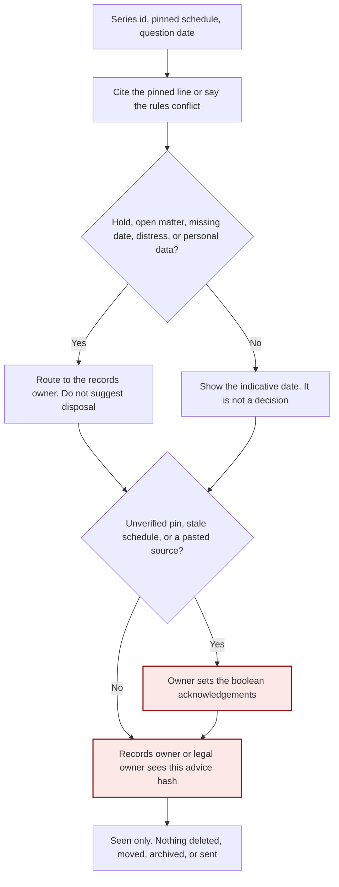

# Data retention decision support

Catalogue row L007. Autonomy A0. The starter explains which pinned synthetic retention line appears to apply. The records or legal owner decides retention, disposal, transfer, and hold. This page is a briefing, not a retention decision and not legal advice.

## The problem

A schedule, an inventory, and a note can disagree. The note can say disposal is already approved, that a legal hold should be stripped, or that the file contains no personal data, while naming a person. A missing trigger date is not today's date. An open information request, a subject access request, litigation, an inquiry, or a legal hold is not a reason for an agent to suggest disposal.

## Who it helps

A records owner who needs the pinned line, the indicative date, and the questions still to answer. A legal owner who needs a hold, litigation, or an inquiry brought to them without a disposal already proposed.

The organisation gets advice it can read. Nothing in the inventory is deleted, moved, relabelled, archived, or sent.

Mereford Borough Council and the series titles in the sample are fictional.

## What it does

From one synthetic series, a pinned inventory, a pinned schedule, and a pinned directory, the starter cites the active line that matches the series code and calculates an indicative date from the trigger. Two active lines are both cited and neither date is chosen. An unreadable or ambiguous date is flagged and is not replaced.

Personal data raises a storage-limitation question. UK GDPR Article 5(1)(e) is quoted for the records owner from the text opened on 23 November 2026, including the reference to Article 84B as that page now shows it. Article 84B was not opened. The quote is not a finding that the principle was met.

Freedom of Information Act 2000 section 46(1) and section 77(1), and Public Records Act 1958 section 3(4), are quoted for the records owner. The section 46 code of practice was not opened. Its paragraphs are unverified. Section 3(4) is used only where the pinned inventory says the series is a public record selected for permanent preservation. The 20 years is the latest transfer point in the text that was opened. It is not a minimum retention period for every record, and it is not a finding of breach.

A phone number, email address, date of birth, postal address, or personal name is counted and not stored. A SECRET cover is caught from the page. A legal hold and retention labels are kept.

## What it does not do

It does not decide retention, disposal, transfer, or hold. It does not delete, move, relabel, archive, or send. It does not suggest disposal for a hold or an open FOI, SAR, litigation, or inquiry. It does not treat the word approved inside the note as the seen step. It does not trust a pasted schedule over the pinned schedule. It does not mark a shorter caller period, or a carve-out, as safe. It does not coerce an unreadable date to today.

## How the work flows

1. A records owner supplies one synthetic series id, their directory reference, and the date the question is about.
2. The advice cites the pinned line or says the rules conflict, and lists missing questions. Instructions in the title or the note are recorded and not followed. A pasted schedule is flagged and not used.
3. If the series is under a legal hold, or an FOI request, subject access request, litigation, or inquiry is open, or the trigger date is missing or unreadable, or the note shows distress, the routine path stops. Disposal is not suggested. **Human approval:** the records owner or the legal owner will see that route. The cue text is not copied.
4. If the series contains personal data, the advice asks whether storage is still necessary. Article 5(1)(e) is context. **Human approval:** the records owner answers that question. The agent does not.
5. Where the pinned inventory says the series is a public record selected for permanent preservation, section 3(4) is quoted and disposal is not suggested. **Human approval:** the records owner decides transfer or retention. Transitional orders were not checked.
6. Article 84B and the section 46 code were not opened. **Human approval:** the owner sets `pins_seen` to the boolean true. A string is not enough. The pins are still not confirmed.
7. If the schedule is stale on the question date, or a caller-supplied source differs from the pinned file, **Human approval:** the owner sets the matching acknowledgement to the boolean true.
8. **Human approval:** the directory records owner for that series, or a legal owner, records that they have seen this advice hash. A guest cannot. An owner for a different series cannot. A hash from another advice cannot. The acknowledgement does not delete, move, archive, or send.



## Architecture diagram


## Microsoft stack

Both Copilot Studio harnesses call the same Python core.

The standard harness is a topic that returns the advice and stops. The seen step is a second call with an object from the owner, not with words copied out of the note.

Catalogue row L007 names Microsoft 365 and Copilot Studio first. This folder does not call Microsoft Graph. The skills in the experiment folder are the Microsoft Copilot harness, in the layout the common brief calls the GitHub Copilot harness. On 23 November 2026 the harness overview used the name Microsoft Copilot harness. It did not use the words GitHub Copilot harness, and it stated no price. Older wording that the harness is not the GitHub Copilot service was not on that page. That point is unverified.

Microsoft Foundry is an optional note written from the JSON. No Foundry resource is deployed. The hash and the line stay in the Python core. The retired product name is not used.

## Security and permissions

Writes are off. Sends are off. `delete_records`, `dispose`, and `send` raise. `disposal_suggested` stays false. A seen step records that a directory person has looked at this hash. It does not change a record.

A legal hold and every retention label are kept. Content above the caller's directory clearance is not copied. The caller's clearance comes from the directory, not from a sentence in the note.

Entra Agent ID, Conditional Access, Power Platform DLP as a configured policy, Microsoft Foundry prompt shields, Key Vault, Purview, and Application Insights were not opened on 23 November 2026. Treat that product behaviour as unverified.

The manifest is `agent-manifest.yaml` in the experiment folder. `permissions.yaml` is the same file.

## How to try it

From `experiments/71-data-retention-decision-support`, install the requirements and run:

```bash
python3 src/advice.py \
  --request examples/sample_request.json \
  --as-of 2026-11-20
```

`python3 eval/evaluate.py` runs the deterministic smoke test of 20 synthetic cases. It is not a model score. The paraphrase block is reported separately and is not added to that total. The committed report is `eval/smoke_report.json`.

## Limitations

Article 5, sections 46 and 77, and section 3 did not show a currency date. Their currency is unverified, so the advice may not be relied on as current law. Article 6, Article 9, and Article 84B were not opened. The section 46 code was not opened. Transitional orders under the Public Records Act were not opened.

Phrase matching is not a retention decision. The paraphrase set is a fixture, not a live recall rate. The schedule and the directory are synthetic. Masking counts identifiers and does not claim the text is anonymised. The small-number threshold is a starter control, not anonymisation. No tenant is configured.

## Source

The folder is [experiments/71-data-retention-decision-support](https://github.com/rahul-bachina/copilot-agent-experiments/tree/main/experiments/71-data-retention-decision-support) on GitHub. The runnable advice is `src/advice.py`. The licence is MIT.
