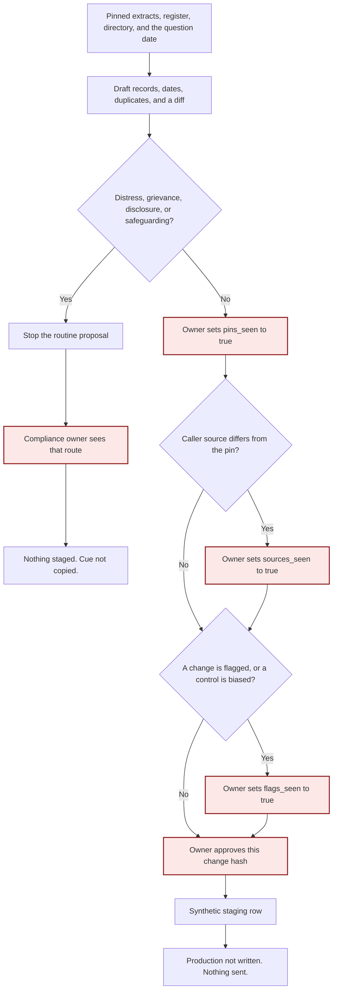

# Compliance obligation register

Catalogue row L008. Autonomy A1. The starter drafts obligation records for a compliance owner. The owner approves each change. This page is a briefing, not legal advice and not a finding that a firm is in scope.

## The problem

An obligation register drifts. A sentence can deny a duty, or add "except where", and still look like the duty. A control can be linked to a row it does not address. A review date can pass, or a provision can be superseded while the register still says active. Someone still has to keep the record, and that person is not the agent.

## Who it helps

A compliance owner who needs a diff before a row is changed: the source and the provision, the obligation in the words of the extract, whether a control addresses it, and whether a near-duplicate is already on the register.

The organisation gets a synthetic staging row only after that owner approves the exact change. Production is not written. Nothing is sent.

Halebridge & Co, and the people in the sample directory, are fictional.

## What it does

From pinned synthetic extracts and a pinned synthetic register, the starter drafts new, changed, and retired records. It quotes the obligation. It proposes an owner reference from the pinned directory and does not assign accountability. It flags a reworded duplicate, a stale review date, and a provision that is not yet in force or that the pin marks as superseded.

A control is cover only when it addresses the duty. A negation is not an inclusion. A carve-out is not acceptable. "should" is not "must". A register, directory, or control library pasted into the request is compared with the pin and not applied. Instructions in the text are not followed.

FCA Handbook SYSC 6.1.1R and Financial Services and Markets Act 2000 sections 59(1), 59ZA(2), and 63E(1) are quoted in `src/sources.py` from the pages opened on 23 November 2026. They are context. They are not the synthetic rows. `pins_confirmed` stays false. The 12-month interval is the fictional policy's internal minimum. Those pages state no number of months.

## What it does not do

It does not interpret the law as final advice. It does not decide that the fictional firm is in scope. It does not assign accountability. It does not mark an obligation covered when the linked control does not address it. It does not treat approval words in the source as the approval step. It does not send, and it does not write the production register.

## How the work flows

1. The compliance owner supplies a synthetic request and the date the question is about. The pinned extracts, register, controls, and directory are the source. A copy inside the request is flagged and not used.
2. The proposal quotes each obligation, lists dates, duplicates, and controls, and shows a diff. Instructions in the text are recorded and not followed.
3. If the note shows distress, a grievance, a disclosure, or a safeguarding concern, including a paraphrase, the routine proposal stops. **Human approval:** the directory compliance owner records that they have seen that route. The cue is not copied. Nothing is staged.
4. The handbook and Act pins are unverified as a basis for reliance. **Human approval:** the owner sets `pins_seen` to the boolean true. A string is not enough. The pins stay unconfirmed.
5. If a caller-supplied source differs from the pin, **Human approval:** the owner sets `sources_seen` to the boolean true.
6. If a change carries a flag, or a biased control was listed, **Human approval:** the owner sets `flags_seen` to the boolean true. The biased control is not applied.
7. **Human approval:** the directory compliance owner approves one change hash and the proposal hash. An analyst cannot. A guest cannot. A hash from another change cannot. Text changed after approval is rejected. The synthetic staging row is written only then. Production stays unwritten. Nothing is sent.



## Architecture diagram


## Microsoft stack

Both Copilot Studio harnesses call the same Python core.

The standard harness is a topic that returns the proposal and stops. The approval step is a second call with an object from the owner, not with words copied out of an extract. Power Platform, in this folder, is the flow note that calls that core. It is not an importable solution. The Dataverse tables are a design, not a deployed environment.

Catalogue row L008 names Copilot Studio and Dataverse. The skills in the experiment folder are the Microsoft Copilot harness, in the layout the common brief calls the GitHub Copilot harness. On 23 November 2026 the harness overview used the name Microsoft Copilot harness. It did not use the words GitHub Copilot harness, and it stated no price. Older wording that the harness is not the GitHub Copilot service was not on that page. That point is unverified.

Microsoft Foundry is an optional note written from the JSON. No Foundry resource is deployed. The hashes and the quotes stay in the Python core. The retired product name is not used.

## Security and permissions

The synthetic staging write is on, and only after `stage_approved_change` matches the directory compliance owner and the change hash. Sends are off. Production writes are off. `interpret_law`, `assign_accountability`, `send`, `write_production`, and `mark_covered` raise.

A legal hold and every retention label are kept. Content above the caller's directory clearance is not copied. The caller's clearance comes from the directory, not from a sentence in the note.

Entra Agent ID, Conditional Access, Power Platform DLP as a configured policy, Microsoft Foundry prompt shields, Key Vault, Purview, and Application Insights were not opened on 23 November 2026. Treat that product behaviour as unverified.

The manifest is `agent-manifest.yaml` in the experiment folder. `permissions.yaml` is the same file.

## How to try it

From `experiments/72-compliance-obligation-register`, install the requirements and run:

```bash
python3 src/register.py \
  --request examples/sample_request.json \
  --as-of 2026-11-14
```

`python3 eval/evaluate.py` runs the deterministic smoke test of 20 synthetic cases. It is not a model score. The paraphrase block is reported separately and is not added to that total. The committed report is `eval/smoke_report.json`.

## Limitations

SYSC 6.1.1R had no currency line on the handbook page. Sections 59, 59ZA, and 63E showed the dates above and said future changes may still be brought into force. Section 63F, SYSC 1 Annex 1, SUP 10C, and COCON were not opened. Article 6 and Article 9 were not opened. The quotes may not be relied on as current law.

Phrase matching is not a decision that a duty is met. The paraphrase set is a fixture, not a live recall rate. The register is synthetic. Masking counts identifiers and does not claim the text is anonymised. The small-number threshold is a starter control, not anonymisation. No tenant is configured.

## Source

The folder is [experiments/72-compliance-obligation-register](https://github.com/rahul-bachina/copilot-agent-experiments/tree/main/experiments/72-compliance-obligation-register) on GitHub. The runnable proposal is `src/register.py`. The licence is MIT.
