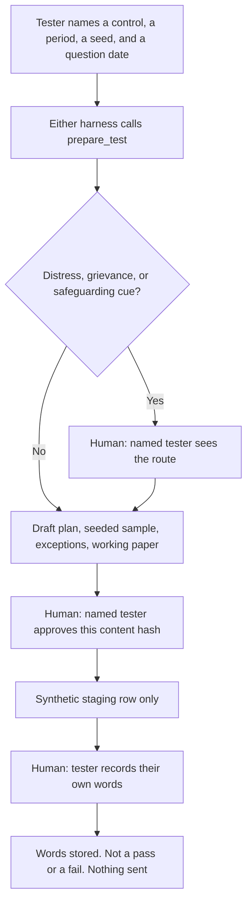

# Control testing assistant

Catalogue row L009. Autonomy A1. The starter prepares a test plan, a seeded sample, and a draft working paper. The named tester decides whether the control operated. This page is a briefing, not a control opinion and not legal advice.

## The problem

A working paper is easy to misread when the evidence itself says the control passed, or tells the reader to ignore the test steps. A date can be outside the period, back-dated, ambiguous, or missing. The person who prepared an item can be the person who approved it. A pasted control library can disagree with the library the team actually uses.

## Who it helps

A tester who needs a reproducible sample, a list of exceptions with evidence ids, and a draft working paper that does not already say pass or fail. A control owner who needs to see that a caller-supplied library was not applied. The organisation gets a synthetic staging row only after the named tester approves that exact draft.

An employee who pastes a note of distress is not processed as a routine test. The cue is routed to the tester and the words are not copied.

Ashcombe Borough Council is fictional.

## What it does

From the pinned control library, the pinned evidence population, and the pinned directory, the starter proposes a seeded sample and checks every evidence item for that control. Dates are compared with the period the question is about. Approvers are checked against the directory. Self-approval, a segregation exception, a missing field, an altered item, and an out-of-period date are listed with the evidence id.

UK Corporate Governance Code 2024 Provision 29 is quoted as context from a company-hosted PDF of the January 2024 Code. The FRC library page was opened on 23 November 2026 and does not carry the full provision. A match to the FRC file is unverified. FCA Handbook SYSC 4.1.1R is quoted from the handbook page that said it was showing the chapter as of 23/11/2026. Neither text was opened on legislation.gov.uk. Currency on legislation.gov.uk is unverified. The quotes are not a finding that the provision or the rule was met.

Negation is read in the same sentence. "It is not true that the preparer approved their own request" is not a self-approval. A distress stem is still routed. Instructions in the evidence are not followed. A self-declared role or clearance is not the directory. A pasted library is not the pinned library. A SECRET cover is caught from the page. A legal hold and retention labels are kept.

## What it does not do

It does not pass or fail a control. It does not close a finding. It does not send the working paper. It does not treat the word approved inside the evidence as the approval step. It does not mark a carve-out as acceptable. It does not apply a leading criterion. It does not coerce an unreadable date or seed to zero or to today. It does not write a production GRC system.

## How the work flows

1. A tester supplies one control id, their directory reference, the period, a sample seed, and the date the question is about.
2. The draft builds the plan, draws the seeded sample, and lists exceptions. Instructions in the text are recorded and not followed. A pasted library is flagged and not used.
3. If the text shows distress, a grievance, or a safeguarding concern, including a paraphrase, the routine draft stops. **Human approval:** the named tester records that they have seen that route. The cue text is not copied.
4. Provision 29 and SYSC 4.1.1R were not opened on legislation.gov.uk. **Human approval:** the tester sets `pins_seen` to the boolean true. A string is not enough. The pins are still not confirmed.
5. If the library is stale on the question date, a date could not be read, or a caller-supplied source differs from the pinned file, **Human approval:** the tester sets the matching acknowledgement to the boolean true.
6. **Human approval:** the directory tester named on the draft approves this content hash. A control owner cannot. A guest cannot. A hash from another draft cannot. The synthetic staging row is written only then.
7. **Human approval:** the same tester may record their own words against that staged hash. The words are stored and not applied. Passing, failing, closing, and sending are not tools.



## Architecture diagram


## Microsoft stack

Catalogue row L009 names the GitHub Copilot harness and Power Platform first. The skills in the experiment folder are the Microsoft Copilot harness, in the layout the common brief calls the GitHub Copilot harness. The harness overview was not re-opened for this experiment. On 20 November 2026, as recorded for Experiment 70, the page used the name Microsoft Copilot harness. It did not use the words GitHub Copilot harness, and it stated no price. That point is unverified against a fresh opening.

The standard harness is a topic guide. It is not an importable solution. Power Platform, in this folder, is a flow note. No connector is enabled. Microsoft Foundry is an optional note beside the JSON. It is not a third harness, and no resource is deployed.

## Security and permissions

Reads are the pinned library, the pinned population, the pinned directory, and a separate approval object. Experiment 12 does not confirm the files. Experiment 69 does not mark a control as met. Experiment 08 does not describe the text as anonymised. The only write is the synthetic staging row, after the content hash matches. Sends are off. Passing, failing, closing, and sending are disabled high-risk actions.

Entra Agent ID, Conditional Access for agents, Power Platform DLP as a configured policy, Microsoft Foundry prompt shields, Key Vault, Purview, and Application Insights were not opened. Treat that product behaviour as unverified.

## How to try it

From `experiments/73-control-testing-assistant`, install the requirements and run:

```bash
python -m pytest tests/ -q
python eval/evaluate.py
python src/testing.py --request examples/sample_request.json --as-of 2026-11-14
```

`eval/smoke_report.json` is a deterministic smoke test of 20 synthetic cases. It is not a model score. Paraphrase recall is not added to that total.

## Limitations

Phrase matching is not a decision that a control operated. The paraphrase set is a fixture, not a live recall rate. The library, the population, and the directory are synthetic. Masking counts identifiers and does not claim the text is anonymised. The small-number threshold is a starter control, not anonymisation. The sample-size rule is a starter rule. ISA (UK) 530 was not opened. Provision 29 and SYSC 4.1.1R are unverified against legislation.gov.uk. No tenant is configured.

## Source

The folder is [experiments/73-control-testing-assistant](https://github.com/rahul-bachina/copilot-agent-experiments/tree/main/experiments/73-control-testing-assistant) on GitHub. The runnable draft is `src/testing.py`. The licence is MIT.
