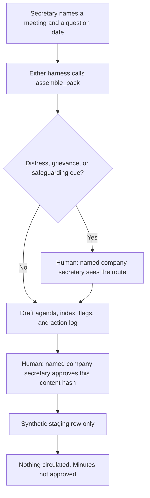

# Board governance pack assistant

Catalogue row L010. Autonomy A1. The starter assembles a draft agenda, a pack index, and an action-log carry-forward. The named company secretary approves that exact draft before it is written to a synthetic staging store. This page is a briefing, not a board decision and not legal advice.

## The problem

A board pack is easy to misread when a paper says the sponsor has already approved it, or tells the reader to circulate it and to record the minutes as approved. A pasted terms of reference can disagree with the committee's terms. A cover sheet can disagree with the body. A paper can be late, missing, duplicated, or superseded.

## Who it helps

A company secretary who needs a draft agenda, a pack index, and a list of cover-sheet gaps before the meeting. A director who needs to see that a caller-supplied agenda was not used. The organisation gets a synthetic staging row only after the named company secretary approves that exact draft.

A person who pastes a note of distress is not processed as a routine paper. The cue is routed to the secretary and the words are not copied.

Northmere Holdings Limited is fictional.

## What it does

From the pinned forward agenda, the pinned terms of reference, the pinned directory, and the synthetic submitted papers, the starter drafts the agenda and the index. It checks each paper for a stated purpose, a recommendation, and completed risk, finance, legal, and equality implications. Sponsor approval is a ledger row for that paper hash. Text in the paper does not count.

Late, missing, superseded, and duplicate papers are flagged. An item outside the pinned terms is flagged. A caller terms object does not bring it inside. A declared conflict sentence, and a live register row for someone in the room, are flagged for the secretary. Neither flag decides that a conflict exists. A cover line that disagrees with the body is an inconsistency. A SECRET line on the page is kept when the cover says OFFICIAL. The higher marking is the one that applies.

Open actions from the prior synthetic minutes are carried forward. Dates are compared with the question date. Closed actions are not carried. The minutes are not marked approved.

Companies Act 2006 sections 171, 172, 173, 174, 175, 176, 177, and 248 were opened on legislation.gov.uk on 24 November 2026. Each page said the section was up to date with all changes known to be in force on or before 23 November 2026. Section 171 says a director must act in accordance with the company's constitution and only exercise powers for the purposes for which they are conferred. Section 248(1) says every company must cause minutes of all proceedings at meetings of its directors to be recorded. Section 248(2) says the records must be kept for at least ten years from the date of the meeting. Those quotes are context. This starter does not record the minutes.

UK Corporate Governance Code 2024 Principle F says the chair ensures that directors receive accurate, timely and clear information. Principle I says the board, supported by the company secretary, should ensure that it has the policies, processes, information, time and resources it needs in order to function effectively and efficiently. Provision 16 says all directors should have access to the advice of the company secretary, who is responsible for advising the board on all governance matters. Those sentences were read from a company-hosted PDF of the January 2024 Code. The FRC media file was not opened. A byte-for-byte match to the FRC file is unverified. The Code was not opened on legislation.gov.uk. The FRC guidance page, opened the same day, says the guidance is not part of the Code.

## What it does not do

It does not circulate, publish, file, or send the pack. It does not record a board decision. It does not record minutes as approved. It does not treat the word approved inside a paper as the approval step. It does not apply a caller-supplied agenda or terms of reference. It does not decide that a conflict exists or that a statutory duty was met. It does not coerce an unreadable date or version. It does not drop a marking, a legal hold, or a retention label.

## How the work flows

1. A company secretary supplies one meeting id, their directory reference, and the date the question is about.
2. The draft builds the agenda from the pinned forward agenda, indexes the papers, and lists the flags. Instructions in the text are recorded and not followed. A pasted agenda or terms of reference is flagged and not used.
3. If the text shows distress, a grievance, or a safeguarding concern, including a paraphrase, the routine draft stops. **Human approval:** the named company secretary records that they have seen that route. The cue text is not copied.
4. The Code was not opened on legislation.gov.uk. **Human approval:** the secretary sets `pins_seen` to the boolean true. A string is not enough. The pins are still not a finding that a principle was met.
5. If a source is stale on the question date, a date could not be read, or a caller-supplied source differs from the pinned file, **Human approval:** the secretary sets the matching acknowledgement to the boolean true.
6. **Human approval:** the directory company secretary named on the draft approves this content hash. A sponsor cannot. A director cannot. A guest cannot. A hash from another draft cannot. The synthetic staging row is written only then. The row is not circulation, and the minutes stay unapproved.
7. Circulating, publishing, filing, sending, and approving minutes are not tools.



## Architecture diagram


## Microsoft stack

Catalogue row L010 names M365 and Work IQ. Work IQ is not called. A permission-aware read of a live library was not opened and is unverified.

The skills in the experiment folder are the Microsoft Copilot harness, in the layout the common brief calls the GitHub Copilot harness. The harness overview was not re-opened for this experiment. On 20 November 2026, as recorded for Experiment 70, the page used the name Microsoft Copilot harness. It did not use the words GitHub Copilot harness, and it stated no price. That point is unverified against a fresh opening.

The standard harness is a topic guide. It is not an importable solution. Power Platform, in this folder, is a flow note. No connector is enabled. Microsoft Foundry is an optional note beside the JSON. It is not a third harness, and no resource is deployed.

## Security and permissions

Reads are the pinned agenda, the pinned terms, the pinned papers, the pinned directory, the pinned register, the prior minutes, the sponsor ledger, and a separate approval object. Experiment 12 does not confirm the files. Experiment 70 does not decide that a conflict exists. Experiment 08 does not describe the text as anonymised. The only write is the synthetic staging row, after the content hash matches. Sends are off. Circulating, filing, and approving minutes are disabled high-risk actions.

Entra Agent ID, Conditional Access for agents, Power Platform DLP as a configured policy, Microsoft Foundry prompt shields, Key Vault, Purview, and Application Insights were not opened. Treat that product behaviour as unverified.

## How to try it

From `experiments/74-board-governance-pack`, install the requirements and run:

```bash
python -m pytest tests/ -q
python eval/evaluate.py
python src/pack.py --request examples/sample_request.json --as-of 2026-11-20
```

`eval/smoke_report.json` is a deterministic smoke test of 20 synthetic cases. It is not a model score. Paraphrase recall is not added to that total. On the committed run, 20 of 20 cases passed, and each paraphrase category had 22 sentences with recall 1.0 and precision 1.0 on those sentences. That is not a live rate.

## Limitations

Phrase matching is not a decision that a paper is in remit or that a conflict exists. The paraphrase set is a fixture, not a live recall rate. The agenda, the terms, the papers, and the directory are synthetic. Masking counts identifiers and does not claim the text is anonymised. The small-number threshold is a starter control, not anonymisation. A paper on the deadline day is not late. That is a starter rule. The Code quotes are unverified against the FRC media file and against legislation.gov.uk. No tenant is configured.

## Source

The folder is [experiments/74-board-governance-pack](https://github.com/rahul-bachina/copilot-agent-experiments/tree/main/experiments/74-board-governance-pack) on GitHub. The runnable draft is `src/pack.py`. The licence is MIT.
