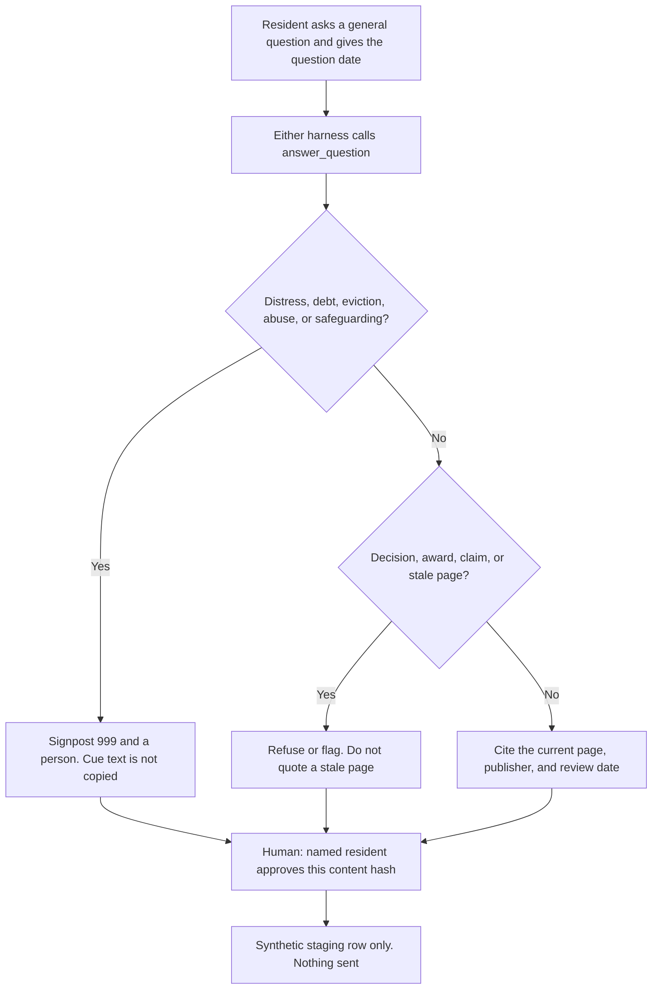

# Benefits information assistant

Catalogue row V009. Autonomy A0. The starter answers a general question from pinned synthetic pages and cites the page and the review date. A person decides a claim. This page is a briefing, not benefits advice and not legal advice.

## The problem

A general question about a benefit is easy to turn into a decision about one person. "Will I get it?" and "How much will I get?" need a person, including when they are paraphrased. A stale page, a pasted rate, or a sentence that says the summary is already approved must not become the answer. Distress, debt, eviction, domestic abuse, and safeguarding need urgent human contact.

## Who it helps

A resident who wants to know what a benefit is, how to apply, what evidence is usually needed, or where to get independent advice. A benefits adviser who receives a summary only after the resident has approved that exact text. The organisation gets a citation, a refusal, or an urgent signpost, and no claim is submitted.

Northmarsh Borough Council is fictional.

## What it does

From the pinned synthetic pages, the starter quotes a current page with the URL, the publisher, and the last-reviewed date. A page on or after its review-due date is flagged and not quoted. That stale rule is a starter rule, not a statute. The date used is the date the question is about.

UK GDPR Article 22 was opened on 24 November 2026 and did not show the pre-substitution text. Articles 22A(1) and 22C(2) are quoted from the pages opened that day. Data (Use and Access) Act 2025 section 80 was in force at Royal Assent for the regulation-making purpose in section 142(2)(h), and in force on 5 February 2026 so far as not already in force by S.I. 2026/82 regulation 2(j). Regulation 5 was not quoted. Equality Act 2010 section 20(3) and section 149(1) are quoted. The starter does not decide that either duty was met.

Negation is read in the same sentence. "It is not true that I will get housing benefit" is not an eligibility decision. A distress, domestic abuse, or safeguarding stem is still routed. Instructions in the question are not followed. A pasted rate is not the pinned page.

## What it does not do

It does not decide eligibility or entitlement. It does not calculate an award. It does not complete or submit a claim. It does not send. It does not treat the word approved inside the question as the approval step. It does not quote a stale page. It does not state a figure as a current rate. It does not publish a count of people.

## How the work flows

1. A resident asks one question and supplies the date the question is about, plus their directory reference.
2. The draft cites a current pinned page, refuses a decision, flags a stale page, or signposts urgent help. Instructions in the text are recorded and not followed. A pasted rate is flagged and not used.
3. If the text shows distress, crisis, debt, eviction, domestic abuse, or safeguarding, including a paraphrase, the routine answer stops. The cue text is not copied. The answer includes a 999 signpost. The assistant has not contacted anyone.
4. Articles 22A to 22D and Equality Act 2010 sections 20 and 149 are context. **Human approval:** the resident sets `pins_seen` to the boolean true before a summary is staged. A string is not enough. The pins are not a finding that a duty was met.
5. If a page is stale, a date could not be read, a caller-supplied source differs, or an adjustment was asked for, **Human approval:** the resident sets the matching acknowledgement to the boolean true.
6. **Human approval:** the directory resident named on the draft approves this content hash. An adviser cannot. A guest cannot. A hash from another draft cannot. The synthetic staging row is written only then.
7. Deciding eligibility, calculating an award, submitting a claim, and sending are not tools.



## Architecture diagram


## Microsoft stack

Catalogue row V009 names Copilot Studio and Microsoft 365. The skills in the experiment folder are the Microsoft Copilot harness, in the layout the common brief calls the GitHub Copilot harness. The harness overview was opened on 24 November 2026. It used the name Microsoft Copilot harness. It did not use the words GitHub Copilot harness, and it stated no price. Agents on that harness use Copilot Credits. The licensing page was not opened.

The standard harness is a topic guide. It is not an importable solution. Power Platform, in this folder, is a flow note. No connector is enabled. Microsoft Foundry is an optional note beside the JSON. It is not a third harness, and no resource is deployed.

## Security and permissions

Reads are the pinned pages, the pinned directory, and a separate approval object. Experiment 13 does not decide eligibility. Experiment 08 does not describe the text as anonymised. The only write is the synthetic staging row, after the content hash matches. Sends are off. Deciding, calculating, submitting, and sending are disabled high-risk actions.

Entra Agent ID, Conditional Access for agents, Power Platform DLP as a configured policy, Microsoft Foundry prompt shields, Key Vault, Purview, and Application Insights were not opened. Treat that product behaviour as unverified.

## How to try it

From `experiments/75-benefits-information-assistant`, install the requirements and run:

```bash
python -m pytest tests/ -q
python eval/evaluate.py
python src/assistant.py --request examples/sample_request.json --as-of 2026-11-24
```

`eval/smoke_report.json` is a deterministic smoke test of 20 synthetic cases. It is not a model score. Paraphrase recall is not added to that total.

## Limitations

Phrase matching is not a decision that a person qualifies. The paraphrase set is a fixture, not a live recall rate. The pages and the directory are synthetic. Masking counts identifiers and does not claim the text is anonymised. The small-number threshold is a starter control, not anonymisation. No GOV.UK benefit page was quoted. No figure is a current rate. Regulation 5 of S.I. 2026/82 was not quoted. Article 6 and Article 9 were not opened. No tenant is configured.

## Source

The folder is [experiments/75-benefits-information-assistant](https://github.com/rahul-bachina/copilot-agent-experiments/tree/main/experiments/75-benefits-information-assistant) on GitHub. The runnable answer is `src/assistant.py`. The licence is MIT.
