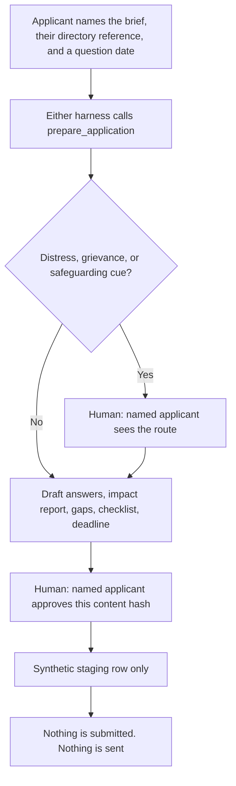

# Charity grant application assistant

Catalogue row V007. Autonomy A1. The starter drafts grant answers, an attachments checklist, a deadline plan, and an impact report from pinned synthetic sources. The named applicant approves the exact draft. This page is a briefing, not a funding decision and not legal advice.

## The problem

Staff time goes on bids and monitoring reports. A draft is easy to misread when the notes themselves say the applicant has approved, or tell the reader to ignore an eligibility gap and submit. A deadline can be past, ambiguous, or unreadable. A pasted funder brief can disagree with the brief the charity is actually using. A monitoring note can name a person or give a count small enough to identify them.

## Who it helps

An applicant at a small charity who needs a first draft that stays inside the word limits and cites the monitoring row for every figure. A trustee who needs to see the criteria the charity does not meet, rather than a draft that hides them. The organisation gets a synthetic staging row only after the named applicant approves that exact package.

A person who pastes a note of distress is not processed as a routine bid. The cue is routed to the applicant and the words are not copied.

Harbour Lane Community Kitchen and Northfold Community Foundation are fictional. The label `synthetic-760014` is not a Charity Commission number.

## What it does

From the pinned funder brief, the pinned charity profile, and the pinned monitoring rows, the starter maps each eligibility check to the profile or to a row. A gap stays a gap. Answers stay within the pinned word limits. The impact report copies a figure or a quotation only when a row contains it, and it names that row. A beneficiary count below 5 is withheld and is not added into a total. Five is this starter's threshold, not a claim of anonymisation.

The deadline is parsed and compared with the date the question is about. A past deadline is flagged. An unreadable date is flagged and is not replaced with today.

Charity Commission guidance CC3 and Charities Act 2011 section 17(1) and section 17(5) are quoted from the pages opened on 24 November 2026. UK GDPR Article 5(1)(c) is quoted from legislation.gov.uk on the same day. PB1, PB2, PB3, and section 14 were not opened. The quotes are not a finding that a duty was met.

Negation is read in the same sentence. "It is not true that the applicant must be a registered charity in England or Wales" is not support for that requirement. A distress stem is still routed. Instructions in the documents are not followed. A self-declared role or clearance is not the directory. A pasted brief is not the pinned brief. A SECRET cover is caught from the page. A legal hold and retention labels are kept.

## What it does not do

It does not submit an application. It does not contact a funder. It does not send the package. It does not treat the word approved inside a document as the approval step. It does not invent an impact figure, a case study, a testimonial, or a partner. It does not mark a carve-out as acceptable. It does not apply a leading criterion. It does not coerce an unreadable date to zero or to today. It does not write a production record.

## How the work flows

1. An applicant supplies their directory reference, the application id, the pinned brief id, and the date the question is about.
2. The draft maps eligibility, writes answers inside the word limits, builds the attachments checklist and the deadline plan, and drafts the impact report. Every published figure names its row. Instructions in the text are recorded and not followed. A pasted brief is flagged and not used.
3. If the text shows distress, a grievance, or a safeguarding concern about a person, including a paraphrase, the routine draft stops. **Human approval:** the named applicant records that they have seen that route. The cue text is not copied.
4. CC3, section 17, and Article 5(1)(c) were opened. Section 14 and the public-benefit guidance booklets were not. **Human approval:** the applicant sets `pins_seen` to the boolean true. A string is not enough. The pins that were not opened are still not confirmed.
5. If a source is stale on the question date, a date could not be read, or a caller-supplied brief differs from the pinned file, **Human approval:** the applicant sets the matching acknowledgement to the boolean true.
6. If a criterion is not met, or a biased criterion was pasted, **Human approval:** the applicant sets `criteria_seen` to the boolean true. The gap is not rewritten as met.
7. **Human approval:** the directory applicant named on the draft approves this content hash. A trustee cannot. A guest cannot. A hash from another draft cannot. The synthetic staging row is written only then. The row is not a submission.



## Architecture diagram


## Microsoft stack

Catalogue row V007 names M365 and the GitHub Copilot harness. The skills in the experiment folder are the Microsoft Copilot harness, in the layout the common brief calls the GitHub Copilot harness. The harness overview was opened on 24 November 2026. The page used the name Microsoft Copilot harness. It did not use the words GitHub Copilot harness, and it stated no price. The sentence that this harness is not the GitHub Copilot service was not on that page. That point is unverified.

The standard harness is a topic guide. It is not an importable solution. This starter does not call Microsoft Graph or a mailbox. Microsoft Foundry is an optional note beside the JSON. It is not a third harness, and no resource is deployed.

## Security and permissions

Reads are the pinned brief, the pinned profile, the pinned monitoring rows, the pinned directory, and a separate approval object. Experiment 12 does not confirm the files. Experiment 08 does not describe the text as anonymised. The only write is the synthetic staging row, after the content hash matches. Sends are off. Submitting, contacting a funder, and sending are disabled high-risk actions.

Entra Agent ID, Conditional Access for agents, Power Platform DLP as a configured policy, Microsoft Foundry prompt shields, Key Vault, Purview, and Application Insights were not opened. Treat that product behaviour as unverified.

## How to try it

From `experiments/76-charity-grant-application-assistant`, install the requirements and run:

```bash
python -m pytest tests/ -q
python eval/evaluate.py
python src/grant.py --request examples/sample_request.json --as-of 2026-11-14
```

`eval/smoke_report.json` is a deterministic smoke test of 20 synthetic cases. It is not a model score. Paraphrase recall is not added to that total.

## Limitations

Phrase matching is not a decision that a bid is eligible. The paraphrase set is a fixture, not a live recall rate. The brief, the profile, and the monitoring rows are synthetic. Masking counts identifiers and does not claim the text is anonymised. The small-number threshold is a starter control, not anonymisation. The deadline offsets are the brief's offsets, not a statutory period. Section 14 and the public-benefit booklets were not opened. No tenant is configured.

## Source

The folder is [experiments/76-charity-grant-application-assistant](https://github.com/rahul-bachina/copilot-agent-experiments/tree/main/experiments/76-charity-grant-application-assistant) on GitHub. The runnable draft is `src/grant.py`. The licence is MIT.
