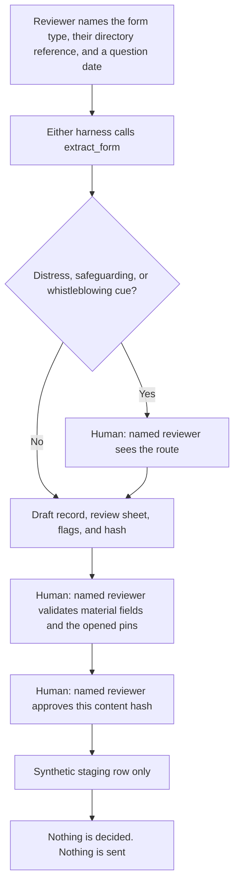

# Form extraction assistant

Catalogue row O002. Autonomy A1. The starter extracts fields from a synthetic form into a draft record. The named reviewer approves the exact draft. This page is a briefing, not a decision on an application and not legal advice.

## The problem

Council permits, HR change forms, and supplier bank-details changes are full of boxes. A box can be blank, illegible, or filled twice. A checkbox can be ticked and crossed. A signature line can say verified when nobody has checked it. A bank-details change is a fraud risk if software treats the form as already confirmed. A line in the form can tell the reader to ignore the schema or to drop a legal hold.

## Who it helps

A reviewer who needs a first structured record, with each field tied to a page, a line, or a box, and a sheet that highlights identity, bank details, amounts, dates, and declarations. The organisation gets a synthetic staging row only after that named reviewer approves the exact record.

A person who pastes a note of distress, a safeguarding concern, or a whistleblowing disclosure is not processed as a routine form. The cue is routed and the words are not copied.

North Quay, Sam River, and River Supplies are fictional.

## What it does

From the pinned schema for that form type, the starter reads labelled lines. A missing value stays missing. An illegible value stays empty. Two different values are not reduced to one. Dates, postcodes, sort codes, and amounts are normalised only when they parse. `12/12/2024` is one date. `03/04/2025` is left ambiguous. An impossible or future date is flagged. An unreadable amount is not turned into zero.

A signature is present or absent. It is never verified. A supplier bank-details change is high risk for a human call-back. The call-back is not performed.

UK GDPR Article 5(1)(c) and Article 5(1)(d) are quoted from the page opened on 25 November 2026. Article 6 and Article 9 were not opened. The quotes are not a finding that a principle was met.

A count from 1 to 4 is withheld, and so are percentages, differences, and the same count under another field name. Five is this starter's threshold, not a claim of anonymisation.

The form is passed to Experiment 12 for intake and to Experiment 08 for UK identifier counts. This page does not ship a second inventory or a second redactor. Neither neighbour confirms the file or describes the text as anonymised.

## What it does not do

It does not invent a value. It does not decide an application. It does not write to a production system. It does not send. It does not perform a call-back. It does not treat the word approved inside the form as the approval step. It does not apply a caller-supplied schema. It does not follow instructions in the form. It does not drop a legal hold, a retention label, or a protective marking.

## How the work flows

1. A reviewer supplies the form type, their directory reference, the extraction id, and the date the question is about.
2. The draft reads the pinned schema, not a schema pasted in the request. Each field keeps a location and a confidence. Instructions in the text are recorded and not followed.
3. If the text shows distress, safeguarding, or whistleblowing, including a paraphrase, the routine draft stops. **Human approval:** the named reviewer records that they have seen that route. The cue text is not copied.
4. Article 5(1)(c) and Article 5(1)(d) were opened. Article 6 and Article 9 were not. **Human approval:** the reviewer sets `pins_seen` and `material_fields_seen` to the boolean true. A string is not enough.
5. If the schema is stale on the question date, a date could not be read, a caller schema differs, a bank-details change is present, or a field is blank, illegible, or contradictory, **Human approval:** the reviewer sets the matching acknowledgement to the boolean true. A call-back is still not performed.
6. **Human approval:** the directory reviewer named on the draft approves this content hash. The hash is the copy the agent stored. A clerk cannot approve. A guest cannot approve. An edited package that is hashed again is refused. The synthetic staging row is written only then. The row is not a decision.



## Architecture diagram


## Microsoft stack

Catalogue row O002 names Document Intelligence and Power Platform. The skills in the experiment folder are the Microsoft Copilot harness, in the layout the common brief calls the GitHub Copilot harness. The harness overview was opened on 25 November 2026. The page used the name Microsoft Copilot harness. It did not use the words GitHub Copilot harness, and it stated no price. The sentence that this harness is not the GitHub Copilot service was not on that page. That point is unverified.

The standard harness is a topic guide. It is not an importable solution. Document Intelligence was read and is not called. The runnable sample works on synthetic text with no cloud call. Microsoft Foundry is an optional note beside the JSON. It is not a third harness, and no resource is deployed.

## Security and permissions

Reads are the pinned schemas, the pinned directory, one pasted form, and a separate approval object. Experiment 12 does not confirm the file. Experiment 08 does not describe the text as anonymised. The only write is the synthetic staging row, after the content hash matches the agent-held copy. Sends are off. Deciding, writing production, calling back, and sending are disabled high-risk actions.

Entra Agent ID, Conditional Access for agents, Power Platform DLP as a configured policy, Microsoft Foundry prompt shields, Key Vault, Purview, and Application Insights were not opened. Treat that product behaviour as unverified.

## How to try it

From `experiments/77-form-extraction-assistant`, install the requirements and run:

```bash
python -m pytest tests/ -q
python eval/evaluate.py
python src/extract.py --request examples/sample_request.json --as-of 2026-10-15
```

`eval/smoke_report.json` is a deterministic smoke test of 20 synthetic cases. It is not a model score. Paraphrase recall and the fee-line check are not added to that total.

## Limitations

Phrase matching is not a decision that a form is valid. The paraphrase set is a fixture, not a live recall rate. The forms and the directory are synthetic. Masking counts identifiers and does not claim the text is anonymised. The small-number threshold is a starter control, not anonymisation. The confidence bands are starter labels, not a model probability. Article 6 and Article 9 were not opened. No tenant is configured.

## Source

The folder is [experiments/77-form-extraction-assistant](https://github.com/rahul-bachina/copilot-agent-experiments/tree/main/experiments/77-form-extraction-assistant) on GitHub. The runnable draft is `src/extract.py`. The licence is MIT.
