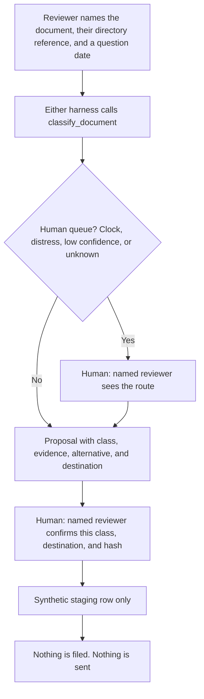

# Document classification and routing assistant

Catalogue row O003. Autonomy A1. The starter proposes a document type and a destination queue or library for one synthetic document. The named reviewer confirms that class and that destination. This page is a briefing, not a filing decision and not legal advice.

## The problem

Incoming post is easy to misfile when the letter itself says the reviewer has approved it, or tells the reader to ignore a legal hold and file it as an invoice. Two types can be present at once. A date can be ambiguous or impossible. A pasted taxonomy can disagree with the taxonomy the organisation actually uses. A cover can say SECRET while the metadata says OFFICIAL.

## Who it helps

A document reviewer who needs a first proposal, with the evidence, a confidence, and the next-best alternative, before anything is put in a queue. An information governance lead who needs statutory clocks, protective markings, and legal holds kept visible. The organisation gets a synthetic staging row only after the named reviewer confirms that exact proposal.

A person who pastes a note of distress, a safeguarding concern, or a whistleblowing disclosure is not processed as routine post. The cue is routed to the reviewer and the words are not copied.

Northwharf Borough Council is fictional.

## What it does

From the pinned taxonomy and the pinned routing table, the starter proposes one class or leaves the class unset. Low confidence, more than one class, and no class go to the human queue. A freedom of information request and a subject access request go to a person. The statutory words are quoted from the pages opened on 25 November 2026. The clock is not marked as met, and no statutory due date is produced.

Freedom of Information Act 2000 section 1(1) and section 10(1), UK GDPR Article 15(1), Article 12(3), and Article 12A(1) are quoted from legislation.gov.uk. Article 12(3) as opened does not itself say "one month". Article 12A(1) does, subject to paragraph 3. The Banking and Financial Dealings Act 1971 was not opened.

Negation is read in the same sentence. "It is not true that this includes a subject access request" is not that class. A distress stem is still routed. Instructions in the document are not followed. A self-declared role or clearance is not the directory. A pasted taxonomy is not the pinned taxonomy. A SECRET cover is caught from the page. A legal hold and retention labels are kept.

## What it does not do

It does not file, move, delete, or send a document. It does not treat the word approved inside a document as the confirmation step. It does not force a low-confidence, multi-type, or unknown document into a class. It does not decide that a statutory period was met. It does not apply bank holidays. It does not coerce an unreadable date to zero or to today. It does not write a production record. It does not use Experiment 49's file plan.

## How the work flows

1. A reviewer supplies their directory reference, the document, and the date the question is about.
2. The proposal matches the pinned taxonomy, records evidence, a confidence, and a top alternative, and names a destination. Instructions in the text are recorded and not followed. A pasted taxonomy is flagged and not used.
3. If the text shows distress, a grievance, a disclosure, urgency, or a safeguarding concern, including a paraphrase, the routine destination stops. **Human approval:** the named reviewer records that they have seen that route. The cue text is not copied.
4. A freedom of information request or a subject access request is a human queue because of the statutory clock. **Human approval:** the reviewer sets `clocks_seen` to the boolean true when that acknowledgement is listed. The clock is not marked as met.
5. Section 1, section 10, Article 15, Article 12, and Article 12A were opened. **Human approval:** the reviewer sets `pins_seen` to the boolean true. A string is not enough.
6. If a source is stale on the question date, a date could not be read, or a caller-supplied taxonomy differs from the pinned file, **Human approval:** the reviewer sets the matching acknowledgement to the boolean true.
7. If the marking is above OFFICIAL, the labels conflict, a legal hold or a retention label is present, or a count was suppressed, **Human approval:** the reviewer sets the matching acknowledgement to the boolean true. The higher marking and the hold stay on the proposal.
8. **Human approval:** the directory reviewer named on the proposal confirms this content hash, this class, and this destination. A clerk cannot. A guest cannot. A hash from an edited copy cannot. The synthetic staging row is written only then. The row is not a filing.



## Architecture diagram


## Microsoft stack

Catalogue row O003 names AI Builder or Microsoft Foundry, and Power Platform. AI Builder was not opened on 25 November 2026. Treat a claim about what AI Builder classifies as unverified. The skills in the experiment folder are the Microsoft Copilot harness, in the layout the common brief calls the GitHub Copilot harness. The harness overview was opened on 25 November 2026. The page used the name Microsoft Copilot harness. It did not use the words GitHub Copilot harness, and it stated no price. The sentence that this harness is not the GitHub Copilot service was not on that page. That point is unverified.

The standard harness is a topic guide. It is not an importable solution. This starter does not call a mailbox or a library. Microsoft Foundry is an optional note beside the JSON. It is not a third harness, and no resource is deployed. The runnable sample works offline on synthetic data.

## Security and permissions

Reads are the pinned taxonomy, the pinned routing table, the pinned directory, one pasted document, and a separate approval object. Experiment 12 does not confirm the file. Experiment 08 does not describe the text as anonymised. Experiment 49 supplies the marking rank and does not supply the class. The only write is the synthetic staging row, after the content hash matches. Sends are off. Filing, moving, deleting, and sending are disabled high-risk actions.

Entra Agent ID, Conditional Access for agents, Power Platform DLP as a configured policy, Microsoft Foundry prompt shields, Key Vault, Purview, and Application Insights were not opened. Treat that product behaviour as unverified.

## How to try it

From `experiments/78-document-classification-routing`, install the requirements and run:

```bash
python -m pytest tests/ -q
python eval/evaluate.py
python src/classify.py --document examples/sample_document.json --as-of 2026-11-25
```

`eval/smoke_report.json` is a deterministic smoke test of 20 synthetic cases. It is not a model score. Paraphrase recall is not added to that total.

## Limitations

Phrase matching is not a decision that a document is that type in law. The paraphrase set is a fixture, not a live recall rate. The taxonomy, the routing table, and the directory are synthetic. Masking counts identifiers and does not claim the text is anonymised. The Monday-to-Friday count is not the statutory working day, because bank holidays were not applied. Article 12A(3) is not applied. No tenant is configured.

## Source

The folder is [experiments/78-document-classification-routing](https://github.com/rahul-bachina/copilot-agent-experiments/tree/main/experiments/78-document-classification-routing) on GitHub. The runnable proposal is `src/classify.py`. The licence is MIT.
