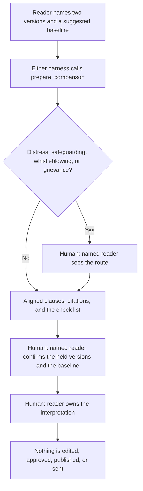

# Document comparison assistant

Catalogue row O004. Autonomy A0. The starter aligns two synthetic versions of a contract, an internal policy, or a guidance document and cites both. The named reader confirms which versions are being compared and which is the baseline. The reader owns the interpretation. This page is a briefing, not a comparison of a live contract and not legal advice.

This is not the insurance policy wording comparison in Experiment 38. That starter uses a closed topic list. This one does not call it.

## The problem

Someone comparing two versions can miss a change that is only a modal, a "not", a number, a date, a party, or a deleted exception. Renumbering and reformatting look like change and are not. A tracked deletion can carry a real figure. A sentence in the document can tell the reader to report no material change, or that the versions are already confirmed.

## Who it helps

A contracts officer, a policy owner, or a guidance editor who needs a first pass that cites both versions and lists what was checked. The organisation gets a record that the named reader confirmed the exact versions. The agent does not become the interpreter.

A person who pastes a note of distress, a safeguarding concern, whistleblowing, or a grievance is not processed as a routine comparison. The cue is routed to the reader and the words are not copied.

Reedmarsh Internal Services, Reedmarsh Council, and Northfold Supplies Ltd are fictional.

## What it does

Given two synthetic versions and a suggested baseline that is one of them, the starter aligns clauses, including a move, a split, and a merge. Each row has a pinpoint citation. It flags a change in obligation strength, an inserted or removed negation, a changed number, amount, percentage, date, period, or notice window, a changed party or definition, and a removed exception. "It is not true that the clause includes an exception" is not treated as an exception.

Reformatting and renumbering are not substantive. A real difference inside similar wording is still flagged. A low-confidence alignment is flagged. Hidden or tracked-change text is flagged. Conflicting duplicate clauses are both cited and neither is chosen. The words "no material change" are used only when every check was run and none fired, and the check list is in the result.

UK GDPR Article 5(1)(c) and Article 22A(1)(a) and the opening of Article 22A(1)(b) are quoted from the pages opened on 25 November 2026. Article 22B, Article 22C, Article 22D, and Article 84B were not opened. S.I. 2026/82 was not opened. The quotes are context. They are not a finding that a duty was met.

## What it does not do

It does not edit, approve, publish, or send a document. It does not give legal advice. It does not say which version is better. It does not treat a sentence in a document as the reader's confirmation. It does not accept a caller-supplied directory or taxonomy. It does not drop a protective marking, a legal hold, or a retention label. It does not coerce an unreadable date or a missing baseline to a default. It does not call a live model.

## How the work flows

1. A reader supplies their directory reference, the comparison id, the document kind, the suggested baseline, the two versions, and the date the question is about.
2. The comparison aligns the clauses and lists the checks. Instructions in the text are recorded and not followed. A pasted directory is flagged and not used.
3. If the text shows distress, a safeguarding concern, whistleblowing, or a grievance, including a paraphrase, the routine reading stops. **Human approval:** the named reader records that they have seen that route. The cue text is not copied.
4. Article 5(1)(c) and Article 22A were opened. Article 22B, Article 22C, Article 22D, and Article 84B were not. **Human approval:** the reader sets `pins_seen` to the boolean true. A string is not enough.
5. If a date could not be read, a review date is on or before the question date, a source is not current, or a marking was applied, **Human approval:** the reader sets the matching acknowledgement to the boolean true.
6. If a material flag, a low-confidence alignment, or hidden text is present, **Human approval:** the reader sets `material_seen` to the boolean true.
7. **Human approval:** the directory reader named on the comparison confirms this content hash and both document hashes, and which version is the baseline. A guest cannot. A hash from another comparison cannot. The documents are not approved.
8. **Human approval:** the same reader records that they own the interpretation of that hash. That step is not legal advice.



## Architecture diagram


## Microsoft stack

Catalogue row O004 names the GitHub Copilot harness and Azure. The skills in the experiment folder are the Microsoft Copilot harness, in the layout the common brief calls the GitHub Copilot harness. The harness overview was opened on 25 November 2026. The page used the name Microsoft Copilot harness. It did not use the words GitHub Copilot harness, and it stated no price. The sentence that this harness is not the GitHub Copilot service was not on that page. That point is unverified.

The standard harness is a topic guide. It is not an importable solution. This starter does not call a mailbox. Microsoft Foundry is an optional note beside the JSON. It is not a third harness, and no resource is deployed. No Azure resource is deployed.

## Security and permissions

Reads are the two synthetic versions, the pinned directory, and a separate confirmation object. Experiment 12 does not confirm the files. Experiment 08 does not describe the text as anonymised. Experiment 38 is not called. Writes are off. Sends are off. Editing, approving, publishing, sending, and giving legal advice are disabled high-risk actions.

Entra Agent ID, Conditional Access for agents, Power Platform DLP as a configured policy, Microsoft Foundry prompt shields, Key Vault, Purview, and Application Insights were not opened on 25 November 2026. Treat that product behaviour as unverified.

## How to try it

From `experiments/79-document-comparison`, install the requirements and run:

```bash
python -m pytest tests/ -q
python eval/evaluate.py
python src/compare.py --request examples/sample_request.json --as-of 2026-11-25
```

`eval/smoke_report.json` is a deterministic smoke test of 20 synthetic cases. It is not a model score. Paraphrase recall and the alignment score are not added to that total.

## Limitations

Token overlap is not a legal reading of whether two clauses mean the same thing. The paraphrase set is a fixture, not a live recall rate. The documents and the directory are synthetic. Masking counts identifiers and does not claim the text is anonymised. The small-number threshold of 5 is a starter control, not anonymisation. Treating a review date on the question date as stale is a starter rule, not a statutory period. Article 22B, Article 22C, Article 22D, and Article 84B were not opened. No tenant is configured.

## Source

The folder is [experiments/79-document-comparison](https://github.com/rahul-bachina/copilot-agent-experiments/tree/main/experiments/79-document-comparison) on GitHub. The runnable comparison is `src/compare.py`. The licence is MIT.
