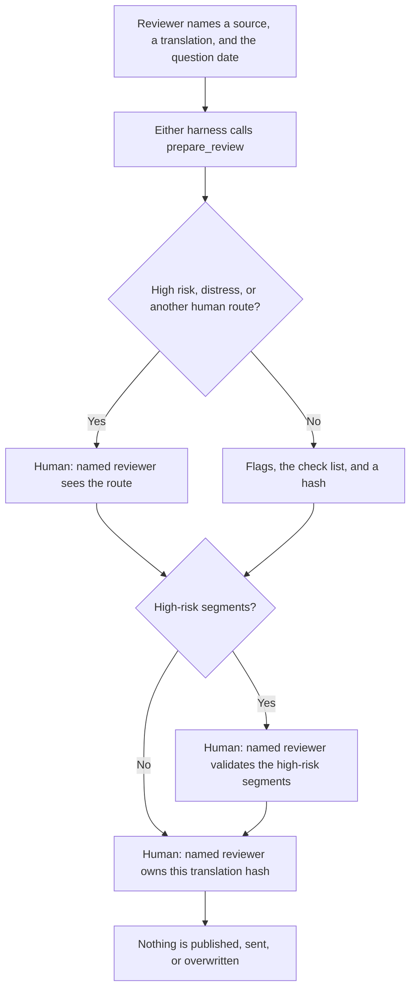

# Translation quality review assistant

Catalogue row O006. Autonomy A0. The starter aligns a synthetic source text with its translation and flags differences for a named bilingual reviewer. The reviewer validates every high-risk segment and owns the final translation. This page is a briefing, not a review of a live translation and not legal advice.

The source in the sample is English. The target is Welsh. Polish is the other community language in the pinned glossary. The sentences are synthetic.

## The problem

A public-information translation can drop a "not", turn "must" into "may", or change a date, a sum, a phone number, or a URL. Lexical overlap is a weak guide when the target is Welsh or Polish. Legal rights, health, safety, benefits, deadlines, and complaints still need a person even when the sentences look close.

## Who it helps

A bilingual reviewer who needs a first pass that lists what was checked. The organisation gets a record that the named reviewer validated the high-risk segments and owns that exact hash. The agent does not become the translator of record.

A person who pastes a note of distress, a safeguarding concern, whistleblowing, or a grievance is not processed as a routine review. The cue is routed to the reviewer and the words are not copied.

Reedmarsh Council is fictional.

## What it does

Given synthetic segments, the starter aligns them with Experiment 79 and masks contact details with Experiment 79 and Experiment 08. It flags omitted or added content, a changed number, amount, date, deadline, phone number, or URL, reversed or dropped negation, a softened or strengthened obligation, a pinned glossary term that is not the pinned target wording, an untranslated segment, inconsistent terminology, and an informal marker in public information.

"It is not true that the letter includes a deadline" is not treated as a deadline. High-risk wording is routed regardless of overlap. A low-confidence alignment is reported and is not a quality score. The words "No issues found in the checks that were run." are used only when every check was run and none fired, and the check list is in the result. A caller-supplied glossary is compared with the pinned glossary and is not applied.

Welsh Language (Wales) Measure 2011, section 1(1) and section 1(4), the Welsh Language Standards (No. 1) Regulations 2015, regulation 1(1) and regulation 1(3), and the Public Sector Bodies (Websites and Mobile Applications) (No. 2) Accessibility Regulations 2018, regulation 1(1) and regulation 1(2), are quoted from the pages opened on 26 November 2026. S.I. 2018/852 was opened the same day. That page says those regulations are revoked and does not show the citation text. The operative wording of the revoked instrument is unverified. The quotes are context. They are not a finding that a duty was met.

## What it does not do

It does not publish, send, or overwrite a document. It does not approve a translation. It does not treat a sentence in either text as the reviewer's step. It does not accept a caller-supplied glossary or directory. It does not drop a protective marking, a legal hold, or a retention label. It does not clear high-risk content because overlap looks high. It does not coerce an unreadable date or an unknown language to a default. It does not call a live model.

## How the work flows

1. A reviewer supplies their directory reference, the review id, the languages, the document kind, the two texts, and the date the question is about.
2. The review aligns the segments and lists the checks. Instructions in the text are recorded and not followed. A pasted glossary is flagged and not used.
3. If the text shows distress, a safeguarding concern, whistleblowing, or a grievance, including a paraphrase, or any other human route, the routine reading stops. **Human approval:** the named reviewer records that they have seen that route. The cue text is not copied.
4. The Welsh language and accessibility pins that were opened are listed. Pins that were not opened are named as not opened. **Human approval:** the reviewer sets `pins_seen` to the boolean true. A string is not enough.
5. If a date could not be read, a review date is on or before the question date, a marking was applied, a flag was raised, or a caller glossary was supplied, **Human approval:** the reviewer sets the matching acknowledgement to the boolean true.
6. If a segment is high risk, **Human approval:** the named reviewer validates those segments for this content hash and both document hashes. Overlap does not skip this step.
7. **Human approval:** the same reviewer owns the final translation of that hash. A guest cannot. A reviewer without the target language cannot. A hash from another review cannot. The documents are not published.



## Architecture diagram


## Microsoft stack

Catalogue row O006 names the GitHub Copilot harness and Microsoft Foundry. The skills in the experiment folder are the Microsoft Copilot harness, in the layout the common brief calls the GitHub Copilot harness. The harness overview was opened on 26 November 2026. The page used the name Microsoft Copilot harness. It did not use the words GitHub Copilot harness, and it stated no price. The sentence that this harness is not the GitHub Copilot service was not on that page. That point is unverified.

The standard harness is a topic guide. It is not an importable solution. This starter does not call a mailbox. Microsoft Foundry is an optional note beside the JSON. It is not a third harness, and no resource is deployed.

## Security and permissions

Reads are the two synthetic texts, the pinned directory, the pinned glossary, and a separate review object. Experiment 79 does not have its alignment rules copied. Experiment 08 does not describe the text as anonymised. Writes are off. Sends are off. Publishing, sending, overwriting, and approving the translation are disabled high-risk actions.

Entra Agent ID, Conditional Access for agents, Power Platform DLP as a configured policy, Microsoft Foundry prompt shields, Key Vault, Purview, and Application Insights were not opened on 26 November 2026. Treat that product behaviour as unverified.

## How to try it

From `experiments/80-translation-quality-review`, install the requirements and run:

```bash
python -m pytest tests/ -q
python eval/evaluate.py
python src/review.py --request examples/sample_request.json --as-of 2026-11-26
```

`eval/smoke_report.json` is a deterministic smoke test of 20 synthetic cases. It is not a model score. Seeded-error precision and recall, paraphrase recall, and the alignment score are not added to that total.

## Limitations

Pattern checks are not a translation model. Welsh and Polish are lower-resource for this starter: a segment-id match is low confidence unless the wording is almost the same. The paraphrase set is a fixture, not a live recall rate. The texts, the directory, and the glossary are synthetic. Masking counts identifiers and does not claim the text is anonymised. The small-number threshold of 5 is a starter control, not anonymisation. Treating a review date on the question date as stale is a starter rule, not a statutory period. The standards schedule and the accessibility requirements after regulation 1 were not opened. No tenant is configured.

## Source

The folder is [experiments/80-translation-quality-review](https://github.com/rahul-bachina/copilot-agent-experiments/tree/main/experiments/80-translation-quality-review) on GitHub. The runnable review is `src/review.py`. The licence is MIT.
