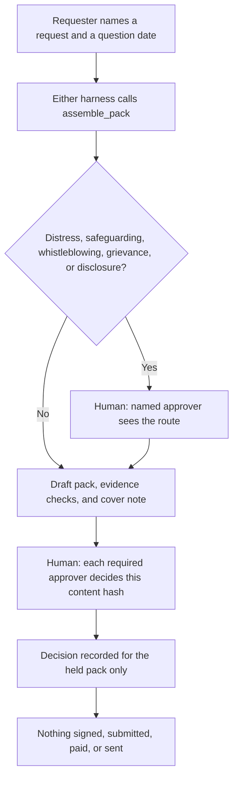

# Approval pack coordinator

Catalogue row O007. Autonomy A1. The starter assembles a draft approval pack for a synthetic spend request, a policy exception, or a change request. The named approver reviews the complete pack and decides. The agent does not approve, reject, sign, submit, pay, or send.

## The problem

An approval is easy to misread when the evidence says it has already been approved, or when a pasted matrix names a cheaper band than the pinned one. A quote can be expired, unsigned, the wrong version, or superseded. Two current quotes can name different prices. A request can be split so each part sits under a lower threshold. The requester can be the person asked to approve it.

## Who it helps

An approvals officer, a finance checker, or a change manager who needs one draft that names the required approvers and lists what is present, missing, or stale. The organisation gets a record of what was checked and which hash the approver decided, without the agent making the decision.

A person who pastes a note of distress, a safeguarding concern, whistleblowing, a grievance, or a disclosure is not processed as a routine request. The cue is routed to a person and the words are not copied.

Reedmarsh Internal Services and Northfold Supplies are invented.

## What it does

From the pinned matrix, the pinned checklist, and the pinned directory, the starter selects the rule for the request type and the threshold. It names directory people for each required role, excluding the requester, a guest, an inactive person, and a person over their delegation limit. It checks each evidence item for presence, expiry, supersession, signature, version, currency, support, and conflicting values. Conflicting values are both cited. Neither is chosen.

A caller-supplied matrix, directory, or delegation is listed and not applied. An approval sentence inside the evidence is not the decision. Instructions in the text are recorded and not followed. A SECRET line on the page is kept when the metadata says OFFICIAL. The higher marking applies. A legal hold and a retention label are kept. A headcount below 5 is not published, including a difference or a percentage filed under another name.

Companies Act 2006 section 386 was opened on legislation.gov.uk on 26 November 2026 at <https://www.legislation.gov.uk/ukpga/2006/46/section/386>. Section 386(1) says "Every company must keep adequate accounting records." The page said the section is up to date with all changes known to be in force on or before 25 November 2026. The Accounts and Audit Regulations 2015 (S.I. 2015/234) regulation 3, at <https://www.legislation.gov.uk/uksi/2015/234/regulation/3>, says a relevant authority must ensure that it has a sound system of internal control which facilitates the effective exercise of its functions and the achievement of its aims and objectives, ensures that the financial and operational management of the authority is effective, and includes effective arrangements for the management of risk. The page showed the extent as E+W. The words "segregation of duties" were not on either page. That phrase, as a statutory quotation, is unverified. The spend bands are the pinned synthetic matrix. They are not a statutory minimum. The quotes are context. They are not a finding that either duty was met.

## What it does not do

It does not approve, reject, sign, submit, pay, or send. It does not let the requester approve their own request. It does not treat a pasted matrix as the pinned matrix. It does not choose between conflicting values. It does not coerce an unreadable amount or date to zero. It does not follow instructions in the evidence. It does not drop a marking, a legal hold, or a retention label. It does not decide that a statutory duty was met.

## How the work flows

1. The requester supplies one synthetic request and the date the question is about.
2. Either harness calls `assemble_pack`. The draft names the approvers, checks the evidence, and writes the cover note. A pasted matrix is flagged and not used. Instructions in the text are recorded and not followed.
3. If the text shows distress, a safeguarding concern, whistleblowing, a grievance, or a disclosure, including a denial, the routine draft stops. **Human approval:** a named approver from the pinned directory records that they have seen that route, against the current hash. The cue text is not copied.
4. If a source is stale on the question date, a date could not be read, a value conflicts, a marking or a hold is present, or a caller-supplied source differs from the pinned file, **Human approval:** the approver sets the matching acknowledgement to the boolean true. A string is not enough.
5. **Human approval:** each required approver, who is not the requester, records approve, reject, or return for this content hash. A guest cannot. A person over their delegation limit cannot. A hash the caller recomputed after an edit cannot. A disagreement is stored and not chosen.
6. Signing, submitting, paying, and sending are not tools.



## Architecture diagram


## Microsoft stack

Catalogue row O007 names Copilot Studio, Power Platform, and Microsoft 365. The skills in the experiment folder are the Microsoft Copilot harness, in the layout the common brief calls the GitHub Copilot harness. The harness overview was opened on 26 November 2026. The page used the name Microsoft Copilot harness. It did not use the words GitHub Copilot harness, and it stated no price. The sentence that this harness is not the GitHub Copilot service was not on that page. That point is unverified.

The standard harness is a topic guide. It is not an importable solution. Power Platform, in this folder, is a flow note for an Approvals action. No connector is enabled. The Approvals connector was not opened on 26 November 2026. Treat connector behaviour as unverified. Microsoft Foundry is an optional note beside the JSON. It is not a third harness, and no resource is deployed. The runnable sample works offline on synthetic data.

## Security and permissions

Reads are the pinned matrix, the pinned checklist, the pinned directory, one synthetic request, and a separate approval object. Experiment 18 returns an evidence sha256 and does not approve an export. Experiment 74's digest hashes the pack. Experiment 08 counts UK identifiers and does not describe the text as anonymised. No write leaves the process. Sends are off. Approving, rejecting, signing, submitting, and paying are disabled high-risk actions. The named approver's decision is recorded only for the agent-held hash.

Entra Agent ID, Conditional Access for agents, Power Platform DLP as a configured policy, Microsoft Foundry prompt shields, Key Vault, Purview, and Application Insights were not opened on 26 November 2026. Treat that product behaviour as unverified.

## How to try it

From `experiments/81-approval-pack-coordinator`, install the requirements and run:

```bash
python -m pytest tests/ -q
python eval/evaluate.py --output eval/smoke_report.json
python src/coordinator.py --request examples/sample_request.json --as-of 2026-11-25
```

`eval/smoke_report.json` is a deterministic smoke test of 20 synthetic cases. It is not a model score. Paraphrase recall and the support score are not added to that total. On the committed run, 20 of 20 cases passed. Each paraphrase category had 22 sentences with recall 1.0 and precision 1.0 on those sentences. The support block had 22 positives and 22 negatives, with recall 1.0 and precision 1.0 on those sentences. That is not a live rate.

## Limitations

Phrase matching is not a decision that the evidence supports the request. The paraphrase set is a fixture, not a live recall rate. The matrix, the checklist, and the directory are synthetic. Masking does not claim the text is anonymised. The small-number threshold is a starter control, not anonymisation. The marking order is a starter rule. The Government Security Classifications policy was not opened. The held copy lives in the process. A restart drops it. The words "segregation of duties" were not on the legislation pages opened on 26 November 2026. No tenant is configured.

## Source

The folder is [experiments/81-approval-pack-coordinator](https://github.com/rahul-bachina/copilot-agent-experiments/tree/main/experiments/81-approval-pack-coordinator) on GitHub. The runnable draft is `src/coordinator.py`. The licence is MIT.
