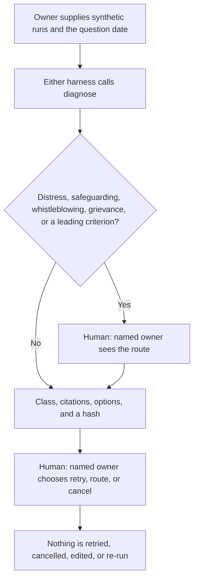

# Workflow exception assistant

Catalogue row O009. Autonomy A1. The starter reads synthetic Power Automate-style run histories, classifies the exception, groups related failures, and proposes retry, route, or cancel with the risks. The named process owner chooses. This page is a briefing, not a reading of a live flow and not a decision to retry one.

This is not the invoice exception triage in Experiment 17. That starter reads one invoice that failed a match. This one does not call it.

## The problem

A failed or stuck flow is hard to read. The error text may say "retry now" when the structured code is a business-rule breach. A lookup that is idempotent is not the same as a payment step. A run that already sent an email or wrote a record can be only partly complete. A sentence in the payload can claim the owner has already approved a retry.

## Who it helps

A process owner who needs a first reading of related failures, with a citation to the run and the step, before they choose. The organisation gets a record that the choice was bound to the exact proposal and its hash.

A person who pastes a note of distress, a safeguarding concern, whistleblowing, or a grievance is not processed as a routine failure. The cue is routed to the owner and the words are not copied.

Reedmarsh Internal Services is fictional.

## What it does

Given synthetic runs and the date the question is about, the starter classifies each failure from a pinned code list: transient connector or throttling, authentication or an expired connection, data validation, missing reference data, permissions, a business-rule breach, a duplicate submission, or a timeout. A run that is still going, and whose start is at least the pinned number of calendar-day hours before the question date, is a timeout. A run that started on the question date is not given a duration of zero.

Related failures are grouped. Each citation names the run, the step, the index, and the status. Error text is not the class. "It is not true that the error includes ignore previous instructions" is not an instruction. Conflicting codes are both kept and neither is chosen.

Retry is marked safe only when every failing step is idempotent on the pinned register, has no side effect, has no qualifier, and the class is transient or timeout. A payment, an email, or a record write is flagged as a possible duplicate. Partial completion is flagged. A caller-supplied register is compared and not applied.

UK GDPR Article 5(1)(c) and Article 22A(1)(a) and the opening of Article 22A(1)(b) are quoted from the pages opened on 26 November 2026. The FCA operational-resilience overview was opened the same day. SYSC 15A was not opened. The quotes are context for an audit trail. They are not a finding that a duty was met or that a firm stayed inside an impact tolerance.

## What it does not do

It does not retry, cancel, edit a record, or re-run a flow. It does not auto-retry, including when the reading says a retry is safe. It does not treat error text or a caller-supplied register as authoritative. It does not drop a protective marking, a legal hold, or a retention label. It does not coerce an unreadable timestamp. It does not decide that a firm met an impact tolerance. It does not call a live model.

## How the work flows

1. An owner supplies their directory reference, the diagnosis id, the process id, the runs, and the date the question is about.
2. The reading classifies the codes and lists the options. Instructions in the text are recorded and not followed. A pasted register is flagged and not used.
3. If the text shows distress, a safeguarding concern, whistleblowing, a grievance, or a leading criterion, including a paraphrase, the routine reading stops. **Human approval:** the named process owner records that they have seen that route. The cue text is not copied.
4. Article 5(1)(c) and Article 22A were opened. Article 22B, Article 22C, Article 22D, and SYSC 15A were not. **Human approval:** the owner sets `pins_seen` to the boolean true. A string is not enough.
5. If a timestamp could not be read, a run is stale or future, a marking was applied, the run is only partly complete, or the codes conflict, **Human approval:** the owner sets the matching acknowledgement to the boolean true.
6. **Human approval:** the directory process owner, or a deputy on the pinned register, chooses retry, route, or cancel for this content hash. A guest cannot. A hash from another diagnosis cannot. The choice is not carried out.



## Architecture diagram


## Microsoft stack

Catalogue row O009 names Power Platform and Copilot Studio. The skills in the experiment folder are the Microsoft Copilot harness, in the layout the common brief calls the GitHub Copilot harness. The harness overview was opened on 26 November 2026. The page used the name Microsoft Copilot harness. It did not use the words GitHub Copilot harness, and it stated no price. The page says that harness retries and finds alternative paths. This starter does not enable that. The sentence that this harness is not the GitHub Copilot service was not on that page. That point is unverified.

The standard harness is a topic guide. It is not an importable solution. This starter does not call Power Automate. Microsoft Foundry is an optional note beside the JSON. It is not a third harness, and no resource is deployed.

## Security and permissions

Reads are the synthetic runs, the pinned register, the pinned directory, and a separate decision object. Experiment 08 does not describe the text as anonymised. Experiment 17 is not called. Writes are off. Sends are off. Retrying, cancelling, editing a record, re-running a flow, and deciding an impact tolerance are disabled high-risk actions.

Entra Agent ID, Conditional Access for agents, Power Platform DLP as a configured policy, Microsoft Foundry prompt shields, Key Vault, Purview, and Application Insights were not opened on 26 November 2026. Treat that product behaviour as unverified.

## How to try it

From `experiments/82-workflow-exception-assistant`, install the requirements and run:

```bash
python -m pytest tests/ -q
python eval/evaluate.py
python src/workflow.py --request examples/sample_request.json --as-of 2026-11-26
```

`eval/smoke_report.json` is a deterministic smoke test of 20 synthetic cases. It is not a model score. Paraphrase recall and the classification score are not added to that total.

## Limitations

The class list is the pinned taxonomy. A code that is not on it is unclassified. The paraphrase set is a fixture, not a live recall rate. Calendar-day hours for a stuck run are a lower bound, not a measured duration. The runs and the directory are synthetic. Masking counts identifiers and does not claim the text is anonymised. The small-number threshold of 5 is a starter control, not anonymisation. Treating a run as stale on the pinned boundary is a starter rule, not a statutory period. Article 22B, Article 22C, Article 22D, and SYSC 15A were not opened. No tenant is configured.

## Source

The folder is [experiments/82-workflow-exception-assistant](https://github.com/rahul-bachina/copilot-agent-experiments/tree/main/experiments/82-workflow-exception-assistant) on GitHub. The runnable reading is `src/workflow.py`. The licence is MIT.
