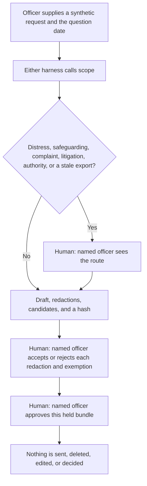

# Subject access request scoping and redaction assistant

Catalogue row UK11. Autonomy A1. The starter reads a synthetic subject access request and a synthetic records export, illustrates the statutory period, and proposes redactions and exemption candidates. The named information governance officer approves every redaction, every exemption, and the disclosure bundle. This page is a briefing, not a disclosure and not legal advice.

This is not the UK identifier gateway in Experiment 08, and it is not the document intake in Experiment 12. Those starters are called. Experiment 01 is not called.

## The problem

A subject access file mixes the requester's data with other people's names, phone numbers, and addresses. The letter may come from a solicitor. It may also be an FOI request, a complaint, or a sign of distress. The one-month period in the UK GDPR text after the Data (Use and Access) Act 2025 has more than one operational reading. An officer needs both readings, a redaction list, and a record that they approved that exact bundle.

## Who it helps

An information governance officer who needs a first scope before they decide what to disclose. The organisation gets a hash that ties the approval to the bundle that was shown.

A person whose letter also shows distress, a safeguarding concern, whistleblowing, a complaint, a grievance, or litigation is not processed as a routine request. The cue is routed to the officer and the words are not copied.

Reedmarsh Borough Council is fictional.

## What it does

Given a synthetic letter, email, or web form, and the date the question is about, the starter logs the request in the draft and illustrates the period. UK GDPR Article 12(3), opened on 27 November 2026, says the controller shall provide information "before the end of the applicable time period (see Article 12A)". Article 12A(1) says that period is "the period of one month beginning with the relevant time". The ICO page opened the same day says to count forward to the same date in the following month. Both readings are returned. They differ. Neither is selected. An extension and an Article 12A(5) pause are illustrative. Public holidays are not applied. The Banking and Financial Dealings Act 1971 was not opened.

The search scope names the pinned systems that the request mentions or that hold a matching document. Article 15(1A) is quoted. `search_reasonable_decided` stays false.

Third-party names, emails, phones, dates of birth, postal addresses, staff ids, and the UK identifiers from Experiment 08 are proposed for redaction. The requester's own values stay. The text is not described as anonymised. A count of one to four third parties is not published as a number, a percentage, or a difference.

Exemption candidates use the paragraph numbers read on legislation.gov.uk on 27 November 2026, including Schedule 2 paragraphs 16, 19, 22, 23, and 24. A negation in the same sentence is not a match. `applied` stays false.

An FOI request for the applicant's own personal data is routed under FOI Act section 40(1). The section was opened. The agent does not answer it as an FOI disclosure. A mixed request goes to a person.

## What it does not do

It does not send a response. It does not delete or edit a record. It does not decide an exemption. It does not choose a deadline. It does not trust an approval sentence, a role, a clearance, or a directory inside the request. It does not drop a protective marking, a legal hold, or a retention label. It does not coerce an unreadable date or a malformed amount. It does not call a live model. It does not call Experiment 01.

## How the work flows

1. An officer supplies their directory reference, the case id, the request, the records export, and the date the question is about.
2. The draft illustrates both deadline readings, lists the search scope, and proposes redactions and exemption candidates. Instructions in the text are recorded and not followed. A pasted directory is flagged and not used.
3. If the text shows distress, a safeguarding concern, whistleblowing, a complaint, a grievance, litigation, or third-party authority, including a paraphrase, the routine draft stops. **Human approval:** the named information governance officer records that they have seen that route. The cue text is not copied.
4. Articles 12, 12A, and 15, DPA 2018 Schedules 2 to 4 where cited, section 45, section 54, and FOI Act section 40(1) were opened. Sections 52 and 53, and S.I. 2026/82, were not. **Human approval:** the officer sets `pins_seen` and `dates_seen` to the boolean true. A string is not enough.
5. If identity is not evidenced, a third party is acting, a marking was applied, a hold or a retention label is present, a count is suppressed, the dates conflict, or the export is stale, **Human approval:** the officer sets the matching acknowledgement to the boolean true.
6. **Human approval:** the directory information governance officer, or a deputy on the pinned directory, accepts or rejects every redaction and every exemption for this content hash. A guest cannot. A hash from another case cannot. The disclosure is not sent.



## Architecture diagram


## Microsoft stack

Catalogue row UK11 names Azure, Microsoft Foundry, and Power Platform. The skills in the experiment folder are the Microsoft Copilot harness, in the layout the common brief calls the GitHub Copilot harness. The harness overview was opened on 27 November 2026. The page used the name Microsoft Copilot harness. It did not use the words GitHub Copilot harness, and it stated no price. The page says that harness retries and finds alternative paths. This starter does not enable that. The sentence that this harness is not the GitHub Copilot service was not on that page. That point is unverified.

The standard harness is a topic guide. It is not an importable solution. This starter does not call Power Automate. Microsoft Foundry is an optional note beside the JSON. It is not a third harness, and no resource is deployed.

## Security and permissions

Reads are the synthetic request, the synthetic export, the pinned directory, the pinned systems list, and a separate approval object. Experiment 08 does not describe the text as anonymised. Experiment 12 leaves `files_confirmed` false. Experiment 01 is not called. Writes are off. Sends are off. Sending, deleting, editing a record, and deciding an exemption are disabled high-risk actions.

Entra Agent ID, Conditional Access for agents, Power Platform DLP as a configured policy, Microsoft Foundry prompt shields, Key Vault, Purview, and Application Insights were not opened on 27 November 2026. Treat that product behaviour as unverified.

## How to try it

From `experiments/83-subject-access-request-assistant`, install the requirements and run:

```bash
python -m pytest tests/ -q
python eval/evaluate.py
python src/sar.py --request examples/sample_request.json --as-of 2026-10-20
```

`eval/smoke_report.json` is a deterministic smoke test of 20 synthetic cases. It is not a model score. Paraphrase recall and the classification score are not added to that total.

## Limitations

The two deadline readings are both shown and neither is selected. Public holidays are not applied. Sections 52 and 53 were not opened, so a law-enforcement identity date is not applied. S.I. 2026/82 was not opened. An export older than 30 days is flagged. Thirty days is a starter rule, not a statute. The paraphrase set is a fixture, not a live recall rate. The records and the directory are synthetic. Masking does not claim the text is anonymised. The small-number threshold of 5 is a starter control, not anonymisation. Article 6 and Article 9 were not opened. No tenant is configured.

## Source

The folder is [experiments/83-subject-access-request-assistant](https://github.com/rahul-bachina/copilot-agent-experiments/tree/main/experiments/83-subject-access-request-assistant) on GitHub. The runnable scope is `src/sar.py`. The licence is MIT.
