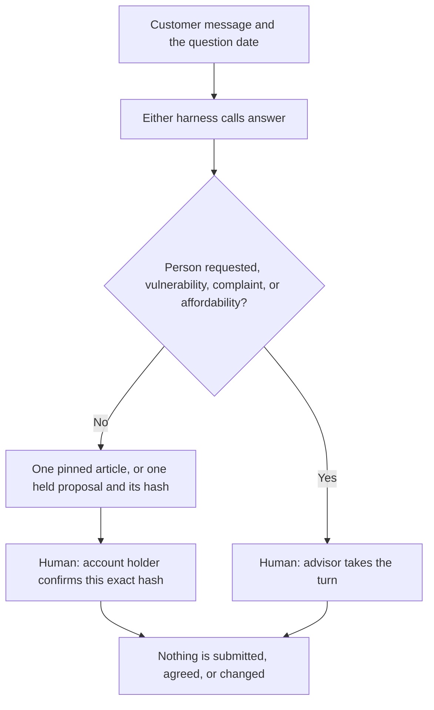

# Energy and water customer agent

Catalogue row UK12. Autonomy A1. The starter answers an account or billing question from a pinned synthetic knowledge base, and it may propose a meter-reading submission, a payment-plan request, or a Priority Services Register referral. The customer confirms each proposal. Affordability, debt, disconnection, prepayment, and vulnerability go to a human advisor. This page is a briefing, not a reading of a live account and not a decision about a tariff or a complaint.

Reedmarsh Energy and Reedmarsh Water are invented. They are not a claim that one firm holds both licences.

## The problem

A customer asks what a bill shows, or asks for a meter reading to be submitted, a payment plan to be requested, or a Priority Services Register referral. The same message can say they cannot afford the bill, that they rely on medical equipment, or that they want to complain. A note on the account can tell the assistant to change the tariff or to treat the action as already confirmed.

## Who it helps

A customer who wants a plain answer from the pinned knowledge, with a clear statement that they are talking to an AI and a person available on the same turn. A human advisor who takes affordability, debt, disconnection, prepayment, vulnerability, and complaints. The organisation gets a record that a proposal was confirmed against the exact held text and its hash, and a fairness count that does not publish a cell of fewer than five people.

## What it does

On every turn the answer says the customer is talking to an AI and that a human advisor is available. A request for a person is handed over immediately.

A question that matches one pinned article is answered with that article. The sector on the pinned account selects the article. A complaint is answered with the pinned escalation text for that sector and is handed to a person. It is not a routine queue. A complaint that also contains distress or a subject access request is still a handover.

A meter reading, a payment-plan request, or a Priority Services Register referral can be proposed when the message asks for that one action and no vulnerability or affordability cue is present. The customer confirms on a separate object bound to the agent-held copy and its hash.

The Ofgem AI blog opened on 27 November 2026 says suppliers should be open when AI is used and should make it easy to reach a person. Electricity and gas standard condition 0, opened the same day, set a customer objective and a duty to make it easy to contact the licensee. Condition 26, opened the same day, requires a Priority Services Register. Gas condition 28.1 was read. The agent does not install a meter. Ofwat's customer-focused licence condition page, opened the same day, says "In February 2024 we introduced a new Condition G". The quotes are context. They are not a finding that a duty was met.

## What it does not do

It does not change a tariff, agree a payment plan, write off debt, install or switch a prepayment meter, disconnect a supply, or add someone to the Priority Services Register. It does not decide a complaint. It does not follow an instruction in a message or an account note. It does not apply the DISP clock. It does not call council triage. It does not drop a protective marking, a legal hold, or a retention label. It does not coerce an unreadable amount or date. It does not call a live model.

## How the work flows

1. The customer supplies a conversation id, an account reference, a message, and the date the question is about.
2. The turn discloses the AI and offers a human advisor. Instructions in the message or the notes are recorded and not followed.
3. If the customer asks for a person, or the text shows vulnerability, distress, safeguarding, a complaint, affordability, debt, disconnection, or prepayment, including a paraphrase, the routine answer stops. **Human approval:** a human advisor takes the turn. The cue text is not copied.
4. Otherwise the turn quotes one pinned article, or proposes one action and holds that exact text and its hash.
5. **Human approval:** the account holder on the pinned directory confirms that held proposal. `explicit_confirm` has to be the boolean true, and the hash has to match the agent-held copy. A sentence in the message is not that step. An edit after the proposal, including a caller who re-hashes the edit, is refused.
6. The confirmation does not submit the reading, agree a plan, or change a tariff.



## Architecture diagram


## Microsoft stack

Catalogue row UK12 names Copilot Studio, Dynamics 365, and Microsoft Foundry. The skills in the experiment folder are the Microsoft Copilot harness, in the layout the common brief calls the GitHub Copilot harness. The harness overview was opened on 27 November 2026. The page used the name Microsoft Copilot harness. It did not use the words GitHub Copilot harness, and it stated no price. The page says that harness retries and finds alternative paths. This starter does not enable that. The sentence that this harness is not the GitHub Copilot service was not on that page. That point is unverified.

The standard harness is a topic guide. It is not an importable solution. Dynamics 365 Contact Centre was not opened. No Dynamics environment is configured. Microsoft Foundry is an optional note beside the JSON. It is not a third harness, and no resource is deployed.

## Security and permissions

Reads are the synthetic account, the pinned knowledge, the pinned complaints policy, the synthetic directory, and a separate confirmation object. Experiment 02 supplies injection phrases and its DISP clock is not applied. Experiment 08 counts identifiers and does not describe the text as anonymised. Experiment 13 supplies the handover fields and its council triage is not called. Writes are off. Sends are off. Changing a tariff, agreeing a plan, writing off debt, installing a meter, and deciding a complaint are disabled high-risk actions.

Entra Agent ID, Conditional Access for agents, Power Platform DLP as a configured policy, Microsoft Foundry prompt shields, Key Vault, Purview, and Application Insights were not opened on 27 November 2026. Treat that product behaviour as unverified.

## How to try it

From `experiments/84-energy-water-customer-agent`, install the requirements and run:

```bash
python -m pytest tests/ -q
python eval/evaluate.py
python src/customer.py --request examples/sample_request.json --as-of 2026-11-27
```

`eval/smoke_report.json` is a deterministic smoke test of 20 synthetic cases. It is not a model score. Paraphrase recall and the knowledge-match score are not added to that total.

## Limitations

The knowledge and the complaint routes are the pinned fixtures. A question that matches none of them is not answered from a model. The paraphrase set is a fixture, not a live recall rate. The eight-week Energy Ombudsman wording is from the Ofgem complaints page opened on 27 November 2026. The 2008 complaints regulations, as opened, do not contain the words "eight weeks". The Energy Ombudsman website and ccw.org.uk were not opened. Electricity condition 28 was not extracted. No water Priority Services Register licence condition number was found, and none is stated. The 90-day stale rule and the small-number threshold of 5 are starter rules, not statutory periods and not anonymisation. Articles 6, 9, and 22A to 22D were not opened. No lawful basis is asserted. A recorded confirmation does not submit the action. No tenant is configured.

## Source

The folder is [experiments/84-energy-water-customer-agent](https://github.com/rahul-bachina/copilot-agent-experiments/tree/main/experiments/84-energy-water-customer-agent) on GitHub. The runnable answer is `src/customer.py`. The licence is MIT.
