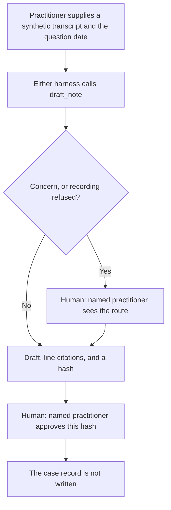

# Visit and meeting notes to a structured case record

Catalogue row UK13. Autonomy A1. The starter drafts a structured case note from a synthetic adult social care or housing-support visit transcript or rough notes. The named practitioner reviews, edits, and approves it. This page is a briefing, not a case record and not an assessment.

## The problem

A visit transcript mixes the person's words, the practitioner's observations, names, and dates. A draft that adds a diagnosis, a quote, or an eligibility finding would put words into the record that nobody said. Unclear audio and a crossed conversation make a guessed speaker worse than a gap. A sentence in the transcript can claim the note is already approved.

## Who it helps

A social worker or a housing officer who wants a first draft they can check, with each statement tied to a transcript line. The organisation gets a record that the approval was bound to that exact draft and its hash.

A person whose words show safeguarding, self-neglect, domestic abuse, distress, a suicidal statement, financial abuse, or a capacity concern is not processed as a routine note. The cue is routed to the practitioner and the words are not copied into the flag.

Northmarsh Council is fictional.

## What it does

Given a synthetic transcript and the date the question is about, the starter drafts who was present, what was discussed, the person's own words and wishes, the practitioner's observations, the agreed actions with owners and dates, and the follow-ups. Every statement cites the line. A statement that is not a span of that line is left out. Inferred text is marked. The person's views stay apart from the practitioner's observations. Third-party information is marked as third-party.

Consent to recording is recorded only when the structured status is given and a clear line from the person affirms it without a qualifier. Missing, refused, qualified, and uncorroborated consent are flagged. Unclear audio, crosstalk, and a misattributed line are flagged and not assigned.

Phones, emails, dates of birth, addresses, names, and NHS numbers are masked. Experiment 08 counts UK identifiers and does not describe the text as anonymised. The draft says the masked text is still in the note. Experiment 12 inventories rough notes. Those sentences stay the practitioner's. They are not the person's own words.

Dates and agreed deadlines are parsed. An unambiguous date such as 12/12/2024 is read. 01/02/2024 is ambiguous and not chosen. A future or impossible date is flagged. An unreadable date is not coerced to a default. A count of people below 5 is suppressed, including a difference or a percentage filed under another name.

Care Act 2014 section 9(1), section 9(4)(b), and section 42, UK GDPR Article 9(1), Caldicott principles 3 and 8, and the NHS England Digital page on ambient scribing were opened on 27 November 2026. The quotes are context. They are not a finding that a duty was met. Published local-authority pilot pages were not opened. No supplier result is stated.

## What it does not do

It does not write the case record. It does not share the note. It does not assess eligibility, risk, or need, and it does not decide that a section 9 assessment or a section 42 enquiry has been carried out. It does not invent a fact, a diagnosis, or a quote. It does not guess a speaker. It does not apply a caller-supplied template or directory. It does not drop a protective marking, a legal hold, or a retention label. It does not treat a sentence in the transcript as an approval. It does not call a live model.

## How the work flows

1. The practitioner supplies the synthetic transcript, the service, their directory reference, and the date the question is about.
2. The draft reads the pinned template and the pinned directory. A template or directory in the request is compared and not used. Instructions in the text are recorded and not followed.
3. Each clear line is copied into one section and cited. Unclear audio, crosstalk, and a misattributed line are flagged and not assigned.
4. Experiment 08 counts UK identifiers. Phones, emails, dates of birth, addresses, names, and NHS numbers are masked. Experiment 12 inventories rough notes.
5. If the text shows safeguarding, self-neglect, domestic abuse, distress, a suicidal statement, financial abuse, or a capacity concern, including a paraphrase or a denial, the routine draft stops. **Human approval:** the named practitioner records that they have seen that route. A refused recording takes the same path. The cue text is not copied.
6. If consent is not clearly given, a date could not be read, a marking was applied, a legal hold or a retention label is present, or a caller-supplied template differs, **Human approval:** the practitioner sets the matching acknowledgement to the boolean true. A string is not enough.
7. **Human approval:** the named practitioner, or their deputy on the pinned directory, approves this content hash or returns it for edit. A guest cannot. A hash from another visit cannot. An edit after approval is refused. The case record is not written.



## Architecture diagram


## Microsoft stack

Catalogue row UK13 names Azure, Microsoft Foundry, and Power Platform. The skills in the experiment folder are the Microsoft Copilot harness, in the layout the common brief calls the GitHub Copilot harness. The harness overview was opened on 27 November 2026. The page used the name Microsoft Copilot harness. It did not use the words GitHub Copilot harness, and it stated no price. The page says that harness retries and finds alternative paths, and that it can create and edit files. This starter does not enable either. The sentence that this harness is not the GitHub Copilot service was not on that page. That point is unverified.

The standard harness is a topic guide. It is not an importable solution. This starter does not call Power Automate. Microsoft Foundry is an optional note beside the JSON. It is not a third harness, and no resource is deployed.

## Security and permissions

Reads are the synthetic transcript, the pinned template, the pinned directory, and a separate approval object. Experiment 08 does not describe the text as anonymised. Experiment 12 inventories rough notes and does not record their content. Writes are off. Sends are off. Writing the case record, sharing the note, and assessing eligibility, risk, or need are disabled high-risk actions.

Entra Agent ID, Conditional Access for agents, Power Platform DLP as a configured policy, Microsoft Foundry prompt shields, Key Vault, Purview, and Application Insights were not opened on 27 November 2026. Treat that product behaviour as unverified.

## How to try it

From `experiments/85-visit-notes-case-record`, install the requirements and run:

```bash
python -m pytest tests/ -q
python eval/evaluate.py
python src/notes.py --request examples/sample_request.json --as-of 2026-11-20
```

`eval/smoke_report.json` is a deterministic smoke test of 20 synthetic cases. It is not a model score. Paraphrase recall and the grounding score are not added to that total.

## Limitations

The paraphrase set is a fixture of 22 sentences in each category, not a live recall rate. Unseen wording is not flagged. The grounding score is the labelled fixture, not a model. The template, the directory, and the visits are synthetic. Masking counts identifiers and does not claim the text is anonymised. The small-number threshold of 5 is a starter control, not anonymisation. Treating a visit as stale after 90 days is a starter rule, not a statutory period. Care Act 2014 sections 1, 2, 4, and 11 were named and not opened. UK GDPR Article 6 and the full text of Article 9(2)(h) were not quoted. Published local-authority pilot pages were not opened. No tenant is configured.

## Source

The folder is [experiments/85-visit-notes-case-record](https://github.com/rahul-bachina/copilot-agent-experiments/tree/main/experiments/85-visit-notes-case-record) on GitHub. The runnable draft is `src/notes.py`. The licence is MIT.
