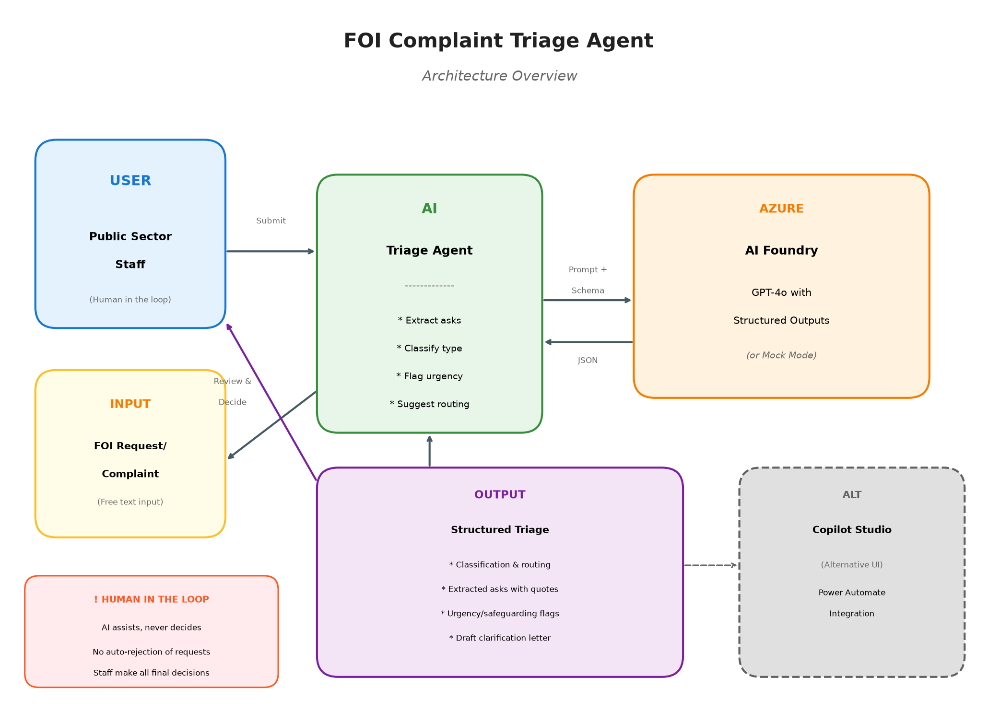
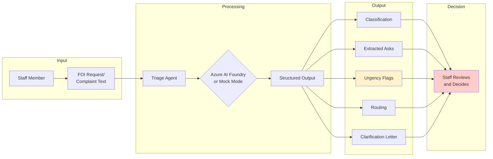

# Experiment 01: FOI Complaint Triage Agent

An AI agent that helps UK public sector staff triage Freedom of Information (FOI) requests, Environmental Information Regulations (EIR) requests, Subject Access Requests (SARs), and complaints.

**Key principle: The agent ASSISTS staff. It never decides. Humans always make final decisions.**



## The Problem

### Context

AI-generated FOI requests and complaints are increasing dramatically across UK public bodies. Sky News reported (20 Oct 2026) that complaints to English councils increased 78% and DWP complaints increased 64% since ChatGPT launched.

The Information Commissioner's Office (ICO) confirms that AI-written requests are completely valid but notes they "tend to be long, repetitive and broad" and advises that authorities may ask for clarification.

GDS founder Tom Loosemore argues the answer is "more structure and data, not friction."

### The Challenge

Public sector staff face:
- ⏱️ Long, complex submissions taking time to read and understand
- 🔀 Mixed requests (complaint + FOI + SAR in one submission)
- 🚨 Urgent safeguarding concerns buried in long text
- 📋 Difficulty determining if requests exceed cost limits
- 🏢 Uncertainty about correct routing

### What This Agent Does

Takes a free-text submission and outputs:
- **Extracted asks**: Each distinct question/request with source quotes
- **Classification**: FOI / EIR / SAR / Complaint / Mixed, with rationale
- **Routing**: Suggested department and team
- **Urgency flags**: Safeguarding concerns flagged for immediate human review
- **Cost assessment**: Whether request likely exceeds FOI cost limit
- **Clarification letter**: Draft letter (if needed) following ICO guidance
- **Bulk signals**: Information only - never affects validity

## Architecture



### Components

| Component | Technology | Purpose |
|-----------|-----------|---------|
| Triage Agent | Python | Core processing logic |
| AI Backend | Azure AI Foundry (GPT-4o) | Natural language understanding |
| Mock Mode | Rule-based Python | Testing without credentials |
| Schema | JSON Schema | Structured output validation |
| Copilot Studio | Low-code alternative | Conversational interface option |

## How It Works

1. **Staff submits** long free-text FOI request or complaint
2. **Agent extracts** distinct asks with direct quotes from source
3. **Agent classifies** as FOI/EIR/SAR/Complaint with confidence level
4. **Agent flags** any safeguarding/urgency concerns (prioritised first)
5. **Agent assesses** if request likely exceeds cost limit
6. **Agent suggests** routing and drafts clarification letter if needed
7. **Staff reviews** structured output and **makes decision**

## Quick Start

### Prerequisites

- Python 3.10+
- (Optional) Azure AI Foundry credentials

### Installation

```bash
cd experiments/01-foi-complaint-triage
pip install -r requirements.txt
```

### Run in Mock Mode (No credentials needed)

```bash
# Triage a sample request
python src/triage_agent.py --mock --input examples/sample_request.txt

# From stdin
echo "I request information about council spending..." | python src/triage_agent.py --mock
```

### Run with Azure AI Foundry

```bash
# Set environment variables
export AZURE_OPENAI_ENDPOINT="https://your-resource.openai.azure.com"
export AZURE_OPENAI_API_KEY="your-key"
export AZURE_OPENAI_DEPLOYMENT="gpt-4o"

# Run triage
python src/triage_agent.py --input examples/sample_request.txt
```

## Sample Input/Output

### Input

```
Dear Council,

I am writing to complain about the state of the roads in my area. The potholes 
on Maple Street are dangerous - my elderly mother tripped last week.

I also want to know:
1. How much was spent on road repairs in 2025?
2. How many pothole reports were received for Maple Street?
3. What is the council's policy on repair timescales?

I have contacted my MP about this matter.

Regards,
Concerned Resident
```

### Output (Abbreviated)

```json
{
  "triage_id": "TRG-20261021-ABC123",
  "classification": {
    "primary_type": "mixed",
    "secondary_types": ["complaint", "foi_request"],
    "confidence": "high",
    "rationale": "Contains explicit complaint about service plus FOI elements"
  },
  "extracted_asks": [
    {
      "ask_id": 1,
      "summary": "Road repair spending in 2025",
      "source_quote": "How much was spent on road repairs in 2025?",
      "specificity": "specific"
    }
    // ... more asks
  ],
  "flags": {
    "urgency_level": "elevated",
    "safeguarding_concern": false,
    "requires_immediate_human_review": false,
    "vulnerability_indicators": ["elderly mother"]
  },
  "routing": {
    "suggested_department": "Highways",
    "suggested_team": "FOI/Complaints Team"
  },
  "cost_limit_assessment": {
    "likely_exceeds_limit": false,
    "clarification_needed": false
  }
}
```

## Evaluation

### Running the Evaluation

```bash
# Run evaluation in mock mode
python eval/evaluate.py

# Save detailed report
python eval/evaluate.py --output eval_report.json
```

### Evaluation Dataset

The synthetic dataset (`eval/synthetic_dataset.json`) contains 12 test cases covering:
- Simple FOI requests
- EIR environmental requests  
- Subject Access Requests
- Complaints with FOI elements
- Safeguarding concerns (urgent escalation)
- Very broad requests (cost limit)
- Template/bulk submission signals
- NHS/DWP referral scenarios
- Child safeguarding (critical)

**All test data is synthetic. No real personal data or real requests are used.**

### Pipeline Smoke Test (Mock Mode)

The evaluation script runs against the synthetic dataset in mock mode as a **pipeline smoke test** to verify the code executes correctly and produces valid structured output.

```
Smoke test: 12/12 cases processed successfully
```

**Important**: Mock mode uses rule-based pattern matching that has been tuned to the synthetic test set. These results verify the pipeline works but say nothing about model accuracy. Real-model evaluation with Azure AI Foundry is pending.

## Copilot Studio Implementation

For a low-code alternative using Microsoft Copilot Studio, see [copilot-studio/README.md](copilot-studio/README.md).

This includes:
- Step-by-step build guide (not an importable solution)
- System prompt for the agent
- Topic designs
- Power Automate flow to connect to Azure AI Foundry

## Responsible AI Notes

### Human in the Loop

This agent is designed as a **decision support tool**, not a decision-making system.

- ✅ Agent analyses and structures information
- ✅ Agent flags concerns for human attention
- ✅ Agent suggests routing and clarification
- ❌ Agent does NOT approve or reject requests
- ❌ Agent does NOT send responses automatically
- ❌ Agent does NOT make final decisions

**All decisions are made by human staff.**

### No Auto-Rejection

The agent will **never** recommend rejecting a request based on:
- How the request is written
- Whether it appears to be AI-generated
- Whether it uses template language
- The identity or perceived motives of the requester

Bulk/template signals are provided as **informational context only**. The ICO is clear that such requests remain valid.

### Fairness and Accessibility

Some people rely on AI tools or templates to write requests due to:
- Disabilities
- Language barriers
- Lack of familiarity with formal writing
- Accessibility needs

The agent treats all requests equally, regardless of how they were composed.

### Data Protection

- No real personal data is used in development or testing
- All evaluation data is synthetic and clearly labelled
- Production deployment should follow UK GDPR requirements
- Staff should follow existing data handling procedures

### Algorithmic Transparency

If this agent were deployed in a public-facing context, it would likely require an entry in the [Algorithmic Transparency Recording Standard](https://www.gov.uk/government/collections/algorithmic-transparency-recording-standard-hub) register.

This experiment is for internal staff decision support, not for direct interaction with the public.

### Permissions and Security

This agent operates at **Autonomy Level A1** (human approves everything). For full governance documentation:

- **[Agent Manifest](agent-manifest.yaml)** — Machine-readable permissions, data access, risk assessment, and controls
- **[Security and Permissions Guide](docs/security-and-permissions.md)** — Human-readable explanation for governance, DPO, and security readers

Key points:
- The agent **never** sends communications, writes to systems, or makes decisions autonomously
- All high-risk actions are disabled
- Human review is mandatory for all outputs
- UK GDPR compliant (Article 6(1)(e) public task; Article 9(2)(g) for special category data)

### Limitations

1. **Mock mode is rule-based**: The mock implementation uses simple keyword matching and won't match live AI quality
2. **No learning from decisions**: The agent doesn't learn from staff decisions (by design - preserving human oversight)
3. **UK-specific**: Classification logic assumes UK FOI/EIR/DPA framework
4. **Not a legal tool**: Does not provide legal advice about exemptions

## Project Structure

```
experiments/01-foi-complaint-triage/
├── README.md                     # This file
├── agent-manifest.yaml           # Permissions and governance manifest
├── requirements.txt              # Python dependencies
├── src/
│   ├── __init__.py
│   ├── triage_agent.py           # Main agent implementation
│   ├── models.py                 # Pydantic output models
│   ├── prompts.py                # System and user prompts
│   └── mock_responses.py         # Mock mode implementation
├── schema/
│   └── triage_output.schema.json # JSON Schema for output
├── examples/
│   ├── sample_request.txt        # Example input
│   └── sample_output.json        # Example output
├── eval/
│   ├── synthetic_dataset.json    # Test cases
│   └── evaluate.py               # Evaluation script
├── tests/
│   └── test_triage_agent.py      # Unit tests
├── copilot-studio/
│   ├── README.md                 # Build guide
│   ├── system-prompt.md          # Agent instructions
│   └── power-automate-flow.md    # Flow design
└── docs/
    ├── architecture_diagram.png      # Architecture diagram
    ├── generate_diagram.py           # Diagram generation script
    └── security-and-permissions.md   # Security guide for governance readers
```

## Running Tests

```bash
# Run unit tests
python -m pytest tests/ -v

# Run with coverage
python -m pytest tests/ --cov=src --cov-report=term-missing
```

## CI/CD

The GitHub Actions workflow (`.github/workflows/experiment-01-tests.yml`) runs:
- Unit tests
- Schema validation
- Smoke test in mock mode
- Full evaluation
- Linting

## What I Learned

*(Coming after real-model testing)*

## References

- [ICO: FOI and Artificial Intelligence](https://ico.org.uk/for-organisations/foi/freedom-of-information-foi-and-artificial-intelligence/)
- [Sky News: AI overwhelming public services](https://news.sky.com/story/why-ai-could-overwhelm-britains-public-services-13241234) (20 Oct 2026)
- [Algorithmic Transparency Recording Standard](https://www.gov.uk/government/collections/algorithmic-transparency-recording-standard-hub)
- [FOI Act 2000](https://www.legislation.gov.uk/ukpga/2000/36/contents)
- [Environmental Information Regulations 2004](https://www.legislation.gov.uk/uksi/2004/3391/contents/made)
- [UK GDPR / Data Protection Act 2018](https://www.legislation.gov.uk/ukpga/2018/12/contents/enacted)

## License

MIT License - see [LICENSE](../../LICENSE)
