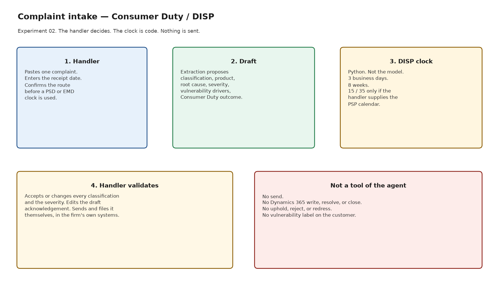
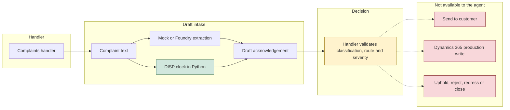

# Architecture

Complaint Intake Agent, Experiment 02. Catalogue ID C006.

The handler stays in the decision. The model may propose a reading of the complaint. The DISP dates are computed in Python. Nothing is sent and nothing is written to a production case.

The red boxes are not tools. The dotted lines mean a person may do those things afterwards, in the firm's own systems. The agent has no connector for them.

## Components

| Piece | What it is | What it is not |
|---|---|---|
| `src/disp_clock.py` | Deterministic DISP dates for England and Wales | A model, and not a decision that the complaint is in time for the Ombudsman |
| `src/intake.py` | Keyword smoke-test stand-in, tuned to the synthetic fixtures | A measure of model quality |
| Microsoft Foundry | Optional extractor and drafter. See [foundry.md](foundry.md) | A source of dates, upholds, or sends |
| Copilot Studio | Handler-facing topic. See [../copilot-studio/README.md](../copilot-studio/README.md) | An importable solution |
| Dynamics 365 Customer Service | Optional read, or a draft the handler owns. See [dynamics-365-customer-service.md](dynamics-365-customer-service.md) | A system the agent updates |

## Run sequence

1. The handler supplies the complaint text and the receipt date, and confirms the route if they want a payment-services or e-money clock.
2. Extraction proposes: complaint or not, product, root cause, severity, vulnerability characteristics, and which Consumer Duty outcome the facts appear to touch.
3. `calculate_disp_clock` produces the dates from those confirmed inputs. A suggested PSD or EMD route is not applied until the handler confirms it. Without the provider's opening days, the 15-day and 35-day dates are non-operative.
4. A draft acknowledgement is assembled for the handler. It says it must not be sent as it stands.
5. The handler accepts or changes every classification and the severity. Anything after that — sending, filing, upholding, redress — happens outside the agent.

## Why the clock is not in the prompt

DISP 1.5, DISP 1.6 and DISP 2.8 are counts. A language model will sometimes add a day, skip a bank holiday, or treat a Saturday as if the eight-week limit moved. The Handbook does not move the eight-week date off a weekend. The payment-services business day is not the bank-holiday calendar. Those distinctions are encoded in `disp_clock.py` and covered by the unit tests. The prompt is told to copy the dates the tool returns and not to recalculate them.
