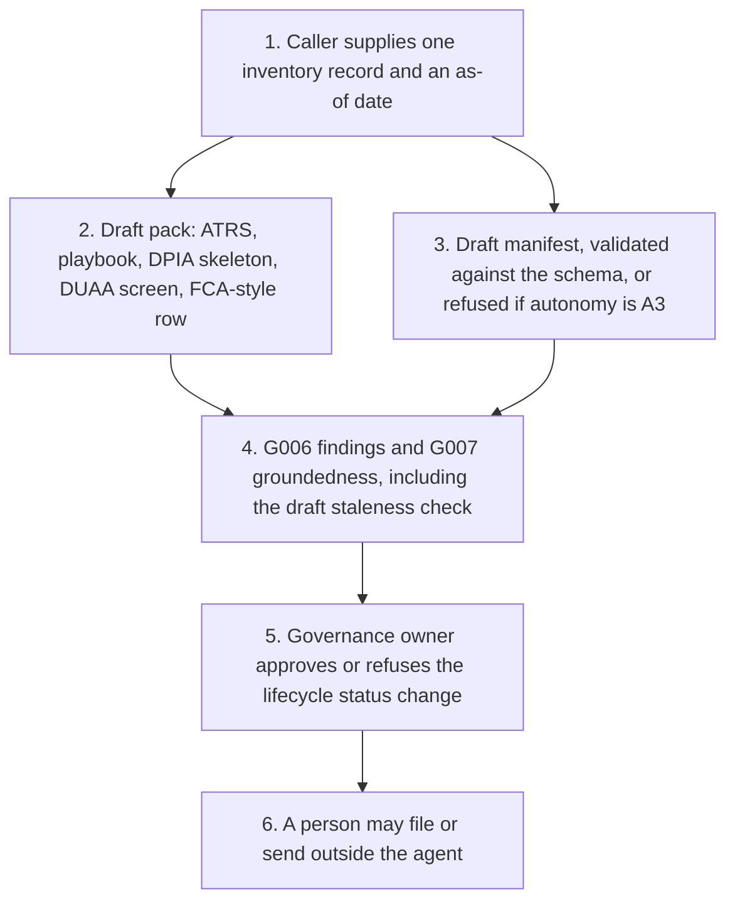

# Architecture

The runnable part is Python in `src/`. Copilot Studio, on either harness, is a guide for a later tenant. Both guides call this same core. Neither guide is an importable solution.

Step 5 is the human approval. The core does not take it. If a later script calls `apply_status_change`, it still needs a decision that was made outside this repository, and the pack remains a draft.

## What runs today

1. Load one JSON inventory record, or the same records from `fixtures/dataverse/*.csv`.
2. Copy ATRS answers from named inventory keys. Leave a gap sentence where the key is empty. Reject a phase or region that is not on the v4.0 Validation sheet.
3. Map the ten playbook principles. Quote inventory text where a key is present. Do not score the principle.
4. Fill a seven-step DPIA skeleton. Leave sign-off blank.
5. Screen recorded facts against Articles 22A to 22D. Do not set `lawful`.
6. Draft an FCA-style inventory row. Do not assign a Senior Manager Function.
7. Run G006 and G007. Do not clear either.
8. Optionally draft a manifest and validate it. Refuse A3. Refuse `--approve`.

## What does not run

- A model call. Microsoft Foundry is described in [foundry.md](foundry.md) and is not used.
- A Dataverse connection. The table design is in [dataverse.md](dataverse.md).
- An email, an ATRS submission, or a write to a system of record.
- An approval minted by this code. Ids with the prefix `g010-generated-` are rejected.

## Worked examples

| Record | Why it is here |
| --- | --- |
| `exp-01-foi-triage` | Public-sector starter. ATRS draft is for a SPOC to consider. The agent's own output is not recorded as a significant decision. |
| `exp-02-consumer-duty-complaint-intake` | Fictional firm. ATRS fields are filled so the shape is visible. The draft is not for submission. The FCA-style row is the audience that publication is written for. |
| `exp-04-fca-cryptoasset-readiness` | Fictional firm, Harbourline Markets Ltd. Autonomy A0. Applicability is not a public-sector body. The checker does not decide readiness. |
| `exp-05-awaabs-law-hazard-triage` | Public-sector starter for a social landlord in England. No landlord is named. ATRS scope is left to a single point of contact. Dates in that experiment are not copied into this pack. |
| `syn-harbour-benefits` | Fictional council scorer with no recorded human decision, so Article 22B has a case to flag. |
| `syn-stale-register` | Review date in 2024, so G007 flags staleness. |
| `syn-injection-note` | The description tells the tool to approve itself. The tool does not. |
| `syn-a3-request` | Asks for autonomy A3. No manifest is drafted. |
