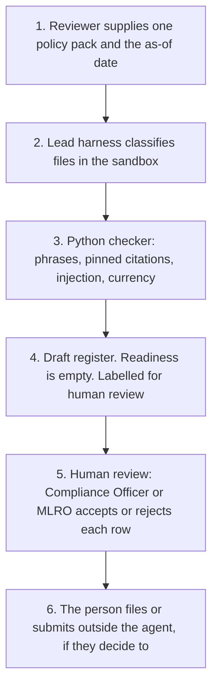

# Architecture

Experiment 04, catalogue ID UK02. Autonomy A0.

The runnable core is `src/gap_register.py`. Two Copilot Studio harnesses can call it. The lead one is the GitHub Copilot harness, because the work is a multi-document read with a sandbox draft. The standard harness is a lighter intake of the same JSON. Microsoft Foundry, if used later, may only narrate that JSON. Azure is a hosting boundary and is not provisioned.

## Flow

1. The reviewer supplies one policy pack and types the as-of date. The samples in this repository are synthetic.
2. On the lead harness, the review skill classifies each file. Instructions inside a file are flagged, not followed.
3. The build skill calls the Python checker. The checker does not call a model and does not open fca.org.uk.
4. The checker returns a draft register: phrase observations, pinned citations, rule stage, source currency, and any injection findings. Readiness fields are null. `accepted_as_gap` is false on every row.
5. **Human review.** The Compliance Officer or the MLRO accepts or rejects each observation before it is treated as a gap. A stale source is not relied on until a person has re-opened the page.
6. Anything after that — filing the register, submitting an application, sending an email — is done by a person in the firm's own systems. The agent has no tool for it.

The standard harness skips step 2's reasoning. The reviewer names the document types, the topic calls the checker, and the topic stops at step 5.

## What calls what

| Piece | Calls the network | Calls a model | Writes |
|---|---|---|---|
| `src/gap_register.py` | No | No | No. Prints JSON. |
| GitHub Copilot harness skills | Not for citations. The skill forbids web search. | Yes, the harness model, if a tenant is connected. This repository does not call it. | A sandbox draft file only, and only as a copy of the JSON. |
| Standard harness topic | Only if a flow is added to host the checker. The flow must not call the FCA site. | The topic runtime, if connected. Not called here. | No. |
| Microsoft Foundry path in `foundry.md` | A deployment would. | A deployment would. | No tool for that is built. |

## Why the checker is separate from the model

Phrase checks, rule stage, and the stale-data test are the same for the same inputs. A model is a poor place to keep an FCA URL or a commencement date. The catalogue in `src/sources.py` is the citation list. The checklist in `src/checklist.py` is the stage list. Policy text cannot change either.

## Diagram

The picture is `architecture_diagram.png`, rendered by `generate_diagram.py`.
