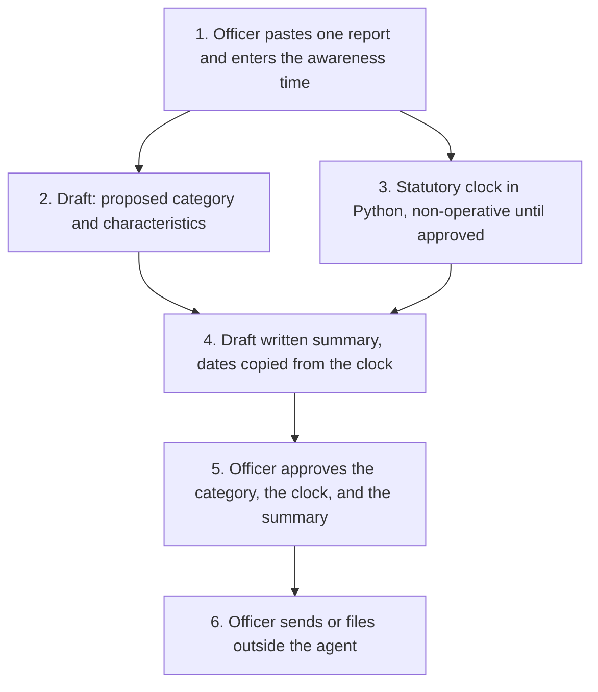

# Architecture

Awaab's Law hazard triage, Experiment 05. Catalogue ID UK01.

The officer stays in the decision. The model may propose a reading of the report. The timeframes are computed in Python. Nothing is sent and nothing is written to a housing system.

What is not a tool of the agent, even after step 5: sending to the tenant, a housing-system write, a finding that reasonable endeavours are made out, an Ombudsman referral, a decant booking, and a vulnerability label on the tenancy.

## Two harnesses, one clock

The standard harness runs steps 1 to 4 as topics, with the clock as the only action. The GitHub Copilot harness runs the officer's case review and the endeavours record, and it calls the same clock. The comparison is in [harness-comparison.md](harness-comparison.md).

Phase 2 and Phase 3 are data in the clock output, not a second calculator. They come back as not in force unless the caller asserts a made Phase 2 instrument on or after 30 November 2026, and that assertion keeps the warning that on 24 October 2026 the amendment was still a draft.

## Modules

| Module | Role |
| --- | --- |
| `src/statutory_clock.py` | Timeframes. No network. No model. |
| `src/working_days.py` | Regulation 2 working days, England and Wales. |
| `src/triage.py` | Mock proposal, summary, and the safety checks. |
| `src/records.py` | Ombudsman information and the endeavours draft. |

`eval/evaluate.py` runs the mock against 24 synthetic reports. The agreement rate is a pipeline check.
