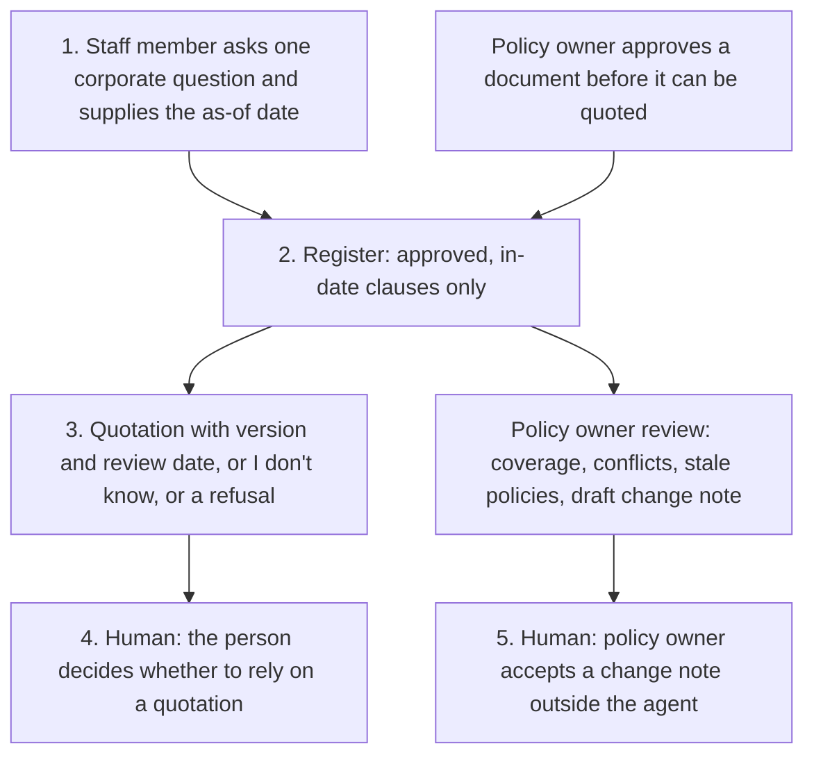

# Architecture

Policy Q&A for NHS and public-sector corporate services, Experiment 06. Catalogue ID M003.

The policy owner approves sources. The register quotes, refuses, or says "I don't know". Nothing is published and nothing is sent.

Step 4 and step 5 are the human approvals. Publishing, sending, and clinical advice stay outside the agent even after someone has read the draft.

## Two harnesses, one register

The standard harness is the lead path for staff. It is one topic and one action: `src/answer.py`. The GitHub Copilot harness is for the policy owner. It calls `src/review.py` through three skills. The comparison is in [harness-comparison.md](harness-comparison.md).

A SharePoint library is not a knowledge source. The approved export is. Connecting generative answers to the whole library would bypass the approval flag and the review date.

## Modules

| Module | Role |
| --- | --- |
| `src/corpus.py` | Load the register. Quarantine instructing clauses. Apply the owner-approval and review-date rules. |
| `src/answer.py` | One staff question. Quotation, refusal, conflict, stale withholding, or "I don't know". |
| `src/review.py` | Coverage, stale policies, conflicts, and draft change notes. |
| `src/time_saving.py` | Score paired timestamps. Reject self-reported minutes. Exclude ungrounded items. |
| `fixtures/policies.json` | Synthetic Northmere policies. Fictional trust. |

`eval/evaluate.py` runs the matcher on 28 synthetic questions and scores the time-saving fixture. The agreement rate is a pipeline check. The median is fixture arithmetic.
