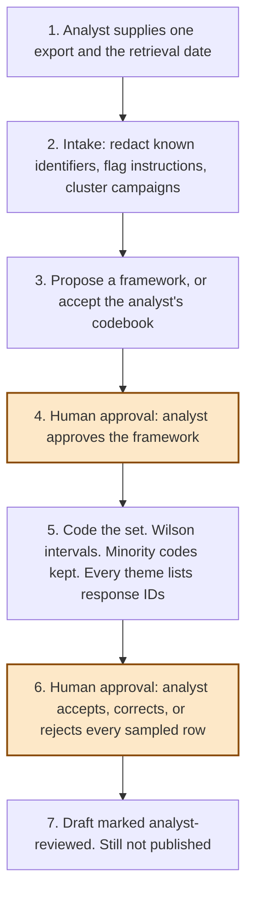

# Architecture

Experiment 07 codes one consultation question. The Python core is the same whichever Copilot Studio harness calls it. The standard harness shows intake and status. The GitHub Copilot harness is the analyst workflow over the set: propose a framework, then code it, then wait for the sample.

Neither harness publishes the draft.

Steps 4 and 6 are the human approvals. Step 7 does not add a publish tool.

## What runs locally

| Piece | Role |
| --- | --- |
| `src/safeguards.py` | Redacts emails, UK phones, National Insurance numbers, NHS numbers with a valid checksum, postcodes, and sort codes. Flags instruction-shaped phrases. Flags a small health word list. |
| `src/clusters.py` | Exact text, token Jaccard, and a repeated long sentence. Blank answers are not clustered together. |
| `src/stats.py` | Wilson score interval at 95% on the unique-voice proportion. |
| `src/pipeline.py` | Intake, coding, sample, and the two gates. |
| `src/themefinder_adapter.py` | Optional call to i.AI ThemeFinder. Not vendored. Falls back to the codebook. |

The same inputs produce the same JSON. Tests and CI do not install ThemeFinder and do not call a model.

## ThemeFinder boundary

Verified from the public repository on 24 October 2026, not by executing the package:

- [i-dot-ai/themefinder](https://github.com/i-dot-ai/themefinder), licence file [`LICENCE`](https://github.com/i-dot-ai/themefinder/blob/main/LICENCE), MIT, copyright (c) 2024 i.AI.
- The README calls it an incubation project and says it is not recommended for critical use cases yet.
- `find_themes` and `theme_mapping` are the two functions the adapter knows how to call. `theme_mapping` is the one used once a framework exists, because it maps onto themes the analyst already holds.
- `theme_clustering` and `rule_2_themes_must_have_a_non_negligible_number_of_responses_slack` are not called. They can set a small theme aside.
- The README's consultation-setup path uploads to an i.AI S3 bucket. This core does not call it.

Vendoring was rejected because of that size and that upload path, not because the MIT licence forbids a copy. A copy would have needed the copyright notice. There is no copy.

## Counts

- **Submission count** is every response still in the count, including campaign copies.
- **Unique-voice count** is one per cluster. The proportion and the Wilson interval use this denominator.
- A campaign is reported, not deleted. Every response ID stays on the theme and in the audit.
- A framework theme with support at or below two unique voices, or under 10% of unique voices, is listed in `minority_views`.
- A framework theme with no support is listed with an empty response ID list, so "not found" is visible.
- Rows the analyst rejects stay linked and are held out of the headline count.

## What is not a tool

Publishing, sending, writing a consultation system, recommending the policy, and approving the framework from a response. The manifest disables those actions. The tool schemas have no field for them.
