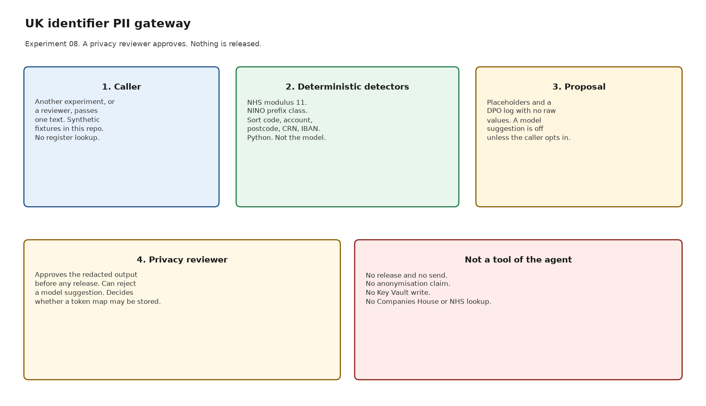
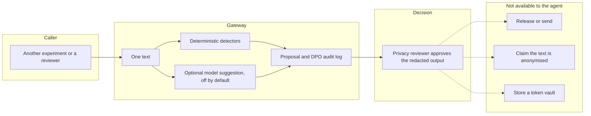

# Architecture

Sensitive Data Redaction Agent, Experiment 08. Catalogue ID O005.

A caller passes one text. Python proposes spans for UK identifiers. A privacy reviewer approves the proposal before anyone releases it. The agent does not release it, and the proposal says it is not anonymised.

The dotted lines are not tools. Approval does not enable them.

## What runs where

| Step | Where it runs | Model allowed? |
| --- | --- | --- |
| NHS modulus 11, NINO prefix class, IBAN rearrangement | `src/identifiers.py` | No |
| Span detection | `src/detectors.py` | No |
| Proposal, audit record, release refusal | `src/gateway.py` | No |
| Extra spans for names or free text | A caller-supplied adapter. Default `NullModel` | Only if the caller opts in. Still a suggestion |
| Approval | A person, role Privacy reviewer | No |
| Release | The caller's own channel, after approval | No. Not this agent |

Both Copilot Studio harnesses call `propose()` and stop at the same gates. The standard harness is one topic. The GitHub Copilot harness adds an explanation skill. Neither one is a generic PII agent: names, email addresses, and telephone numbers are out of scope unless a model suggestion is applied, and a suggestion is still not anonymisation.

## What the audit record keeps

A hash of the input, the character count, the caller id, the pinned rules date, and one row per finding with offsets, detector, and checksum. Not the matched characters. A reversible map is a different object, returned only when asked for, and not written to the audit record. This starter persists neither.

## Human approval

The highlighted step on the briefing page is the privacy reviewer's approval. Viewing a proposal and re-running detection do not need a separate approval. Release stays outside the agent after approval. `release()` raises `ReleaseForbidden`.
