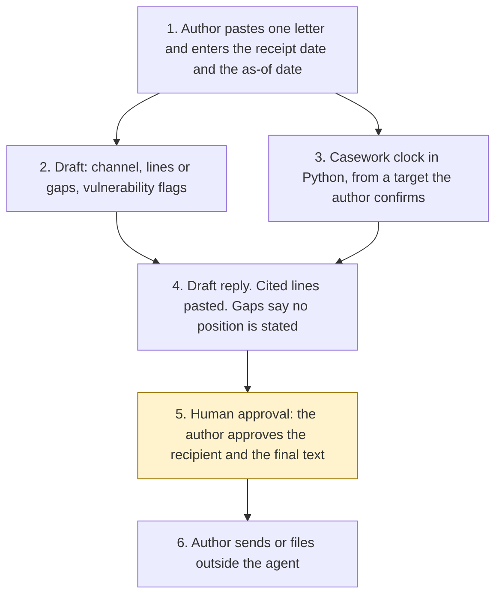

# Architecture

Correspondence Draft Agent, Experiment 09. The author decides. The clock is code. A policy sentence is a supplied line, or the draft says there is a gap. Nothing is sent.

1. The author pastes one letter and enters the receipt date and the as-of date. They confirm the channel and the reply target if they want an operative date. A suggested channel is not applied as a confirmation until they say so.
2. The drafter proposes a channel, matches the synthetic lines library, and flags vulnerability wording. In this folder that step is `src/draft.py`. A Foundry call is described and not built.
3. `src/sla.py` calculates the date. A central-government target over 20 working days is refused. An information-rights letter does not get a correspondence date. A holding reply does not clear the clock.
4. The draft pastes each current line with its id. A gap says no position is stated. The recipient is a role, not an address, unless the author has supplied one. `may_be_sent_by_agent` is false.
5. **Human approval.** The author confirms the channel and whether a ministerial reply is required, confirms the target, reviews any vulnerability flag, approves the recipient, and approves the final text.
6. The author sends or files in the unit's own systems. The agent has no tool for that.

What is not a tool of the agent, even after step 5: sending, a case-system write, choosing the address from the letter, inventing a position, an FOI decision, a complaint outcome, a vulnerability label, and publishing the ATRS note.

The diagram file is [architecture_diagram.png](architecture_diagram.png). Regenerate it with `docs/generate_diagram.py` if the shape changes. Matplotlib is used only by that script. It is not a runtime dependency.
