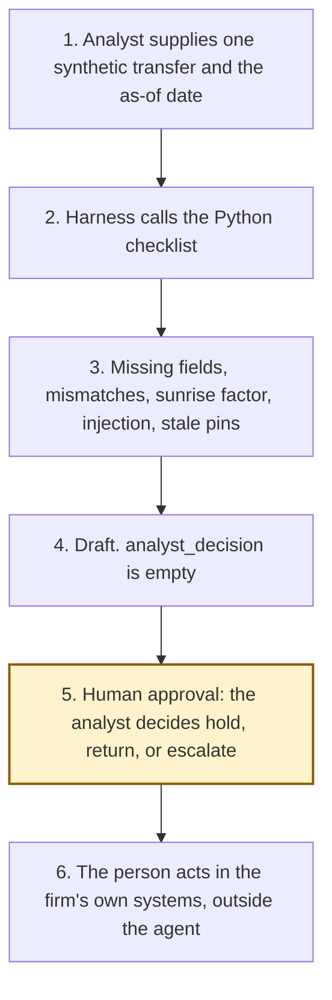

# Architecture

Experiment 10. Catalogue ID UK05. Autonomy A1.

The analyst supplies one transfer. The Python checklist compares it with the pinned text of Part 7A and the FCA statement. It proposes hold, return, or escalate. The analyst decides. The agent has no action after the draft.

Harbourline Markets Ltd is the invented firm from Experiment 04. This agent does not re-score that experiment's policy pack.

Step 5 is the human approval. Filing a report, contacting a counterparty, and making a cryptoasset available are not tools of the agent, including after the analyst has decided.

## What runs where

| Piece | Role |
|---|---|
| `src/triage.py` | The checklist. Standard library only. No network and no model. |
| `src/sources.py` | Pinned pages and the unverified list. `last_verified` is 26 October 2026. |
| `src/injection.py` | Instructions in names and notes. They are recorded and not followed. |
| Copilot Studio, standard harness | One topic and one flow. The flow returns JSON. |
| Copilot Studio, GitHub Copilot harness | Two skills around the same JSON. Sandbox draft only. |
| Microsoft Foundry | Optional narrative over the JSON. Not provisioned. |
| Power Platform | The flow that calls the checklist. No Dataverse write in this starter. |

## What is not a component

A wallet, a chain node, a Travel Rule messaging network, FCA Connect, and a suspicious-activity-report gateway. They are named in the manifest so that a later design does not add them quietly.
