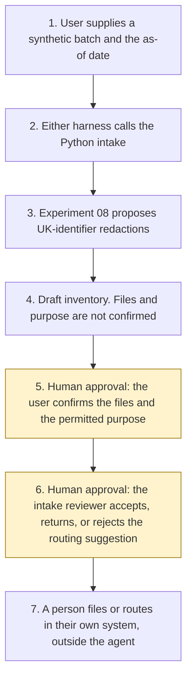

# Architecture

Experiment 12. Catalogue ID O001. Autonomy A1.

The user supplies one synthetic batch and an as-of date. The Python intake hashes each file, suggests a keyword class, previews a checklist, and records injection and stale dates. It calls Experiment 08 for a UK-identifier proposal. It does not confirm the files or the purpose. An intake reviewer decides the routing suggestion afterwards. The agent has no action after the draft.

B004, B007, UK11, and UK09 are labels on the purpose list. They are not components of this experiment.

Steps 5 and 6 are the human approvals. Accepting the batch into a queue, writing a production record, releasing redacted text, and sending a message are not tools of the agent, including after both people have decided.

## What runs where

| Piece | Role |
|---|---|
| `src/intake.py` | The inventory. Standard library, plus an in-process call to Experiment 08. No network and no model. |
| `src/catalogue.py` | Closed classes and purposes. `catalogue_pinned_on` is 27 October 2026. |
| `src/injection.py` | Instructions in the body, in comments, after a form feed, after blank lines, in zero-width characters, and in the filename. They are recorded and not followed. |
| Experiment 08 `propose()` | UK identifier spans. Model suggestions off. Reversible tokens not requested. The draft keeps entity types and the hash. |
| Copilot Studio, standard harness | One topic and one flow. The flow returns JSON. |
| Copilot Studio, GitHub Copilot harness | Two skills around the same JSON. Sandbox draft only. |
| Microsoft Foundry | Optional narrative over the JSON. Not provisioned. Document Intelligence and Content Understanding were read and are not called. |
| Power Platform | The flow that calls the intake. No Dataverse write in this starter. |

## What is not a component

A mailbox, a SharePoint library, a case system, an NHS or HMRC lookup, and the specialist agents named on the purpose list. They are named in the manifest so that a later design does not add them quietly.
