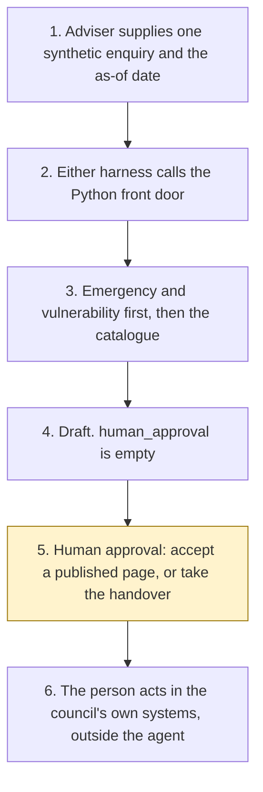

# Architecture

One enquiry in. One draft out. The adviser accepts a published sentence or takes the handover. The front door does not send, write, or decide.

1. The adviser supplies one synthetic enquiry and types the as-of date. Northmarsh Borough Council is invented.
2. Either Copilot Studio harness calls `triage()`. The standard harness is one topic. The GitHub Copilot harness is two skills around the same call. Neither is the Customer Conversation harness.
3. Emergency and vulnerability phrases return a fixed script. Otherwise the core matches the synthetic catalogue, records injection, and refuses a stale body.
4. The draft comes back with an outcome, citations, and an empty `human_approval`.
5. **Human approval.** The adviser accepts a current published page, rejects it, or takes the handover. A stale page is not relied on until a person has re-opened the council's own page. An emergency or a vulnerability phrase cannot be accepted as a service answer.
6. The person acts in the council's own systems, if they decide to. The agent has no tool for that.

What is not a tool of the agent, even after step 5: an eligibility decision, a case write, a message, a payment, an appointment, enforcement, and a call to 999.

The rendered diagram is [architecture_diagram.png](architecture_diagram.png). Regenerate it with `docs/generate_diagram.py` if the boxes change. Matplotlib is used only for that script. It is not a runtime dependency.
