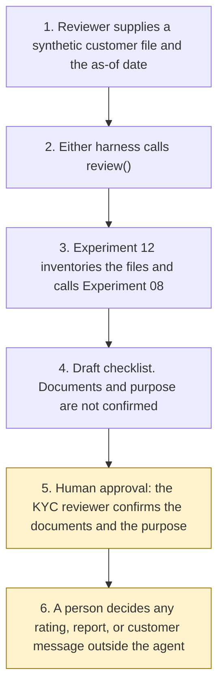

# Architecture

Experiment 16. Catalogue ID B004. Autonomy A1.

A KYC reviewer supplies one synthetic customer file and an as-of date. `review()` calls Experiment 12 `intake()` with purpose `kyc_evidence`. That intake calls Experiment 08. This experiment then drafts the regulation 28, 33, and 40 checklist. It does not confirm the documents or the purpose. The reviewer does that afterwards. The agent has no action after the draft.

Step 5 is the catalogue checkpoint. Step 6 is outside the agent: a risk rating, a suspicious activity report, onboarding, and sending the customer note are not tools, including after the reviewer has confirmed the documents.

## What runs where

| Piece | Role |
|---|---|
| `src/review.py` | The checklist. Calls Experiment 12. No network and no model. |
| `src/sources.py` | Short quotations from pages opened on 27 October 2026. JMLSG Guidance, Part I, is named and not applied. |
| `src/kyc_injection.py` | KYC instructions in the body, in comments, after a form feed, after blank lines, and in zero-width characters. Recorded and not followed. |
| `src/tipping_off.py` | Fixed customer sentences and a lexicon. The agent does not send the note. |
| Experiment 12 `intake()` | Hash, keyword class, O001 checklist preview, its own injection list, document dates. |
| Experiment 08 `propose()` | UK identifier spans, called by Experiment 12. The draft does not copy the body. |
| Copilot Studio, standard harness | One topic and one flow. The flow returns JSON. Not a customer chat. |
| Copilot Studio, GitHub Copilot harness | Two skills around the same JSON. Sandbox draft only. |
| Microsoft Foundry | Optional narrative over the JSON. Not provisioned. |
| Power Platform | The flow that calls `review()`. No Dataverse write in this starter. |

## What is not a component

An onboarding system, a SAR filing channel, the FATF list, Companies House, and a customer-facing chat. They are named in the manifest so that a later design does not add them quietly.
