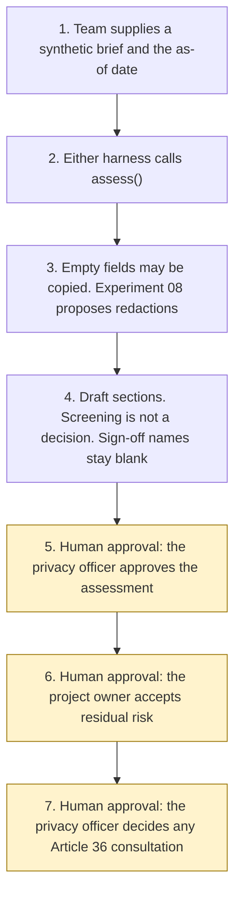

# Architecture

Experiment 19. Catalogue ID L006. Autonomy A1.

A project team supplies one synthetic brief and an as-of date. An Experiment 03 inventory record, or a permissions manifest, is optional. `assess()` copies empty fields from those sources and does not infer screening answers. Free text is passed to Experiment 08 `propose()`. The draft screens Article 35 and Articles 22A to 22D, writes the Article 35(7) sections, and flags a high recorded residual. It does not approve the assessment. The privacy officer does that afterwards. The agent has no action after the draft.

Steps 5, 6, and 7 are the catalogue checkpoint and the two decisions that stay outside the agent. Relying on stale sources, and treating pre-filled inventory or manifest text as the team's own answer, are further approval points in the manifest. Viewing the draft and re-running it do not need approval. Sending a consultation is not a tool, including after the privacy officer has decided to consult.

## What runs where

| Piece | Role |
|---|---|
| `src/assess.py` | The draft. Calls Experiment 08. No network and no model. |
| `src/screening.py` | Article 35(1) and (3), the ten ICO types, and the nine WP29 criteria as listed on the ICO when-page. `dpia_required` stays null. |
| `src/automated.py` | Articles 22A to 22D. Law-enforcement and intelligence-services regimes are named and not applied. `lawful` stays null. |
| `src/prefill.py` | Copies empty fields from an inventory or a manifest. Does not answer the questionnaire. |
| `src/injection.py` | Instructions in the body, in comments, after a form feed, after blank lines, and in zero-width characters. Recorded and not followed. |
| `src/sources.py` | Short quotations from pages opened on 28 October 2026. |
| Experiment 08 `propose()` | UK identifier spans. Model suggestions off. The reversible vault is not requested. |
| Copilot Studio, standard harness | One topic and one flow. The flow returns JSON. Not a public chat. |
| Copilot Studio, GitHub Copilot harness | Two skills around the same JSON. Sandbox draft only. |
| Microsoft Foundry | Optional narrative over the JSON. Not provisioned. |
| Power Platform | The flow that calls `assess()`. No Dataverse write in this starter. |

## What is not a component

A DPIA register, the Commission or ICO inbox, a mailbox, and the Experiment 08 reversible token vault. They are named in the manifest so that a later design does not add them quietly.
