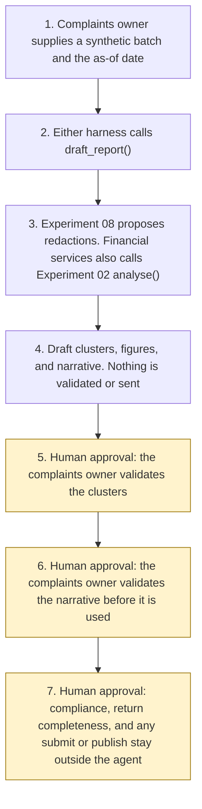

# Architecture

Experiment 20. Catalogue ID UK04. Autonomy A0.

A complaints owner supplies one synthetic batch and an as-of date. `draft_report()` passes free text to Experiment 08 `propose()`. A financial-services narrative is then passed to Experiment 02 `analyse()`. The draft groups in-period records, builds figures that list record ids, and writes template sentences. It does not validate the clusters or the narrative. The complaints owner does that afterwards. The agent has no action after the draft.

Steps 5, 6, and 7 are the catalogue checkpoint and the decisions that stay outside the agent. Relying on stale sources, and treating an Experiment 02 suggestion or a lexicon label as the confirmed root cause, are further approval points in the manifest. Viewing the draft and re-running it do not need approval. Submitting or publishing is not a tool, including after the complaints owner has decided to file something.

## What runs where

| Piece | Role |
|---|---|
| `src/report.py` | The draft. Calls Experiment 02 and Experiment 08. No network and no model. |
| `src/classify.py` | One theme per record. Experiment 02 for financial services. A starter lexicon for housing. Ofgem guidance categories for energy. |
| `src/figures.py` | Counts equal the length of their record-id lists. Sentences may contain only those values and the run's dates. |
| `src/narratives.py` | Template sentences. They do not confirm compliance. |
| `src/injection.py` | Instructions in the body, in comments, after a form feed, after blank lines, and in zero-width characters. Recorded and not followed. |
| `src/sources.py` | Short quotations from pages opened on 29 October 2026. Summaries are marked as summaries. |
| Experiment 02 `analyse()` | Suggested product and cause for a financial-services narrative. `intake()` is not called, so no acknowledgement is drafted. |
| Experiment 08 `propose()` | UK identifier spans. Model suggestions off. The reversible vault is not requested. |
| Copilot Studio, standard harness | One topic and one flow. The flow returns JSON. Not a public chat. |
| Copilot Studio, GitHub Copilot harness | Two skills around the same JSON. Sandbox draft only. |
| Microsoft Foundry | Optional narrative over the JSON. Not provisioned. |
| Power Platform | The flow that calls `draft_report()`. No Dataverse write in this starter. |

## What is not a component

A complaints system of record, the FCA, Housing Ombudsman, or Ofgem inbox, a mailbox, a landlord website, and the Experiment 08 reversible token vault. They are named in the manifest so that a later design does not add them quietly.
