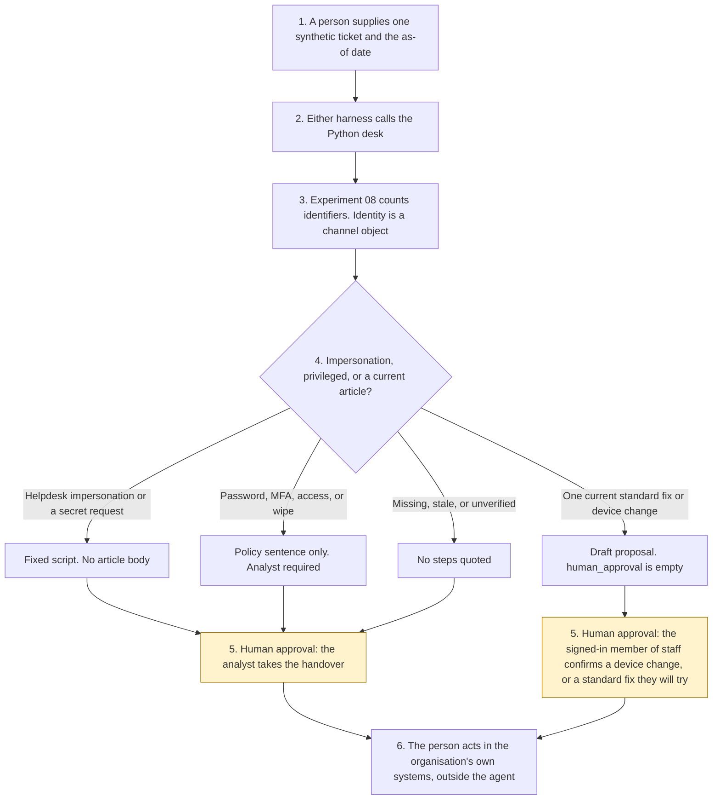

# Architecture

One ticket in. One draft out. The member of staff confirms a device-change proposal, or an analyst takes a privileged handover. The desk does not reset, grant, write, or send.

1. A member of staff or an analyst supplies one synthetic ticket and types the as-of date. Aldermere District Council is invented.
2. Either Copilot Studio harness calls `triage()`. The standard harness is one topic. The GitHub Copilot harness is three skills around the same call. Neither is the Customer Conversation harness.
3. Free text goes through Experiment 08. The redacted string is not copied out. A passed identity check is honoured only when the channel recorded an `entra_session` for the same day on portal or Teams chat.
4. Helpdesk impersonation and secret requests return a fixed script. Privileged articles quote a policy sentence and no click-path. A current standard fix or device change is quoted only for a trusted session. A stale article is not quoted.
5. **Human approval.** The signed-in member of staff confirms a standard fix they will try, or confirms a device change when the required diagnostics are present. An analyst takes a password reset, an MFA change, an access grant, a wipe, an unverified caller, a third-party request, or a stale article. Confirmation does not perform the action.
6. The person acts in the organisation's own identity system, device console, or ITSM tool, if they decide to. The agent has no tool for that.

What is not a tool of the agent, even after step 5: a password reset, an MFA change, an access grant, a device change, a remote wipe, a ticket write, a message, and a licence purchase.

The rendered diagram is [architecture_diagram.png](architecture_diagram.png). Regenerate it with `docs/generate_diagram.py` if the boxes change. Matplotlib is used only for that script. It is not a runtime dependency.
