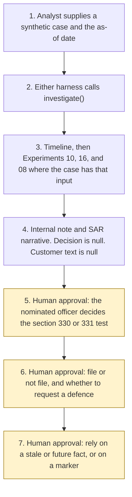

# Architecture

Experiment 22. Catalogue UK07. Autonomy A1.

The analyst supplies one synthetic case and an as-of date. Either Copilot Studio harness calls `investigate()`. The Python core builds the timeline from synthetic tokens, calls Experiment 10 when a transfer is attached, Experiment 16 when a KYC file is attached, and Experiment 08 for the analyst note. Experiment 04 is cited for the registration-page pin. The draft comes back with `mlro_decision` null and `customer_facing.text` null.

The nominated officer decides whether section 330 or section 331 is met, whether to file, and whether to request a defence. Those steps are not tools. A stale source, a stale alert, or a future-dated event stays flagged until that officer relies on it. A supplied label is not a determination. Nothing is written for the customer.

The rendered picture is [architecture_diagram.png](architecture_diagram.png), produced by [generate_diagram.py](generate_diagram.py). Matplotlib is used only for that script. It is not a runtime dependency.

What is not a tool, even after the officer has decided: filing with the NCA, requesting a defence, drafting or sending customer text, freezing or moving a cryptoasset, assigning a glossary code, and querying a chain.
